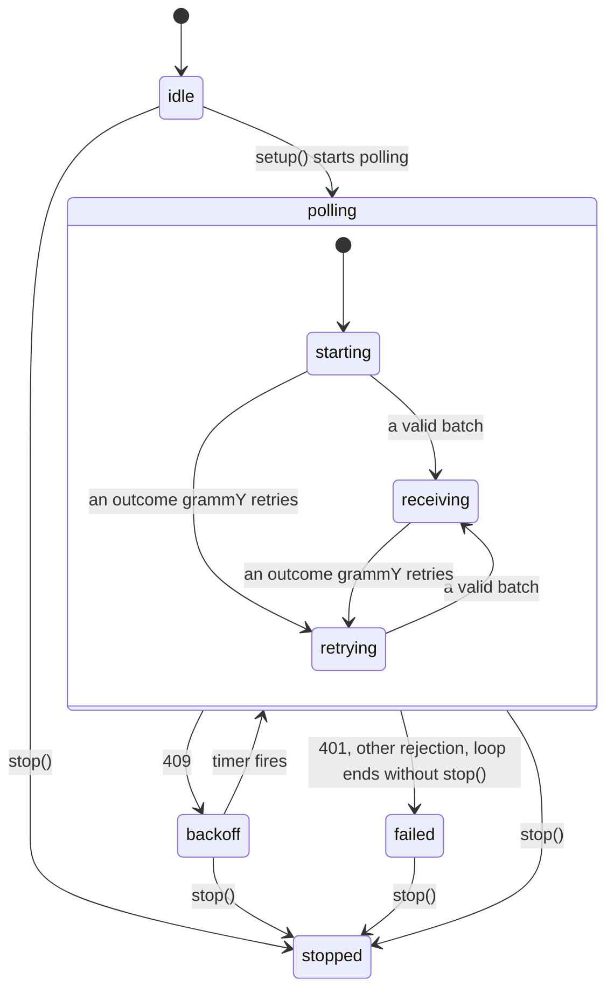

# Liveness `[proposed]`

Some of cogmo's work fails by not happening: a Telegram receive loop that has exited, a cron that no longer fires. Such a failure leaves at most one log line, and `/health` stays `pass`. This doc defines the checks that turn that absence into a signal, the registry they report to, and what an operator alerts on. It serves [#801](https://github.com/iskhakovt/cogmo/issues/801) (channel adapters) and [#427](https://github.com/iskhakovt/cogmo/issues/427) (crons).

**Decisions** (the owner, 2026-11-22):

1. Adapter contract: `liveness(): ChannelLiveness | null`, required on `Adapter` and `StreamingAdapter`; `startChannels` reports every row ([Channel contract](#channel-contract-confirmed)).
2. Surface: `/health`'s top-level `status` stays public, and `checks` appears only for a valid web session ([Surface](#surface-confirmed)).
3. Polling state: the supervisor's `PollingState` gains a receive sub-state and its projection's fields ([Telegram receive loop](#telegram-receive-loop-confirmed)).
4. Cron storage: `src/liveness/` with `cron_heartbeats` and its boot baseline ([Cron heartbeats](#cron-heartbeats-proposed)), plus a `cogmo.cron.last_tick` gauge.
5. Cron builder: `createCronFunction` with a final heartbeat step; `sandbox-reaper` and `model-catalog-refresh` leave design/architecture.md's single-step list; replayed log lines are accepted.
6. Thresholds: 90 s stale, 5 min wedged, two 409s in a row; a cron overdue 5 min past the second tick after its reference, or 30 min past the next tick for a period of a day or more.
7. Sequencing: on Inngest now; [Under Temporal](#under-temporal-proposed) covers the move.

## Sources `[proposed]`

| Component | Can stop silently | Check |
|-|-|-|
| Telegram adapter | Yes: polling goes down on a 401 or a setup rejection, a second poller keeps it restarting, grammY retries other `getUpdates` errors forever, and a hung handler stalls it | `telegram:polling`, one entry per channel row |
| Cron-triggered functions | Yes: #427, two months without a fire | `crons:heartbeat`, one entry per function |
| Inngest connect worker | Yes, but a per-minute ticker goes overdue whatever stopped it | none; `connection.state` could name the cause `[research]` |
| Direct and web adapters | No loop: direct runs on an Inngest function, web writes to the SSE registry in the server that answers `/health` | none |
| Connector server | No: an inbound gRPC server; a connector that never dials in surfaces as `unavailable` at dispatch | none |
| MCP pool, skills warm pool | Fail per call; pool spawn failures are a `todo.md` entry | none |

## Surface `[confirmed]`

One in-process check registry, read three ways:

1. **`/health`**, after the IETF health+json draft ([draft-inadarei-api-health-check-06](https://datatracker.ietf.org/doc/html/draft-inadarei-api-health-check-06)). Its top-level `status` is public: `warn` when any check warns, always at HTTP 200, the draft's code for healthy with concerns. Its `checks`, a key per component (`{componentName}:{measurementName}`) holding entries told apart by `componentId`, appear only for a valid web session: `/health` shares the web UI's port, so it is as reachable as the UI, and Spring Boot's actuator likewise hides health details by default, with `when-authorized` to show them to authenticated users. A request without the session cookie reads memory only; one with it resolves the session under a 2 s deadline, catching a rejected lookup in the route (the server's outer catch would answer 500), and any session that doesn't resolve gets the public body, still 200. Both bodies carry `Cache-Control: no-store`, since one URL serves two bodies and a shared cache must not hand the session's to a caller without one.
2. **The `cogmo.check.status` gauge**, an OTel observable gauge, as a state set after [`hw.status`](https://opentelemetry.io/docs/specs/semconv/hardware/common/): exactly the attributes `check`, `component_id` and `status` (`pass` | `warn`), 1 for the entry's current status and 0 for the other. No unit, so a Prometheus translation adds no suffix.
3. **One log line per verdict change**, of status or of reason: `liveness check warn` (with `check`, `componentId`, `reason`, `output` and a channel error's `detail`) and `liveness check pass`.

The registry evaluates every check on a 15-second tick, the first when it is built; `/health` and the gauge render the last tick from memory. A check that throws, a bug, reports `warn` (`check_error`) and logs at error. Probes alert on `status`; the gauge and the log lines name the failing check.

**Only fixed text leaves the process.** `output` is a text per reason and cause from a constant table, plus a normalized code: digits, a system code (`[A-Z][A-Z0-9_]*`), a node-fetch `type` (`[a-z][a-z-]*`), else `unknown`. The gauge carries no text. A Bot API error's own text can echo the request URL or the bare token from a custom `apiRoot`, so it reaches log lines only. The Telegram adapter's setup registers its configured token with the logger (`maskInLogs`), which masks it by value in every serialized line, raw or percent-encoded in either hex case, after the URL shapes: matching the written line, not each field, it covers the verdict line's `detail`, an error's cause chain and every nesting.

The public body, and the same with a session:

```json
{ "status": "warn", "version": "2.17.0", "description": "cogmo",
  "notes": ["node: v26.1.0", "startedAt: 2026-11-19T08:00:00.000Z"] }
```

```json
{
  "status": "warn", "version": "2.17.0", "description": "cogmo",
  "notes": ["node: v26.1.0", "startedAt: 2026-11-19T08:00:00.000Z"],
  "checks": {
    "telegram:polling": [{ "componentId": "0194…", "componentType": "component", "status": "warn",
      "reason": "failed", "observedValue": 412, "observedUnit": "s", "time": "2026-11-19T09:00:15.000Z",
      "output": "failed: the platform refused the channel's credentials (401)" }],
    "crons:heartbeat": [{ "componentId": "scheduled-task-ticker", "componentType": "component",
      "status": "pass", "observedValue": 23, "observedUnit": "s", "time": "2026-11-19T09:00:15.000Z" }]
  }
}
```

`observedValue` is the seconds since the last progress or served tick; `reason` is a user-defined key the draft allows.

| Alternative | Why not |
|-|-|
| `fail` with a 503 | Liveness probes act on the status code: a revoked token would restart-loop, and the supervisor already restarts on a 409 in-process. |
| `checks` for every caller | `/health` is as reachable as the UI, and channel errors and cron names are the operator's. |
| An optional `liveness?()` | Fails by omission: an adapter with a loop that forgets it reports nothing, and unlike a missing `sendVoice?`, nothing notices. |
| `AdapterSetupResult.liveness` | Splits the running adapter's lifecycle between `stop()` and a getter returned beside it. |
| Beside the boot checks, where `hindsightCompat` fails | Boot checks run once and fail boot closed; these watch what stops after boot, which failing boot wouldn't fix. |
| `/health/ready` | Readiness gates traffic, so an orchestrator would take the web UI out of service over a Telegram fault; cogmo has no load balancer to gate. |
| A separate checks endpoint | A second route and gate for what one cookie check on `/health` does; the restart risk is the status code, not the body. |
| One projection alone | `/health` alone needs a JSON exporter for a metrics-based alerting stack; the gauge alone leaves operators without one nothing to probe; log rules alone miss a state reached without a transition (a stale poll, a cron that stops). |
| A Prometheus scrape endpoint | A runtime dependency and a second export path beside OTLP, and the scraper needs a route to a port deploy.md publishes on loopback only; `absent_over_time` covers the missing `up`. |
| Dead-man's-switch pings per cron | A ping URL and key per check in cogmo, an outbound call per fire, and crons only. |
| Inngest's run history | No documented self-hosted API returns a function's last run, and it would read the system whose failure #427 was. |
| Persisting channel state | [Not persisted](#not-persisted). |

## Channel contract `[confirmed]`

`Adapter` and `StreamingAdapter` each require `liveness(): ChannelLiveness | null`, both because `AdapterSetupResult.adapter` is either and web is streaming-only; Telegram's one method satisfies both. An adapter with a receive loop returns a projection of its own state; `null` means no loop, and direct and web return it explicitly.

```ts
/** A channel's receive loop, projected from its adapter's state. Times are monotonic ms. */
interface ChannelLiveness {
  readonly state: LoopState;
  /** The later of the last valid update batch or finished update, and the current run's start or backoff. */
  readonly progressAt: number;
  readonly handlingSince: number | null;   // when handling the update in hand began
  readonly conflicts: number;              // conflict restarts in a row; zero once a run resets the streak
  readonly thresholds: { staleAfterMs: number; wedgedAfterMs: number };
}
type LoopState =
  | { kind: "starting" } | { kind: "receiving" }
  | { kind: "retrying"; since: number; cause: RetryCause; error: ChannelError }
  | { kind: "failed"; reason: "unauthorized" | "rejected" | "ended"; error: ChannelError | null }
  | { kind: "stopped" };
type RetryCause = "conflict" | "network" | "rate_limited" | "server_error" | "client_error" | "bad_reply" | "unknown";
/** `code` is normalized and is all `/health` shows; `detail` is the platform's text, for logs, which mask the token. */
interface ChannelError { readonly code: string; readonly detail: string | null }
```

A pure `channelCheck(liveness, now)` turns a projection into a reading ([Verdict](#verdict-and-thresholds)), reusable by a later channel with a loop. Ages are monotonic.

`startChannels` returns each row it read: the started ones with their adapter and `channelId`, and the ones whose type this build has no adapter for, which it skips with a warning; each skipped row gets a `channels:adapter` entry that always warns `unsupported`. A setup that throws fails boot (design/infrastructure.md → Boot-Time Blocking Policy), so no running process has a channel whose setup threw. `bootstrapRuntime` builds the registry from those rows and from the crons `createCronFunction` recorded, and returns it on `RuntimeDeps` for `/health` and the gauge. The tick timer is unref'd and cleared on shutdown.

## Telegram receive loop `[confirmed]`

This extends the polling supervisor's `PollingState` ([design/transport/telegram.md → Polling Supervision](transport/telegram.md#polling-supervision-confirmed), #800), and adds no second machine. The unit is one channel's loop in one `cogmo serve` process, keyed by the channel id.

```ts
type ReceiveState =
  | { kind: "starting" }   // bot.start()'s setup, until getUpdates returns a batch
  | { kind: "receiving" }
  | { kind: "retrying"; since: number; cause: Exclude<RetryCause, "conflict">; error: ChannelError };
type PollingState =
  | { kind: "idle" }
  | { kind: "polling"; run: Promise<void>; startedAt: number; conflicts: number;
      receive: ReceiveState }   // written in place, since the supervisor finds the run by identity
  | { kind: "backoff"; timer: NodeJS.Timeout; conflicts: number; since: number; error: ChannelError }
  | { kind: "failed"; reason: "unauthorized" | "rejected" | "ended"; error: ChannelError | null }
  | { kind: "stopped"; drained: Promise<void> };
```

Beside the state, the adapter keeps `#progressAt` (set at construction and on each progress) and `#handlingSince`, which span runs.

### Signals

Two writers add what the supervisor can't see, a `getUpdates` error grammY retries and a handler in progress. grammY long-polls with a 30 s `timeout` and handles a batch's updates one at a time.

| Writer | Sees | Writes |
|-|-|-|
| An API transformer (`bot.api.config.use`), installed before polling starts, filtering on `getUpdates` | Every `getUpdates` outcome | The current run's `receive`; `#progressAt` on a valid batch |
| The update-tracking middleware, ahead of every handler | Each update's start and end | `#handlingSince` when handling begins. Its `finally` clears it and, only for an `update_id` that is a safe integer, sets `#progressAt` and the handled id `stop()` confirms past, so a malformed update can't credit progress or store a `NaN` offset |

The transformer returns `prev`'s result, or rethrows its error, unchanged, and its bookkeeping can't throw: grammY reads a transformer's throw as a failed request. grammY hands it the parsed reply before checking `ok`, and wraps a failure of the request, its reply or its client timeout in an `HttpError`; a throw while building the request propagates unwrapped.

| `getUpdates` outcome | `receive` | `cause`, `code` |
|-|-|-|
| `ok: true`, `result` an array whose every element's `update_id` is a safe integer; an empty array is a long-poll timeout | `receiving`, with progress | — |
| `ok: false` with 401 or 409 | unchanged: the supervisor's | — |
| `ok: false` with 429, 5xx, or another 4xx | `retrying` | `rate_limited`, `server_error` or `client_error`; the `error_code` |
| Any other reply: `ok: true` with another `result` or none, no boolean `ok`, an `error_code` outside 400–599 | `retrying` | `bad_reply`, `unexpected-reply` |
| An `HttpError` wrapping a node-fetch error, told by its `name` (`FetchError`, `AbortError`) | `retrying` | `bad_reply` for `invalid-json` (a reply that isn't JSON), else `network`; the error's system `code`, else its `type` |
| An `HttpError` wrapping grammY's client timeout, recognised by its fixed message prefix | `retrying` | `network`, `timeout` |
| Any other throw, an `HttpError` wrapping another error included | `retrying` | `unknown`, `unknown` |

Only a valid batch counts as progress: grammY polls again at once on `ok: true` with no `result`, and handles an element with no `update_id`, so either would read as a healthy poll. A `result` that is present but not iterable (a number, an object, `null`) ends the run instead: grammY's loop throws iterating it, and the supervisor reads the `TypeError` as `failed` (`rejected`). A string `result` is walked a character at a time, as updates with no id. `detail` is Telegram's `description` when it is a string, else null; no error message reaches a `ChannelError`, since a `FetchError`'s names the request URL. The supervisor's transitions map their errors the same way: a `GrammyError` by its `error_code`, `unknown` unless a non-negative integer, and anything but a `GrammyError` or `HttpError` as `unknown`.

### States



Polling Supervision's table holds every top-level transition. This design adds:

| From | To | By | Guard | Writes |
|-|-|-|-|-|
| `idle`, `backoff` | `polling` / `starting` | The supervisor's `#poll` | — | `receive` |
| `polling` / any | `polling` / `receiving` | Transformer | A valid batch | `receive` on entry, `#progressAt` |
| `polling` / any | `polling` / `retrying` | Transformer | A `retrying` row above | `since` on entry, `cause`, `error` |
| `polling` | `backoff` | Supervisor, on a 409 | — | `conflicts` (the new streak), `since`, `error` |
| `polling` | `failed` | Supervisor | — | `error` |

An outcome changes nothing unless the run its call was made in is still the current state, such as `stop()`'s own confirming calls or a reply that lands after its run ended. No transition logs a line of its own: the supervisor's lines cover its transitions, and the verdict-change line covers a warning the sub-state raises.

| `PollingState` | Projected `LoopState` | `progressAt` from |
|-|-|-|
| `idle` | `starting` | `#progressAt` |
| `polling` | its `receive` | the later of `#progressAt` and `startedAt` |
| `backoff` | `retrying` (`conflict`) | the later of `#progressAt` and `since`: a 409 is an answer |
| `failed`, `stopped` | `failed`, `stopped` | `#progressAt` |

`conflicts` projects as the backoff's streak, the run's while it is younger than the supervisor's `HEALTHY_RUN_MS` (10 min), and zero otherwise, so it clears when the supervisor's streak would reset.

### Verdict and thresholds

The first matching row decides:

| Condition | Status | `reason` |
|-|-|-|
| `failed` | warn | `failed` |
| `stopped` | pass | — |
| An update in hand for at least `wedgedAfter` | warn | `wedged` |
| `conflicts` ≥ 2 | warn | `flapping` |
| `retrying` for at least `staleAfter` | warn | `retrying` |
| No update in hand, and `progressAt` at least `staleAfter` ago | warn | `stale` |
| Otherwise | pass | — |

- **Order:** terminal, then what needs a restart, contention, a transient retry, and `stale` as the catch-all. A higher row masks a lower one, but a reason change logs, so `flapping` giving way to `wedged` is seen.
- **`staleAfter` = 90 s**, three 30 s long polls: a healthy poll answers within one even with no update. It flags a half-open connection grammY would hold for 500 s, a setup stuck in grammY's retries, and a loop that stopped unnoticed.
- **Flapping at the second 409 in a row**, on the supervisor's streak. A first 409 (a webhook, a poller that has gone) clears in a restart whose backoff is 2.5–5 s, so `retrying` covers only what grammY retries within a run. A poller that stays keeps both sides below the 10-minute run that resets the streak (Polling Supervision → Backoff), so the warning holds until the run after the last 409 has lasted 10 minutes.
- **`wedgedAfter` = 5 min**, bounded by handlers: `/compact` and `/reflect` call the model inline, under the SDK's 10-minute timeout, while every other update waits.

With `@grammyjs/runner` (`todo.md`), `handlingSince` becomes the oldest update in hand.

### Failure modes

| # | Crash, race or event | State left | Why it is safe, or the residual |
|-|-|-|-|
| a | The process exits | Gone | `/health` stops answering; every series stops, which an absence rule catches. The next boot starts at `idle`. |
| b | Network outage in the loop | `polling` / `retrying` (`network`) | Warns after 90 s; recovers on its own. |
| c | Network outage in a run's setup | `polling` / `starting` | grammY's setup retries back off up to 20 min out of the transformer's sight; `stale` 90 s after the run's start. |
| d | Half-open connection | `polling` / `receiving`, progress ageing | `stale` at 90 s; at 500 s grammY's client gives up, `retrying` (`network`, `timeout`). |
| e | A 4xx only `getUpdates` draws (none known to recur) | `polling` / `retrying` (`client_error`) | grammY retries it every 3 s; warns after 90 s. |
| f | A wrong `apiRoot` that answers like a Bot API | `failed` (`rejected`) | The setup's 404 `GrammyError` is rethrown; the supervisor logs a terminal line. |
| f′ | A wrong `apiRoot` that doesn't resolve or serves HTML | `polling` / `starting` | grammY's setup retries the `HttpError` forever; `stale` at 90 s, with no supervisor line for a log rule on those lines to see. Residual. |
| g | A second poller that stays | `polling` and `backoff` in turn | `flapping` until the run after the last 409 has lasted 10 minutes. |
| g′ | A competitor polling less often than every 10 minutes | `receiving`, with a short backoff per 409 | The streak resets each time, so the check stays `pass`; each 409 logs at error. Residual: a rolling count would catch it but outlive the competitor by its window. |
| h | 401 | `failed` (`unauthorized`) | Warns until the token is replaced and cogmo restarts. |
| i | A handler hangs | `polling`, `#handlingSince` ageing | `wedged` at 5 min, ahead of any other warning. Residual: the operator restarts. |
| j | The loop stops unnoticed (a bug) | `polling`, progress ageing | `stale`: the time-derived verdict backs the machine. |
| k | A restart while a second poller stays | `idle`, then `polling` | A poller already at the supervisor's cap supersedes this one up to 5 min after boot and again 2.5–5 min later, so `flapping` shows 2.5–10 min after boot. Residual. |
| l | A channel row whose type this build has no adapter for | No adapter | Its entry warns `unsupported`. |
| m | `DEBUG=grammy:*` | — | grammY prints polling errors itself, outside pino and the redaction. Residual: an operator opt-in. |
| n | An error `deliver` or a stream handle throws to its caller | — | It keeps grammY's text; a line that logs it masks the token, by URL shape or by the registered value. Residual: what the caller does with it beyond logging. |

### Not persisted

The state describes this process's own loop, means nothing once the process ends, and has only in-process readers. Persisting would cost a write per poll and leave a stale row after a crash: the case the absence rule and the liveness probe already cover.

## Cron heartbeats `[proposed]`

The unit is a cron-triggered function, keyed by its function id: one row, a latest-value register, its status derived when read. It is persisted because schedules outlive the process.

**Scope: a cron fires and completes, not that its work succeeds.** A handler that returns normally after failing inside, as `sandbox-reaper` does when `listContainers` fails and `boundary-janitor` when every resolve errors, records its tick. A handler-reported outcome is `[research]`.

```
cron_heartbeats (
  id           UUID v7 PK,
  function_id  cron_function NOT NULL UNIQUE,      -- pgEnum; a new cron adds a value, a removed one keeps it
  last_tick    TIMESTAMPTZ,                        -- nullable: the latest scheduled occurrence a run completed; null until the first
  created_at   TIMESTAMPTZ NOT NULL DEFAULT now()  -- when a boot first registered the cron: the baseline before any tick
)
```

Owned by `liveness/store/` in the new `src/liveness/`, which also holds the registry, its projections, `channelCheck` and `createCronFunction` (`cron-function.ts`), and imports only the `ChannelLiveness` type from `transport/`.

**Recording.** `createCronFunction(inngest, heartbeats, config, handler)` builds every cron in place of `inngest.createFunction`:

- `config.id` is typed as the `cron_function` union. It records `{ id, cron }` on `heartbeats`, a `CronHeartbeats` built in `bootstrapCore`: the one list the baseline, the registry and the invariant test read.
- After the handler returns, on every return path, a final step `cron-heartbeat` records the tick through the `Durable` port. A run whose work throws records nothing; `model-catalog-refresh` records only for `inngest/scheduled.timer`, not `model-catalog/refresh.requested`.
- The tick is the cron event's `data.scheduledAt`, the scheduled occurrence (verified against the pinned Inngest server, v1.52.0), read through a Zod schema since the SDK types cron data as `{ cron }`. It is durable, so a late or retried step records the same tick.
- `recordCronTick` runs `UPDATE … SET last_tick = GREATEST(last_tick, $tick::timestamptz)`, the tick passed as its ISO string, since a raw `sql` fragment skips the column's driver mapping. It runs with `SET LOCAL lock_timeout = '2s'` and `statement_timeout = '5s'` under a 10 s deadline that also covers acquiring a connection, so a ticker with concurrency 1 never queues behind a stuck write. It returns `Result<{ kind: "recorded" } | { kind: "no_row" }, WriteError>`.
- The step never throws, since six of the nine crons run with `retries: 0`, which Inngest applies to each step. It returns `recorded`, `no_row`, `write_failed` (an error or the deadline) or `no_tick` (no `scheduledAt`), logging each of the last three at warn.

**Baseline.** Once `bootstrapRuntime` has built the functions, it inserts a row per recorded cron through `ON CONFLICT (function_id) DO UPDATE` with a no-op SET, `RETURNING` every row, so an existing row keeps its `created_at` and tick. The order is fixed: the baseline, the registry seeded from its rows, then the web UI and connector server, then `connect` (`main.ts`). So no cron runs before its row exists, and every cron has a verdict before any request reads one. The baseline runs under the tick write's bounds, and an error or timeout fails boot, so a held row lock stalls boot for at most 10 s. Failing beats degrading: a database that can't take one write in 10 s fails the first request too, and boot fails closed on such a dependency (design/infrastructure.md → Boot-Time Blocking Policy).

**Replays.** The step adds one boundary per run, so a bare-body log line repeats once more, and one after the last step logs twice (`ticker fan-out`). `sandbox-reaper` runs `runReap` and its log in a `reap` step. About 6,200 updates a day, on an unindexed column.

**Check.** An evaluation reads an entry `overdue` past a cutoff counted from its reference, `last_tick` or else `created_at`:

- **A period under a day:** 5 minutes past the second tick after the reference, so one missed or failed run passes unseen; about 7 minutes for a per-minute ticker.
- **A day or more** (the daily venv reaper, the weekly sweep): 30 minutes past the first tick after it, so one missed or failed run warns. The recorded tick lands when the run completes, and 30 minutes covers its queueing, its run time and a deploy across the tick.

Ticks come from croner in UTC, like Inngest's; a cron given Inngest's `jitter` needs the grace to cover it. A cron missing from a read, its row deleted out of band, reads `unrecorded`. Evaluations run every 15 s, so a stretch with no tick served that outlasts its cutoff by 15 s always warns, whatever stopped it: the Inngest server (#427), the worker's connection, or a cron failing every run. A warning lasts until the next served tick.

**Read path.** The registry reads every row on its tick, bounded like the write, with one read in flight. Evaluation never awaits it: each tick ages the cached rows and evaluates the channels while a read is outstanding, so neither surface freezes on a stale `pass`. A failed read keeps the cache and logs `liveness: reading cron heartbeats failed`, the first in a streak, then `recovered` on success.

| # | Crash, race or deploy | Row left | Why it is safe, or the residual |
|-|-|-|-|
| a | The update commits; the process dies before Inngest records the step | Updated | A retry records the same tick again. |
| b | The write fails or hits its deadline | Unchanged | `write_failed`; the run completes. A single missed write, like a failed run, warns only for a cron of a day or more, once its cutoff (Check) passes, until the next tick. A write the deadline abandoned may still commit, which the monotone update makes harmless. |
| c | The work throws | Unchanged | Warns once the entry passes its cutoff (Check): for a cron under a day, 5 minutes after the second unserved tick; for one of a day or more, 30 minutes after the scheduled time of one failed run, even with that run still in flight. |
| d | Two runs at once | The later tick | `GREATEST` keeps it monotone; a `40001` is retried by the transactor. |
| e | The final step runs long after the work | The run's own tick | The tick comes from the event, so a late write can't make a stopped cron look fresh. |
| f | A run in flight across the deploy that adds the step | Recorded, or not at all | In connect mode `serve` drains in-flight requests, each one step: a run the old build completes records nothing, one missed tick, and one cut between steps records on the new build. HTTP serve mode doesn't await its requests (`main.ts`), so a cut step is retried where the function allows. |
| f′ | A run resumed by a build with another step plan: a rollback without `cron-heartbeat`, or `skill-venvs-reaper`, whose `reap` step depends on current config | Unchanged | The request fails `step-not-found` and the run fails. Residual: one missed tick, which warns for a cron of a day or more. |
| f″ | `sandbox-reaper` across the deploy | Unchanged | Its old build has no step to replay; with `retries: 0` a cut-off run fails. A retry would reap again, harmlessly. |
| g | The Inngest server down across ticks | Unchanged, or recorded late | Whether Inngest runs a missed tick is undocumented; the rule doesn't depend on it. Residual: a warning lasts until the next served tick, up to a period after recovery. |
| h | A cron never fired since the deploy that added it | Baseline only | Timed from `created_at`, which every boot keeps. |
| i | A cron removed from code | Stale row | Not checked. Its enum value stays: Postgres can't drop one in place. |
| j | A conditional cron registered again (`sandbox-reaper` and the weekly sweep need a coding sandbox; the catalog refresh, a `MODEL_CATALOG_URL`) | Its old `last_tick` | Overdue at once if it was off past its cutoff, until its next tick: up to a week for the sweep. Residual: resetting the reference on registration would let a cron that never fires stay green across restarts. |
| k | The row deleted out of band | No row | `unrecorded`; a write returns `no_row`. The next boot recreates it. |

## Under Temporal `[proposed]`

On the move in design/orchestration-temporal.md:

| Part | On Temporal |
|-|-|
| The table, baseline, registry and overdue rule | Unchanged: the key is the function id, which `defineFunction` keeps, and the tick is the Schedule's scheduled time, which the workflow id `cron:<functionId>:<scheduled time>` carries. |
| `createCronFunction` and its final step | Rewritten: `defineFunction`'s `cron` records the cron on `CronHeartbeats`, and a final activity writes the tick with the same bounds and outcomes. |
| The event-name gate | Rewritten: the model-catalog refresh's jobs carry their origin, so only the Schedule's job records a tick, never an operator refresh. |
| A moved cron between deploys N and N+1 | The row and baseline stay. Under the normal drain the Schedule is paused until N+1, so a per-minute cron reads `overdue` after about 7 minutes: true, since no tick runs on either engine, an outage the plan bounds by N+1. Accepted. Under the fallback the Schedule starts unpaused at N, and Temporal's ticks record without a gap. |
| The architecture.md edits | Superseded by the flow layer's. |

## Alerting `[proposed]`

| Signal | Alert when | Absence means |
|-|-|-|
| `cogmo.check.status` | An entry's `warn` series is 1 for 5 minutes | No `crons:heartbeat` series for the deployment's `job`: cogmo is down or its export broken. No `telegram:polling` series for an expected channel: its row is gone or its type unserved, which the examples don't cover. |
| `/health` | `status` is not `pass` | The process is down or its event loop blocked |
| The supervisor's log lines | The newest of the start line and the terminal lines is terminal | Nothing: a log rule can't tell a quiet process from a dead one |

**The gauge** is exported every 60 s, both state-set series per entry each time. Through a Prometheus translation it arrives as `cogmo_check_status` with `check`, `component_id`, `status` and `job`, from `OTEL_SERVICE_NAME` (deploy.md → Observability); a backend that keeps OTel names stores `cogmo.check.status`. A collector in between needs a metrics pipeline fed by its OTLP receiver, which otherwise refuses every cogmo metric ([`otlpreceiver/otlp.go`](https://github.com/open-telemetry/opentelemetry-collector/blob/main/receiver/otlpreceiver/otlp.go)). From Rollout step 3, every `serve` registers crons, so the cron entries make "cogmo silent" independent of channels:

```promql
cogmo_check_status{job="cogmo", status="warn"} == 1                                        # for 5m
absent_over_time(cogmo_check_status{job="cogmo", check="crons:heartbeat", status="pass"}[10m])  # cogmo silent
```

`cogmo.cron.last_tick` gives each cron's last served tick, or its baseline before the first, in seconds since the epoch, with `component_id` as above; its unit `s` makes it `cogmo_cron_last_tick_seconds` after translation, so a backend can alert on `time() -` it without trusting cogmo's own evaluation.

**`/health`:** any prober that reads the public `status`, such as Gatus with `[BODY].status == pass`.

**The supervisor's log lines:**

| Level | Text |
|-|-|
| info | `telegram polling started`, once a start's setup succeeds |
| error | `telegram polling: conflict (409), another poller or a webhook is using the bot token; starting again after a backoff` |
| error | `telegram polling: the Bot API refused the bot token (401), revoked or invalid; down until the channel's token is replaced and cogmo restarts` |
| error | `telegram polling: failed; down until cogmo restarts` |
| error | `telegram polling: ended without stop(); down until cogmo restarts` |

The rule's window reaches back to the last successful start. The lines carry no channel id, so one channel's start line hides another's terminal line, and a boot stuck in setup logs neither (rows c, f′).

## Web UI `[proposed]`

The SPA reads `/health` with its session, so it gets `checks`, and shows a status strip listing each warning's `output`. No oRPC procedure, no `Transport` change.

## Telegram self-notification `[research]`

Messaging the owner when the loop warns works only for a 409 or a wedged handler, since other faults take sending down too, and duplicates any alerting stack. Revisit with S11's owner channel (design/skills.md).

## Rollout `[proposed]`

0. Operator: a log rule on the supervisor's lines.
1. Operator: an OTLP metrics pipeline in any collector in front of the metrics backend; confirm the gauge's name.
2. cogmo: `src/liveness/` with the registry, the gauge and the verdict lines; `/health`'s public `status` and session-gated `checks`; the required `liveness()`, `null` from direct, web and the adapter test stubs; `startChannels` reporting every row; the receive sub-state; the token registered with the logger, and `%2Fbot` in `util/redact-secrets.ts`. Update deploy.md (Health check, Observability), design/web-ui.md's `/health` line, Polling Supervision, and AGENTS.md → Module Structure.
3. cogmo: `cron_heartbeats`, the baseline, `createCronFunction` for every cron and the check; `sandbox-reaper` and `model-catalog-refresh` onto `fromStepTools`. Update design/architecture.md → Orchestration Coupling (the Functions row and the single-step list), `refresh-function.ts`'s header, design/data-model.md and `.agents/rules/store-pattern.md`. Confirm in the integration tier that the dev server's cron events carry `scheduledAt`, and run `recordCronTick` on postgres-js.
4. Operator: the gauge rules, retiring the log rule.
5. cogmo, once an operator's collector carries metrics: the `cogmo.cron.last_tick` gauge.
6. The web UI strip.

## Testing `[proposed]`

- `channelCheck`: each row and threshold at its boundary, precedence, and a reason change logged under `warn`.
- The adapter: each sub-state transition, field write and projection row (a backoff after a slow poll isn't `stale`), events refused outside `polling`, `conflicts` clearing at `HEALTHY_RUN_MS`, a transformer that passes `prev`'s result or error through unchanged, and a malformed batch then a valid update through `stop()`, which credits and confirms only the valid one.
- The outcome table, one case per row: each throw shape (system code, `invalid-json`, grammY's timeout, `AbortError`, unwrapped), no `ok`, `error_code` 302, `ok: true` with no `result`, a non-array one, and `[{}]` (`bad_reply`, no progress), `[]` (progress), and the `failed` (`rejected`) mapping; no `code` carries the URL.
- Redaction: the token, raw and percent-encoded, bare or in a URL, masked in each adapter line that carries a Bot API error once setup has registered it; `/health` shows no `detail`.
- `/health`: always 200 and `Cache-Control: no-store`; `status` without `checks` with no session, an invalid one, or a lookup that rejects or passes its deadline; `checks` with a valid one; a throwing check; an `unsupported` row.
- The gauges: exactly three attributes on `cogmo.check.status`; `cogmo.cron.last_tick` at the baseline, then the served tick.
- `cron_heartbeats`: a monotone `last_tick`, a baseline that keeps existing rows and returns all, `no_row`, and a write held on a row lock returning `write_failed` at its deadline, on PGlite and postgres-js.
- The overdue rule: just inside and past each cutoff, from `last_tick` and from `created_at`: the second tick plus 5 minutes per-minute and six-hourly, the next tick plus 30 minutes daily and weekly; one failed daily run warns; `unrecorded`.
- The read path: first verdicts from the baseline, evaluation continuing while a read hangs, one warn per failed streak, one recovered line.
- `createCronFunction`: the event's `scheduledAt` on every return path, nothing on a throw, the same tick from a late or retried step, `no_tick`, nothing on `model-catalog/refresh.requested`, one write under `@inngest/test` replay; and an invariant test that every cron-triggered function is one `CronHeartbeats` recorded.
