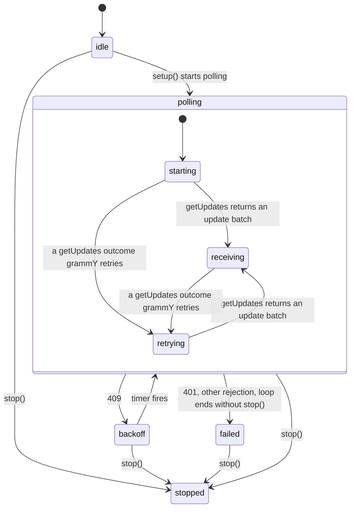

# Liveness `[proposed]`

Some of cogmo's work fails by not happening: a Telegram receive loop that has exited, a cron that no longer fires. Such a failure leaves at most one log line, and `/health` stays `pass`. This doc defines the checks that turn that absence into a signal, the one registry they report to, and what an operator alerts on. It serves [#801](https://github.com/iskhakovt/cogmo/issues/801) (channel adapters) and [#427](https://github.com/iskhakovt/cogmo/issues/427) (crons).

**Decisions for the owner.** Each is an architecture or data-model change:

1. `Adapter` and `StreamingAdapter` gain an optional `liveness?()`, and `startChannels` reports every channel row it read, the ones it skipped included ([Channel contract](#channel-contract-proposed)).
2. `/health`'s body gains `checks`, and its top-level `status` can be `warn`, still at HTTP 200 ([Surface](#surface-proposed)).
3. The Telegram adapter's `PollingState` ([#800](https://github.com/iskhakovt/cogmo/issues/800)) gains a receive sub-state and the fields its projection reads ([Telegram receive loop](#telegram-receive-loop-proposed)).
4. A new `src/liveness/` module, and a `cron_heartbeats` table with a `cron_function` pgEnum, into which each `cogmo serve` boot inserts a baseline row for every registered cron that has none, before `connect`; a failed baseline fails boot ([Cron heartbeats](#cron-heartbeats-proposed)).
5. Every cron is built by `createCronFunction` and gains a final `cron-heartbeat` step. `sandbox-reaper` and `model-catalog-refresh` leave design/architecture.md → Orchestration Coupling's single-step list, and log lines outside steps repeat once more, an accepted cost.
6. The thresholds: 90 s stale, 5 min wedged, two 409s in a row, and two cron periods plus 5 min.

## Sources `[proposed]`

| Component | Can stop silently | Check |
|-|-|-|
| Telegram adapter | Yes: polling goes down on a 401 or a setup rejection, a second poller keeps it restarting, grammY retries other `getUpdates` errors forever, and a hung handler stalls it | `telegram:polling`, one entry per channel row |
| Cron-triggered functions | Yes: #427, two months without a fire | `crons:heartbeat`, one entry per function |
| Inngest connect worker | Yes, but covered: a per-minute ticker goes overdue whatever stopped it | none of its own; `connection.state` could name the cause `[research]` |
| Direct adapter | No loop: its inbound is the `direct-inbound` Inngest function | covered by the worker's coverage |
| Web adapter | No loop: it writes to the SSE registry in the server that answers `/health` | `/health` itself |
| Connector server | No: an inbound gRPC server whose timers are `setInterval`s. A connector that never dials in is the remote's absence and surfaces as `unavailable` at dispatch | none |
| MCP pool, skills warm pool | Fail per call; pool spawn failures are a `todo.md` entry | none |

## Surface `[proposed]`

One in-process check registry, read three ways:

1. **`checks` in `/health`**, shaped after the IETF health+json draft ([draft-inadarei-api-health-check-06](https://datatracker.ietf.org/doc/html/draft-inadarei-api-health-check-06)): a key per component (`{componentName}:{measurementName}`), each an array of entries told apart by `componentId`. A check reports only `pass` or `warn`, and the response is always HTTP 200: the draft defines `warn` as healthy with concerns and requires 2xx–3xx for it. Top-level `status` is `warn` when any check warns.
2. **The `cogmo.check.status` gauge**, an OTel observable gauge, as a state set after [`hw.status`](https://opentelemetry.io/docs/specs/semconv/hardware/common/): exactly three attributes, `check`, `component_id` and `status` (`pass` | `warn`), value 1 for the entry's current status and 0 for the other. No unit, so the Prometheus translation adds no suffix.
3. **One log line per verdict change**, a change of status or of reason: `liveness check warn` (warn, with `check`, `componentId`, `reason`, `output` and, for a channel, the error's `detail`) and `liveness check pass` (info).

The registry evaluates every check on a 15-second tick, the first when it is built, and keeps the readings; `/health` and the gauge callback render the last tick. `/health` keeps its rule: the handler reads memory only, never Postgres or the network, so a dependency blip can't slow or fail it. A check whose evaluation throws, a bug, reports `warn` (`check_error`) and logs at error.

**Nothing an upstream wrote leaves the process except in logs.** `/health` is unauthenticated, so its `output` is a fixed public text per reason and cause from a constant table in `src/liveness/`, followed by a normalized code: an `error_code` as digits, a system code matching `[A-Z][A-Z0-9_]*`, a node-fetch `type` matching `[a-z][a-z-]*`, and `unknown` for anything that fails its pattern. The gauge carries no text at all. Telegram's `description` stays in the process as `ChannelError.detail`, which reaches only the verdict-change log line. A custom `apiRoot` can answer an error whose description echoes the request URL or the bare token, so the adapter, which holds its token, replaces the token's value, raw and percent-encoded, with `<redacted>` where it builds `detail`. The line then passes through the logger's redaction, whose Bot API token shape this design extends to a percent-encoded slash (`%2Fbot`) beside the literal `/bot` and the encoded colon it already covers.

```json
{
  "status": "warn",
  "version": "2.17.0",
  "description": "cogmo",
  "notes": ["node: v26.1.0", "startedAt: 2026-11-19T08:00:00.000Z"],
  "checks": {
    "telegram:polling": [
      { "componentId": "0194…", "componentType": "component", "status": "warn", "reason": "failed",
        "observedValue": 412, "observedUnit": "s", "time": "2026-11-19T09:00:15.000Z",
        "output": "failed: the Bot API refused the bot token (401)" }
    ],
    "crons:heartbeat": [
      { "componentId": "scheduled-task-ticker", "componentType": "component", "status": "pass",
        "observedValue": 23, "observedUnit": "s", "time": "2026-11-19T09:00:15.000Z" }
    ]
  }
}
```

`observedValue` is the seconds since the component last made progress (for a cron, since the last tick it served), `time` the tick of the registry that read it, and `reason` a user-defined key the draft allows.

| Alternative | Why not |
|-|-|
| `fail` with a 503 when a check fails | Liveness probes act on the status code. A revoked token would restart-loop, and on a 409 #800's supervisor already restarts the loop in-process, so a process restart would add nothing. |
| Beside the boot checks, where `hindsightCompat` fails | Boot checks run once and fail boot closed. What these watch stops after boot, and failing then would take down the healthy parts without fixing the broken one. |
| `/health/ready` | Readiness gates traffic: an orchestrator acting on it takes the web UI out of service over a Telegram fault, and cogmo has no load balancer to gate. |
| A separate checks endpoint | The same body at a second URL. The draft puts `checks` on the health resource, and the restart risk is the status code, not the body. |
| One projection alone | `/health` alone leaves an alerting stack that reads metrics needing a JSON exporter. The gauge alone leaves an operator without a metrics backend nothing to probe, and the web UI wants a same-origin read. Log rules alone see events, and a state reached without a transition (a stale poll, a cron that stops) writes none. |
| A Prometheus scrape endpoint (`@opentelemetry/exporter-prometheus`) | A scrape's `up` comes free, but it adds a runtime dependency and a second export path beside OTLP, and the scraper needs a route to a port deploy.md publishes on loopback only. `absent_over_time` covers the missing `up`. |
| Dead-man's-switch pings per cron (Healthchecks) | Needs a ping URL and key per check in cogmo, an outbound call per fire, and covers crons only. |
| Inngest's run history as the heartbeat | No documented self-hosted API returns a function's last run, and it would read the system whose failure #427 was. |
| Persisting channel state | [Telegram receive loop → Not persisted](#not-persisted). |

## Channel contract `[proposed]`

`Adapter` and `StreamingAdapter` each gain an optional `liveness?(): ChannelLiveness`, as both carry `sendVoice?`. An adapter with a receive loop implements it as a projection of its own state; one without (direct, web) leaves it out and contributes no check. The alternative, `AdapterSetupResult.liveness`, leaves the instance interfaces alone but splits the running adapter's lifecycle between `stop()` on the instance and a getter returned beside it.

```ts
/** A channel's receive loop, projected from its adapter's state. Times are monotonic milliseconds. */
interface ChannelLiveness {
  readonly state: LoopState;
  /** The later of the last completed receive or finished update, and the current run's start or backoff. */
  readonly progressAt: number;
  /** When handling of the update in hand began; null between updates. */
  readonly handlingSince: number | null;
  /** Conflict restarts in a row; zero once a run has lasted long enough to reset the streak. */
  readonly conflicts: number;
  /** The adapter's own thresholds. */
  readonly thresholds: { staleAfterMs: number; wedgedAfterMs: number };
}

type LoopState =
  | { kind: "starting" }
  | { kind: "receiving" }
  | { kind: "retrying"; since: number; cause: RetryCause; error: ChannelError }
  | { kind: "failed"; reason: FailureReason; error: ChannelError | null }
  | { kind: "stopped" };

type RetryCause =
  | "conflict" | "network" | "rate_limited" | "server_error" | "client_error" | "bad_reply" | "unknown";
type FailureReason = "unauthorized" | "rejected" | "ended";
interface ChannelError {
  /** Normalized ([Surface](#surface-proposed)); the only part `/health` shows. */
  readonly code: string;
  /** The platform's own description with the adapter's credential redacted, for log lines only; null where there is none. */
  readonly detail: string | null;
}
```

One pure function, `channelCheck(liveness, now)`, turns a projection into a reading ([Verdict](#verdict-and-thresholds)), so a later channel with a loop (a gateway WebSocket, IMAP IDLE) reuses it. Ages come from a monotonic clock, so a wall-clock step can't fake staleness; only `time` shows wall-clock time.

`startChannels` returns each channel row it read: the started ones with their adapter and `channelId` on `ChannelAdapter`, and the ones whose type this build has no adapter for, which it skips with an `unknown channel type` warning today. Each skipped row gets an entry under `channels:adapter`, keyed by the row's id, that always warns `unsupported`, so a configured channel nothing serves still shows. A setup that throws fails boot, as Boot-Time Blocking Policy has `startChannels` do (design/infrastructure.md), so no running process has a channel whose setup threw. `bootstrapRuntime` builds the registry from those rows and from the crons `createCronFunction` recorded ([Cron heartbeats](#cron-heartbeats-proposed)), returns it on `RuntimeDeps`, and the web server's `/health` route and the gauge callback read it. The tick timer is unref'd and cleared on shutdown.

## Telegram receive loop `[proposed]`

This extends #800's supervisor machine, `PollingState` (design/transport/telegram.md → Polling Supervision), and adds no second one: `polling` gains a receive sub-state, `backoff` and `failed` gain the fields a projection needs, and `liveness()` reads the result. The unit is one channel's loop inside one `cogmo serve` process, keyed by the channel id: [Not persisted](#not-persisted).

```ts
type ReceiveState =
  | { kind: "starting" }   // bot.start()'s setup, until a getUpdates answers
  | { kind: "receiving" }
  | { kind: "retrying"; since: number; cause: Exclude<RetryCause, "conflict">; error: ChannelError };

type PollingState =
  | { kind: "idle" }
  | { kind: "polling"; run: Promise<void>; startedAt: number; conflicts: number;
      receive: ReceiveState }                     // added; written in place, since #settle finds the run by identity
  | { kind: "backoff"; timer: NodeJS.Timeout;
      conflicts: number; since: number; error: ChannelError }               // fields added
  | { kind: "failed"; reason: "unauthorized" | "rejected" | "ended";
      error: ChannelError | null }                                          // error added; null for ended
  | { kind: "stopped"; drained: Promise<void> };
```

Beside the state, the adapter keeps two fields that span runs: `#progressAt`, set at construction and on each progress, and `#handlingSince`.

### Signals

Polling Supervision describes what grammY retries on its own and how the supervisor handles each rejection of `bot.start()`. Neither shows a `getUpdates` error that grammY retries, nor a handler in progress, so two writers add them. grammY long-polls with a 30 s `timeout` (cogmo passes none) and handles each batch's updates one at a time.

| Writer | Sees | Writes |
|-|-|-|
| An API transformer (`bot.api.config.use`), installed before polling starts | Every `getUpdates` outcome. grammY copies it onto each update's `ctx.api`, so it filters on the method. | The current run's `receive`; `#progressAt` on an update batch |
| The update-tracking middleware, registered ahead of every handler | Each update's start and end | `#handlingSince` when handling begins; clears it and sets `#progressAt` in its `finally` |

The transformer returns `prev`'s result, or rethrows `prev`'s error, unchanged, and its own bookkeeping can't throw: grammY reads a transformer's throw as a failed request, which would turn a good poll into a retry. grammY hands it the parsed reply before checking `ok`, and wraps a failure of the request, of reading its reply, or of its client timeout in an `HttpError`. A throw while grammY builds the request (the signal check, the URL, the payload) propagates unwrapped. The transformer maps each outcome by this table, closed by its last row:

| `getUpdates` outcome | `receive` | `cause` | `code` |
|-|-|-|-|
| Returned `ok: true` with an array `result`, an update batch | `receiving` | — | — |
| Returned `ok: true` with any other `result`, or none | `retrying` | `bad_reply` | `unexpected-reply` |
| Returned `ok: false` with `error_code` 401 or 409 | unchanged: the supervisor's | — | — |
| Returned `ok: false` with `error_code` 429 | `retrying` | `rate_limited` | the `error_code` |
| Returned `ok: false` with `error_code` 500–599 | `retrying` | `server_error` | the `error_code` |
| Returned `ok: false` with another `error_code` in 400–499 | `retrying` | `client_error` | the `error_code` |
| Returned anything else: no boolean `ok`, or `ok: false` with an `error_code` outside 400–599 | `retrying` | `bad_reply` | `unexpected-reply` |
| Threw an `HttpError` wrapping a `FetchError` of type `invalid-json`: a reply that isn't JSON, such as a proxy's HTML error page | `retrying` | `bad_reply` | `invalid-json` |
| Threw an `HttpError` wrapping an error with a system `code` | `retrying` | `network` | that code (`ECONNRESET`) |
| Threw an `HttpError` wrapping another error with a `type` and no `code` (node-fetch's `FetchError`, its `AbortError`) | `retrying` | `network` | the `type` |
| Threw an `HttpError` wrapping grammY's client timeout, recognised by its fixed message prefix | `retrying` | `network` | `timeout` |
| Threw anything else, such as an unwrapped throw while building the request | `retrying` | `unknown` | `unknown` |

Only an update batch counts as progress. On an `ok: true` with no `result`, grammY's loop gets `undefined` and calls `getUpdates` again at once, so a reply that keeps coming back that way would otherwise read as a healthy poll; a non-array `result` it can't iterate ends the run, which #800 records as `failed` (`rejected`). `detail` is Telegram's `description`, redacted as in [Surface](#surface-proposed), for a returned error and null otherwise; no error message reaches a `ChannelError`, since a `FetchError`'s message names the request URL, bot token included. #800's transitions take their `ChannelError` the same way: `backoff` and `failed` (`unauthorized`) from the `GrammyError`'s `error_code` and `description`; `failed` (`rejected`) from a `GrammyError` alike, from an `HttpError` by the throw rows above, and from anything else as `unknown`.

### States



#800's table holds every top-level transition. This design adds the sub-state's and the fields #800's transitions write:

| From | To | By | Guard | Writes |
|-|-|-|-|-|
| `idle`, `backoff` | `polling` / `starting` | #800's `#poll` | — | `receive` |
| `polling` / `starting`, `retrying` | `polling` / `receiving` | Transformer | `getUpdates` returned an update batch | `receive`, `#progressAt` |
| `polling` / `receiving` | `polling` / `receiving` | Transformer | Same | `#progressAt` |
| `polling` / any | `polling` / `retrying` | Transformer | A `retrying` row of the outcome table | `since` on entry, `cause`, `error` |
| `polling` | `backoff` | #800, on a 409 | — | `conflicts` (the new streak), `since`, `error` |
| `polling` | `failed` | #800 | — | `error` |

A transformer event outside `polling` changes nothing: a `getUpdates` answered after the run settled, or `stop()`'s own confirming calls. Logging adds nothing per transition: #800's lines cover its transitions, and the registry's verdict-change line, carrying the cause and `detail`, is the one line for a warning the sub-state raises.

| `PollingState` | Projected `LoopState` | `progressAt` from |
|-|-|-|
| `idle` | `starting` | `#progressAt` |
| `polling` | its `receive` | the later of `#progressAt` and `startedAt` |
| `backoff` | `retrying` (`conflict`) | the later of `#progressAt` and the backoff's `since`: a 409 is an answer |
| `failed` | `failed` | `#progressAt` |
| `stopped` | `stopped` | `#progressAt` |

`conflicts` projects as the backoff's streak, the run's while it is younger than #800's `HEALTHY_RUN_MS` (10 min), and zero otherwise, so it clears 10 minutes into a run with no 409, exactly when #800's streak would reset.

### Verdict and thresholds

The first matching row decides:

| Condition | Status | `reason` |
|-|-|-|
| `failed` | warn | `failed` |
| `stopped` | pass | — |
| An update in hand for at least `wedgedAfter` | warn | `wedged` |
| `conflicts` ≥ 2 | warn | `flapping` |
| `retrying` for at least `staleAfter` | warn | `retrying` |
| No update in hand, and `progressAt` at least `staleAfter` ago | warn | `stale` |
| Otherwise | pass | — |

- **Order.** A terminal failure first, then the one that needs an operator restart (`wedged`), then contention, then a transient retry, with `stale` as the catch-all. A higher row masks a lower one while it holds, but a change of reason logs, so a `flapping` that gives way to `wedged` when a handler passes 5 minutes is seen.
- **`staleAfter` = 90 s**, three of the 30 s long-poll timeouts. A healthy long poll answers within one even when no update arrives, so 90 s is two missed polls. It flags a half-open connection that grammY's client would otherwise hold for 500 s, a setup stuck in grammY's retries, and a loop that stopped without any writer noticing. A 409 counts as an answer, so a backoff after a slow poll doesn't read `stale`.
- **Flapping at the second 409 in a row**, on #800's streak. One 409 is a webhook or a poller that has gone, which a restart clears, and its 2.5–5 s backoff ends long before `staleAfter`. A poller that stays keeps both sides below the 10-minute run that resets the streak (Polling Supervision → Backoff), so the warning holds until the run after the last 409 has lasted 10 minutes. `retrying` therefore applies only to the outcomes grammY retries within a run.
- **`wedgedAfter` = 5 min**, bounded by handlers rather than by the poll: `/compact` and `/reflect` call the model inline, under the SDK's 10-minute timeout, while every other update waits. Past 5 minutes the bot has been deaf that long, so the warning is true while it lasts.

With `@grammyjs/runner` (`todo.md`), `handlingSince` becomes the oldest update in hand, and the contract stands.

### Failure modes

| # | Crash, race or event | State left | Why it is safe, or the residual |
|-|-|-|-|
| a | The process exits or is killed | Gone with the process | `/health` stops answering, which liveness probes catch; every `cogmo.check.status` series stops, which an absence rule catches. The next boot starts at `idle`. |
| b | Network outage during the loop | `polling` / `retrying` (`network`) | grammY retries every 3 s; warns after 90 s; returns to `receiving` on its own. |
| c | Network outage during a run's setup | `polling` / `starting` | grammY's setup retries back off for up to 20 min out of the transformer's sight; `stale` 90 s after the run's start. |
| d | Half-open connection: `getUpdates` never answers | `polling` / `receiving`, progress ageing | `stale` at 90 s; at 500 s grammY's client gives up and the transformer records `retrying` (`network`, `timeout`). |
| e | A 4xx only `getUpdates` draws (none is known to recur) | `polling` / `retrying` (`client_error`) | grammY retries it every 3 s and never rejects; warns after 90 s until fixed. |
| f | A wrong `apiRoot` that answers like a Bot API | `failed` (`rejected`) | The setup's `getMe` or `deleteWebhook` draws a 404 `GrammyError`, which grammY's setup rethrows; #800 logs a terminal line. |
| f′ | A wrong `apiRoot` that doesn't resolve or serves HTML | `polling` / `starting` | The setup's call throws an `HttpError`, which grammY's setup retries forever; `stale` at 90 s. No line is logged, terminal or start, so a log-only alert misses it. Residual. |
| g | A second poller on the token | `polling` and `backoff` in turn | `flapping` from the second 409 until the run after the last has lasted 10 minutes. |
| h | 401 | `failed` (`unauthorized`) | Warns until the token is replaced and cogmo restarts. Sending fails too. |
| i | A handler hangs | `polling`, `#handlingSince` ageing | `wedged` at 5 min, ahead of any other warning. Not recovered: the operator restarts. Residual. |
| j | The loop stops without any writer noticing (a bug) | `polling`, progress ageing | `stale`: the time-derived verdict is the backstop for an exit the machine misses. |
| k | A restart or deploy while a second poller stays | `idle`, then `polling` | The streak starts again at zero. A poller already at #800's cap supersedes this one at its next restart, up to 5 min after boot, and again 2.5–5 min later, so `flapping` shows 2.5–10 min after boot. Residual. |
| l | A channel row whose type this build has no adapter for | No adapter | Its entry warns `unsupported` until the row is removed or a build serves the type. |
| m | The wall clock steps | Unchanged | Ages are monotonic. |
| n | The event loop is blocked | — | `/health` doesn't answer at all; out of scope. |

### Not persisted

The state describes this process's own loop and means nothing once the process ends, since the next process starts a new loop. Every reader is in-process (`/health`, the gauge callback, the web UI through `/health`), and no other process acts on it. Persisting would cost a write per poll, or a heartbeat timer, and would leave a stale row after a crash for a reader to age out: the dead-process case that an absence rule and the liveness probe already cover.

## Cron heartbeats `[proposed]`

The unit is a cron-triggered function, keyed by its Inngest function id. A heartbeat is a latest-value register, not a lifecycle: one row per function, with its status derived when read. It is persisted because schedules outlive the process: a weekly cron's last served tick, and the baseline before its first, must survive deploys.

**Scope: a cron fires and completes, not that its work succeeds.** A run records its tick once its handler returns. A handler that returns normally after failing inside, as `sandbox-reaper` does when `listContainers` fails and `boundary-janitor` does when every resolve errors, records the tick all the same. Checking the work's outcome is a non-goal here; a handler-reported outcome on the heartbeat is `[research]`.

```
cron_heartbeats (
  id           UUID v7 PK,
  function_id  cron_function NOT NULL UNIQUE,  -- pgEnum of cron-triggered function ids; a new cron adds a value, and a removed one keeps its value
  last_tick    TIMESTAMPTZ,                    -- nullable: the latest scheduled occurrence a run of it completed; null until the first
  created_at   TIMESTAMPTZ NOT NULL DEFAULT now()  -- when a boot first registered the cron: the baseline before any served tick
)
```

Owned by `liveness/store/`, in a new `src/liveness/` module holding the registry, its three projections, `channelCheck`, `createCronFunction` (`src/liveness/cron-function.ts`), and the cron source. It imports the `ChannelLiveness` type from `transport/types.ts` and no other domain module.

**Recording.** `createCronFunction(inngest, heartbeats, config, handler)` builds every cron in place of `inngest.createFunction`:

- `config.id` is typed as the `cron_function` enum's union, so a cron with no enum value fails typecheck.
- It sets the cron trigger beside any others and records `{ id, cron }` on `heartbeats`, a `CronHeartbeats` built in `bootstrapCore` and handed to each cron factory. That record is the one list of crons: the boot baseline, the registry's entries and the invariant test all read it.
- After the handler returns, on every return path, it plans one step, `cron-heartbeat`, through the `Durable` port. A run whose work throws records nothing.
- The tick is the cron event's `data.scheduledAt`, which the Inngest server sets to the scheduled occurrence (RFC 3339, UTC; `ts` and `data.fireAt` carry the jittered fire time). The SDK types cron data as `{ cron }` only, so the step reads it through a Zod schema. It is durable, so a resumed or retried step records the same tick however late it runs. A cron event without it records nothing and logs `cron heartbeat: no scheduledAt on the cron event` at warn; the entry goes overdue, which surfaces it.
- The step calls `recordCronTick`, a use case that runs `UPDATE … SET last_tick = GREATEST(last_tick, $tick::timestamptz) WHERE function_id = $id`, passing the tick as the event's ISO string, not a `Date`: the expression is a raw `sql` fragment, which skips the column's driver mapping. It returns `Result<"recorded" | "no_row", WriteError>`; `no_row` means the baseline row is gone, deleted out of band. The step logs `cron heartbeat write failed` or `cron heartbeat: no row for the cron` at warn with the function id and the tick. It returns `{ kind: "recorded" } | { kind: "no_row" } | { kind: "write_failed" } | { kind: "no_tick" }` and never throws, because six of the nine crons run with `retries: 0`, which Inngest applies to each step: a throwing heartbeat would fail a run whose work had committed.
- `model-catalog-refresh` records only when `event.name` is `inngest/scheduled.timer`, a gate on the event payload, and not on `model-catalog/refresh.requested`.

**Baseline.** Once `bootstrapRuntime` has built the functions, it inserts a row for each cron `heartbeats` recorded, `last_tick` null, through `ON CONFLICT (function_id) DO UPDATE` with a no-op SET, so an existing row keeps its `created_at` and its tick, and `RETURNING` every row from either arm. A cron that never fires is then timed from its first registration, across every restart. The order is fixed: the baseline, then the registry, seeded from the rows the baseline returned, then the web UI and connector server, then `connect`, which `serve` reaches only once the bootstrap has returned (`main.ts`). So no cron runs before its row exists, and the registry has a verdict for every cron before any request reads it. The baseline is a blocking boot write like boot seeding: a failure fails boot.

**Replays.** The step is the run's last, with a fixed id, so it adds one step boundary per run: the body replays at most once more, and the memoized step never writes twice. Every log line in a bare body therefore repeats once more. A line after a function's last step logs twice on the runs that reach it, such as `ticker fan-out` in both tickers and `boundary-janitor: cleaned up orphan holds`; those log only on runs that did work. `sandbox-reaper` runs `runReap` and its tick log in a `reap` step. Writes cost one update per run, about 5,800 a day for the four per-minute crons, on an unindexed column.

**Check.** `crons:heartbeat` has one entry per cron `heartbeats` recorded in this process. An evaluation reads it `overdue` when now is more than 5 minutes past the second scheduled tick after its reference: `last_tick`, or the row's `created_at` when no tick has been served. Ticks come from croner, already a dependency, in UTC like Inngest's crons; a cron given Inngest's `jitter` needs the grace to cover it. A cron missing from a read, its row deleted out of band, reads `unrecorded`; the next boot's baseline recreates it.

The rule warns at any evaluation that sees a cron past its cutoff, whatever stopped it: the Inngest server (#427), the connect worker's connection, or the cron failing on every run. Evaluations run every 15 s, so a stretch with no tick served that lasts more than two periods, 5 minutes and 15 s always warns: about 7 minutes for a per-minute ticker. A shorter one that ends in a served tick passes unseen, as does one missed or failed run. A warning lasts until the cron's next served tick, which after a long outage can be up to a period after recovery: a week for the weekly orphan-branch sweep.

The registry reads every row on its tick, with one read in flight, and keeps the last result, starting from the baseline's rows. A failed read logs `liveness: reading cron heartbeats failed` at warn, the first in a streak, and `liveness: reading cron heartbeats recovered` at info when one succeeds. It keeps the cache, so ages keep growing and the check fails toward `warn`.

| # | Crash, race or deploy | Row left | Why it is safe, or the residual |
|-|-|-|-|
| a | The update commits; the process dies before Inngest records the step | Updated | A retry, where the function allows one, records the same tick again. |
| b | The heartbeat write fails (a Postgres blip) | Unchanged | The step logs and returns `write_failed`; the run completes. The next tick's run records a later tick. |
| c | The cron's work throws on every run | Unchanged | Overdue after two periods plus 5 minutes: a run that throws records nothing. |
| d | Two runs of one cron at once (a slow run overlapping the next tick) | The later tick | `GREATEST` keeps it monotone, so an older tick finishing last doesn't move it back; a REPEATABLE READ conflict raises `40001`, which the transactor retries. |
| e | The final step is resumed or retried long after the work, as after a lost acknowledgement | The run's own tick | The tick comes from the event, not the clock, so a late write can't make a stopped cron look fresh. |
| f | A run in flight across the deploy that adds the step | Recorded on resume, or not at all | In connect mode `cogmo serve` drains in-flight requests, each one step, before it stops. A run the old build completes records nothing, one missed tick. A run cut between steps continues on the new build, replays its memoized steps and records. HTTP serve mode doesn't wait for its requests (`main.ts` closes the server without awaiting it), so a step cut there is retried where the function allows. No cron plans a parallel step group, so `step-not-found` can't arise. |
| f′ | `sandbox-reaper` across that deploy | Unchanged | Its old build has no step, so a cut-off run has no memoized `reap` to replay. With `retries: 0` such a run fails without a retry; a retry would run `reap` again, which is harmless, since a reap is idempotent. |
| g | The Inngest server or the worker is down across ticks | Unchanged, or recorded late | Whether Inngest runs a tick missed while its server was down is undocumented; the rule doesn't depend on it. An outage past the cutoff warns until the next served tick, up to a period after recovery. Residual. |
| h | A cron that has never fired since a deploy that added it | Baseline only | Timed from `created_at`, which every later boot keeps; overdue two periods plus 5 minutes after its first registration. |
| i | A cron removed from code | Stale row | Only crons `heartbeats` recorded in this process are checked; the row is ignored. Its `cron_function` value stays: Postgres can't drop an enum value in place, and the row still holds it. |
| j | A conditional cron registered again: `sandbox-reaper` and the weekly sweep only with a coding sandbox, `model-catalog-refresh` unless `MODEL_CATALOG_URL=off` | Its old `last_tick` | Overdue at once if it was off longer than two periods, until its next served tick: up to a week for the sweep. Residual: resetting the reference on registration would let a cron that never fires stay green across frequent restarts. |
| k | The baseline row deleted out of band | No row | The entry reads `unrecorded`; a run's write returns `no_row` and logs. The next boot recreates the row. |

Residual: two periods trade latency for quiet on long periods. A stopped daily cron (`skill-venvs-reaper`) warns about two days after its last served tick, the weekly sweep about two weeks after.

## Alerting `[proposed]`

What an operator alerts on, per signal. Each needs a rule that also treats the signal's absence as a failure, since a dead process sends nothing.

| Signal | Alert when | Absence means |
|-|-|-|
| `cogmo.check.status` | An entry's `warn` series is 1 for 5 minutes | No `crons:heartbeat` series: cogmo is down or its export path is broken. No `telegram:polling` series for an expected channel: its row is gone, or the build no longer serves its type, which a `channels:adapter` entry then reports as `unsupported`. The example rules below don't alert per channel; an operator who expects a channel adds an absence rule for its series. |
| `/health` | `status` is not `pass` | The process is down, or its event loop is blocked |
| #800's log lines | The newest of the start line and the terminal lines is a terminal one | Nothing: a log rule can't tell a quiet process from a dead one |

**The gauge.** It is exported every 60 s, the SDK default, with both state-set series per entry on every collection, so an entry's `pass` series exists whenever it reports. Through a Prometheus translation it arrives as `cogmo_check_status`, labelled `check`, `component_id`, `status` and `job` (from `service.name`); a backend that keeps OTel names stores `cogmo.check.status`. An OpenTelemetry Collector between cogmo and the backend needs a metrics pipeline fed by its OTLP receiver: the receiver serves `/v1/metrics` only when one consumes it ([`otlpreceiver/otlp.go`](https://github.com/open-telemetry/opentelemetry-collector/blob/main/receiver/otlpreceiver/otlp.go)), and otherwise refuses every cogmo metric. Every `cogmo serve` registers crons, so the cron entries make the "cogmo silent" rule independent of which channels a deployment runs. An operator alerts when:

```promql
cogmo_check_status{status="warn"} == 1                                       # for 5m
absent_over_time(cogmo_check_status{check="crons:heartbeat", status="pass"}[10m])  # cogmo silent
```

**`/health`.** Any prober that reads the body works: Gatus with `[BODY].status == pass`, or blackbox's `fail_if_body_matches_regexp` on `"status":"warn"`.

**Logs, before the gauge ships.** #800's supervisor logs:

| Level | Text |
|-|-|
| info | `telegram polling started`, once a start's setup succeeds |
| error | `telegram polling: conflict (409), another poller or a webhook is using the bot token; starting again after a backoff` |
| error | `telegram polling: the Bot API refused the bot token (401), revoked or invalid; down until the channel's token is replaced and cogmo restarts` |
| error | `telegram polling: failed; down until cogmo restarts` |
| error | `telegram polling: ended without stop(); down until cogmo restarts` |

An operator alerts while the newest of the start line and the three terminal lines is a terminal one, which holds until polling starts again. The rule's window has to reach back to the last successful start. While a second poller stays, the conflict line repeats every 5–10 minutes on each side. The lines carry no channel id, so the rule is per process: with two Telegram channels, one channel's start line hides the other's terminal line. A boot stuck in setup logs neither kind of line (rows c and f′), so only the gauge and `/health` catch it.

## Web UI `[proposed]`

The SPA reads `/health`, which is same-origin and open, and shows a status strip while `status` is `warn`, listing each warning check's `output`. This needs no oRPC procedure and no `Transport` change.

## Telegram self-notification `[research]`

The adapter could message the owner when its loop warns, since sending still works while receiving is down. It can deliver only some warnings: a 409 or a wedged handler, but not a 401 or a network outage, which take sending down with receiving. It also needs the owner's address and a once-per-episode limit, and where an alerting stack exists it duplicates it. Revisit with the owner channel S11 introduces (design/skills.md), for operators without monitoring.

## Rollout `[proposed]`

0. Operator: a log rule on #800's lines, once #800 ships.
1. Operator: an OTLP metrics pipeline in any collector between cogmo and the metrics backend; confirm the gauge's translated name once it arrives.
2. cogmo, after #800: `src/liveness/` with the registry, the `/health` checks, the gauge and the verdict lines; `liveness?()` on the adapter interfaces; `startChannels` reporting every row, with `channelId` on `ChannelAdapter`; the receive sub-state and fields on `PollingState`; the percent-encoded `%2Fbot` in `util/redact-secrets.ts`'s Bot API token shape. Update `deploy.md` → Health check and Observability, `design/web-ui.md`'s topology line for `/health`, design/transport/telegram.md → Polling Supervision, and AGENTS.md → Module Structure with a `src/liveness/` row.
3. cogmo: `cron_heartbeats` and its migration, the boot baseline, `createCronFunction` for every cron, and the `crons:heartbeat` check. `sandbox-reaper` and `model-catalog-refresh` become multi-step on `fromStepTools`. In design/architecture.md → Orchestration Coupling, name `createCronFunction` beside `inngest.createFunction` in the Functions row and drop both handlers from the single-step list; revise `refresh-function.ts`'s "One step" header. Add the table to `design/data-model.md` and the store to `.agents/rules/store-pattern.md`'s table. Confirm in the integration tier that the dev server's cron events carry `data.scheduledAt`, and run `recordCronTick` there on postgres-js.
4. Operator: the gauge rules, retiring the log rule.
5. The web UI strip.

## Testing `[proposed]`

- `channelCheck`: each verdict row, each threshold at its boundary, precedence when several rows match, and a reason change logged while the status stays `warn`.
- The adapter: every sub-state transition and field write in the table, events refused outside `polling`, each projection row (a backoff after a slow poll not reading `stale`), `conflicts` clearing at `HEALTHY_RUN_MS`, and a transformer that returns `prev`'s result, or rethrows its error, unchanged. Run against a grammY transformer stub with no network.
- The outcome mapping: one case per row, each throw shape included (a system-code `FetchError`, an `invalid-json` `FetchError`, grammY's timeout, an `AbortError`, an unwrapped throw), returned data with no `ok`, with an `error_code` of 302, and `ok: true` with no `result` and with a non-array one (`bad_reply`, no progress), the `failed` (`rejected`) mapping for a `GrammyError`, an `HttpError` and anything else, and code normalization; no `code` carries the request URL.
- `detail`: the configured token, raw and percent-encoded, is redacted from a description that holds it bare or inside a URL; the logger's redaction also masks a token behind `%2Fbot`.
- `/health`: `pass` and `warn` bodies, always HTTP 200, a check that throws, an `unsupported` channel row, and no `detail` or token in `output`.
- The gauge: exactly the three attributes, and both state-set series per entry with values following the readings.
- `cron_heartbeats` on PGlite: `last_tick` is monotone, the baseline insert keeps an existing row's `created_at` and `last_tick` and returns every row, and `recordCronTick` returns `no_row` for a missing row. The same write runs on postgres-js in the integration tier.
- The overdue rule: just inside and just past the second tick plus 5 minutes, from `last_tick` and from `created_at` with no tick, for a per-minute and a weekly schedule; a cron missing from a read reads `unrecorded`.
- The read path: the registry's first verdicts come from the baseline's rows, so a first read that fails still reports an overdue cron; consecutive failed reads log one warn, a success one recovered line, and the cache holds between.
- `createCronFunction`: it records the event's `scheduledAt`, parsed through the Zod schema, on every return path and nothing on a throw, a late or retried step records the same tick, a failed write returns `write_failed` and the run completes, an event without `scheduledAt` returns `no_tick`, `model-catalog/refresh.requested` records nothing, and a replay with `@inngest/test`'s `steps:` writes once.
- An invariant test that every function `cogmo serve` registers with a cron trigger is one `heartbeats` recorded, so a new cron can't skip the heartbeat.
