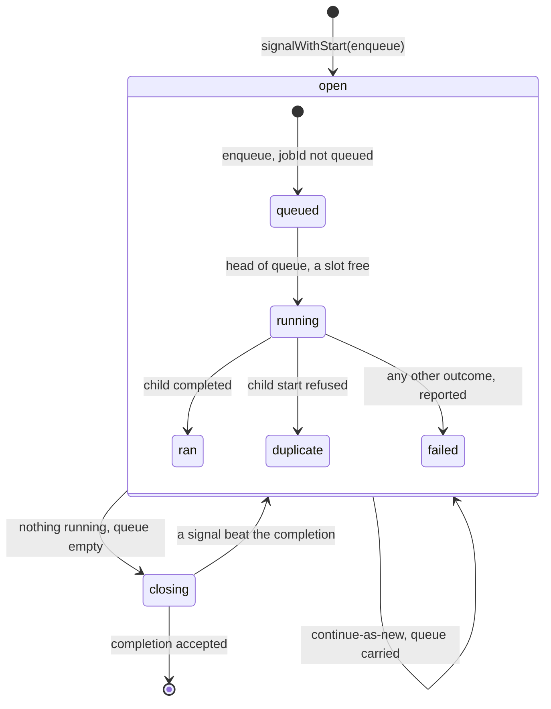
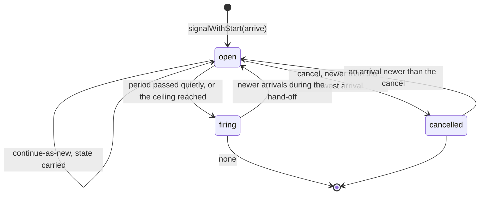
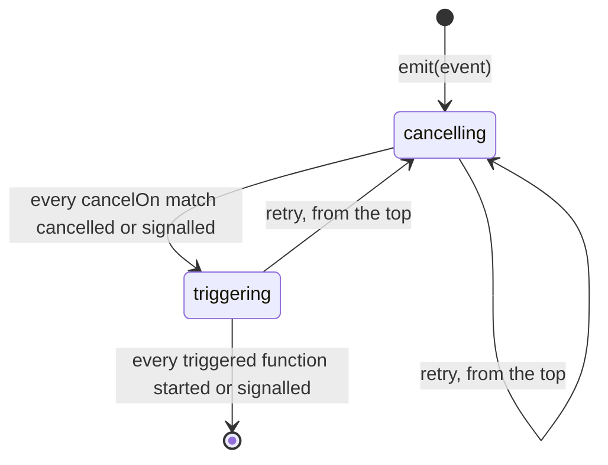
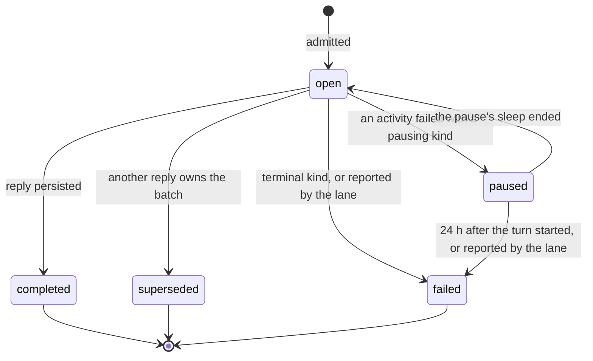
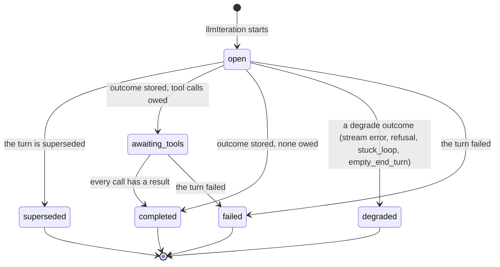

# Orchestration on Temporal `[proposed]`

The plan for moving cogmo's orchestration from Inngest to Temporal.

## Decision

Decided by the owner, 2026-11-22 ([decisions.md](decisions.md) → Orchestration); the plan below stays `[proposed]`.

- **Cogmo moves to Temporal when engineering time allows**, keeping function configuration declarative through a flow layer of about 450 lines ([The flow layer](#the-flow-layer-proposed)).
- **The official SDK, `@temporalio/*`, is approved as a runtime dependency.** It is the only TypeScript SDK, and it ships the native bridge its worker needs.
- **The data-model changes the plan needs are approved:** the four turn tables, the user row's unique index, and slice 4's keyed cooldown write if it extends `CooldownStateSchema`. The turn's design review settles the turn's exact shape ([Entry criteria](#entry-criteria-for-the-turns-design-review)).
- **Two tripwires make it sooner:**
  1. Inngest gates a feature cogmo uses behind its cloud or a paid plan: concurrency keys, debounce, connect, or system events.
  2. A blocking upstream bug that cogmo can't fix or work around itself.
- **The cost of moving is the turn pipeline.** About half of the 179 step call sites port mechanically. `handle-message` needs the redesign in [handle-message on Temporal](#handle-message-on-temporal-proposed) and its own design review before any code.

## Why move `[proposed]`

In order of weight.

**1. The execution model is a recurring cost.** Inngest re-runs the whole function body at every step boundary. Of the 14 rules in [inngest.md](../.agents/rules/inngest.md), 8 exist only for that model and have no counterpart on Temporal, where workflow code replays deterministically and an activity runs once per attempt:

| Rule in inngest.md | On Temporal |
|-|-|
| Count your replays; side effects in `step.run` fire live and are suppressed on replay; step results come back with sorted keys; never gate the bare body on state your own steps mutate; the continuation after a parallel group; step ids from model output; the `ToolSpec.durable` policy; bare-body wall-clocks | Retired |
| A memoized result is a contract with runs in flight | `patched()`, and additive argument schemas ([Versioning](#versioning)) |
| Non-determinism upstream of a step | Enforced by the sandbox and the Replayer, not by review |
| A step boundary abandons the function | Workflows unwind: `finally` runs ([The step model](#the-step-model-proposed)) |
| Expensive work goes in a step; `durable` is not exactly-once (idempotency keys); no broad catch | Unchanged, over activities |

**Inngest hazards.** Shipped fixes that guard one (`changelog.d/`):

| Fragment | Hazard |
|-|-|
| *The re-run model* | |
| `2026-08-20-durable-llm-iterations.md` | The model call re-ran once per step boundary |
| `2026-05-21-durable-tool-step-id-ordinal.md` | Step ids from `tool_use_id` failed runs on retry |
| `2026-09-26-freeze-turn-inputs.md` | Reads changed between invocations of one turn |
| `2026-08-20-coding-orchestrator-durability.md` | A bare-body status read abandoned tasks |
| *Engine behaviour* | |
| `2026-05-04-debounce-native-fast-path-issue.md` | The `cancelOn` listener race ran `handle-message` 4× for one Telegram message |
| `2026-05-19-auto-repair-worker-death-reconcile.md` | `onFailure` is skipped on worker death ([#3549](https://github.com/inngest/inngest/issues/3549)) |

**2. Self-hosting is second-class, and cogmo can't fix it** `[research]` (2026-11-20).

| Evidence | Detail |
|-|-|
| Licence | Server and CLI are SSPL, with delayed publication under Apache 2.0 ([README](https://github.com/inngest/inngest)). Not OSI open source. |
| Realtime | No self-hosted support. Community PR [inngest/inngest#2537](https://github.com/inngest/inngest/pull/2537) has been open since 2025-06-11. |
| `step.sandbox` | Inngest Cloud only, on a paid plan ([sandbox.md](sandbox.md) → Open Questions). |
| Dashboard auth | None when self-hosted ([discussion #1932](https://github.com/orgs/inngest/discussions/1932)); cogmo runs `--no-ui` (deploy.md). |
| Feature flags | `inngest start` reports ServerKind "cloud", so the feature-flags endpoint 404s ([#3600](https://github.com/inngest/inngest/issues/3600)). |
| Support | The self-hosting docs say support isn't guaranteed ([docs](https://www.inngest.com/docs/self-hosting)). |
| Blocking bug | [#3549](https://github.com/inngest/inngest/issues/3549): connect worker death doesn't run `onFailure`. Open since 2026-01-15, worked around ([decisions.md](decisions.md) → Worker-death reconciliation). |
| In its favour | Actively released (v1.53.0 on 2026-11-12), and nothing cogmo uses is gated. |

Outside contributions don't separate the engines. First-time human PRs merged since 2025-01-01: inngest 0 and inngest-js 4, temporal 3 and sdk-typescript 3, hatchet 1, against hundreds opened.

**3. Flow control cogmo owns:** debounce at any period, FIFO lanes, flow behaviour that tests exercise, and no Redis ([The flow layer](#the-flow-layer-proposed)).

**What it costs:**

- the turn-pipeline redesign ([handle-message on Temporal](#handle-message-on-temporal-proposed));
- per-step latency: 15 ms per activity against Inngest's 2.6 ms, unless a step is a local activity ([Measurements](#measurements));
- a runtime dependency with a native bridge, `@temporalio/worker`;
- Node 26, which works but is outside the SDK's supported 20, 22 and 24: each SDK bump re-runs the flow tests on cogmo's Node before it merges;
- rewriting the replay-test tier and the rule files ([Migration plan](#migration-plan-proposed)).

Reason 1 accrues continuously and pays back only once `handle-message` moves, which is the last slice.

## Engine choice `[proposed]`

| Engine | Licence, gating | Fit | Verdict |
|-|-|-|-|
| **Temporal** | MIT, nothing gated | Signals, updates, queries, `signalWithStart`, Schedules, child workflows, continue-as-new, `patched()` and worker versioning; a time-skipping test environment and a history replayer. No event bus, debounce or per-key limits: the flow layer builds them. Workflow code runs in a deterministic V8 sandbox, so all I/O moves into activities. The TS SDK ships monthly. | **Target** |
| Hatchet | MIT; its cloud adds operations only | v1, Postgres-only possible (`SERVER_MSGQUEUE_KIND=postgres`). Event triggers, concurrency keys, per-key rate limits, cron, durable sleep and event waits. Its durable tasks may only sleep, wait for events or spawn children, "should not directly access your database or an external API", and must be deterministic given the event history ([durable tasks](https://docs.hatchet.run/v1/durable-tasks)): every LLM and tool call becomes a child task with a queue hop each, and nothing enforces the determinism. No debounce, no event-based cancel. | Out on the execution model |
| DBOS | Library MIT, Postgres only, no server | Queues (concurrency, rate limit, priority, dedup), a debouncer, cron, send/recv. No event-triggered functions. Conductor, its recovery and dashboard layer, is proprietary and needs a paid key in production ([licence](https://dbos.dev/conductor-license)). | Out: the gating cogmo would be leaving |
| Restate | BSL | No built-in cron. | Out on licence |
| Absurd | Apache-2.0 | A SQL file and a thin SDK: no concurrency, debounce or throttle. | Too thin |

## What cogmo uses from Inngest

About 40 `createFunction` call sites. Paths are under `apps/server/src/`.

| Feature | Users |
|-|-|
| Concurrency `{ limit: 1, key }` | Per conversation: `handle-message` (`agent/handle-message.ts:163`), `pipeline-stage-runner` (`agent/pipeline/stage-runner.ts:96`), observer (`agent/evolution/observer.ts:577`), `recover-conversation` (`agent/recover-conversation.ts:47`), `idle-timer` (`agent/idle-timer.ts:19`). Per task: the coding orchestrators (`agent/coding/orchestrator.ts:145`, `:177`), `verify-orchestrator.ts:106`, `scheduling/fire-handler.ts:28`, the Telegram coding-progress function (`transport/adapters/telegram/inngest-functions.ts:33`). Per run: both failure reconcilers (`agent/reconcile-on-failure.ts:106`, `agent/coding/reconcile-on-failure.ts:138`), `pipeline/gate-resolver.ts:202`. Per skill: `skills/cron-fire-handler.ts:105`. |
| A key shared across functions | `conversationTurnConcurrency`, `scope: "env"`: chat turns and stage turns in one queue (`inngest/concurrency.ts:19`) |
| Global limits | Limit 1: `scheduling/ticker.ts:91`, `model-catalog/refresh-function.ts:32`, `skills/cron-ticker.ts:97`, `skills/deps-reaper-function.ts:73`, `skills/mirror-reconcile.ts:161`, `skills/runs-sweeper.ts:48`, `transport/boundary/janitor.ts:52`. Limit 2: `coding/cleanup-orphan-run-branches.ts:100`. |
| Debounce | Native, keyed on conversation, with a period and an optional ceiling (`agent/debounce.ts:74-78`). The sub-second debounce state machine, which also serves no-debounce and maxwait-only settings, runs on `cancelOn` timers and carries a documented race (`agent/debounce.ts:85`, `:97`). |
| `cancelOn` | `idle-timer.ts:18`, the debounce state machine's timers (`debounce.ts:106`, `:122`), `pipeline/gate-waiter.ts:52`, `transport/boundary/waiter.ts:39` |
| Function `idempotency` | `coding/announce-task-failure.ts:113`, `coding/auto-register-skill.ts:159`, `coding/cleanup-run-branch.ts:109`, `pipeline/gate-waiter.ts:51`, `transport/boundary/waiter.ts:38` |
| Event dedup ids | On many `sendEvent` calls. The inbound edge sets none (`transport/namespaces/sessions.ts:187`). |
| Cron triggers | The tickers, reapers and sweepers above |
| `waitForEvent` | One: a stage waits for the origin turn's `response/ready` (`pipeline/stage-runner.ts:221`) |
| System event | `inngest/function.failed`, for worker-death reconciliation |
| Not used | Throttle, rate limit, priority, singleton |

## Where state lives `[proposed]`

[state-machines.md](../.agents/rules/state-machines.md) assumes a unit's state is a Postgres row. The flow layer's units (lane, debounce window, fan-out) hold theirs in Temporal workflow history. The rule maps as follows:

| Rule | Postgres unit | Workflow-internal unit |
|-|-|-|
| Durable id | Row key | Workflow id, derived from an event id or a key in event data. Never a clock, model output or a fresh uuid. |
| Status as a `pgEnum` | Column | The server's execution status (running, completed, failed, cancelled, terminated, continued-as-new) plus a workflow-local discriminated union, readable through a query handler |
| Conditional UPDATE | `WHERE id AND status = <from>` | The server serializes every command on a workflow id. The guard is the id plus a start policy (`REJECT_DUPLICATE`, `signalWithStart`), decided by the server atomically, and the caller branches on what it returns. |
| Per-state data, JSONB + Zod + CHECK | Column | Workflow arguments and signal payloads, Zod-parsed in the dispatcher before they are sent |
| A failed state records why | Enum column | A failed job is reported as a `flow/function.failed` event carrying a `reason` from a closed union, which the domain row it concerns maps to its own enum |

Unions in workflow code are matched with ts-pattern's `.exhaustive()` if ts-pattern bundles into the sandbox `[research]`; otherwise with a `never`-checked `switch` exempted from the Biome plugin for workflow files.

**What may live in history:** orchestration state only: a queue, a timer, a loop position, ids and verdicts. History is deleted after the namespace's retention period and nothing else can query it.

**What stays in Postgres:** every domain lifecycle (`coding_tasks`, `pipeline_runs`, `skill_runs`, `turn_observations`, `scheduled_tasks`), unchanged, and the turn and its iterations ([Turn](#turn-proposed)), which follow state-machines.md to the letter.

## The flow layer `[proposed]`

Inngest's declarative flow control gives one line for a single writer per key, queued runs that hold no worker slot, queues that span functions, and short runs that fit event decoupling. Its costs are a fixed menu whose semantics the vendor owns, engine-internal state nothing can query, and lock-in; cogmo's tests cover a function's config and its handler, and nothing tests that the engine debounces or serializes. The flow layer keeps the declarative surface and builds it from Temporal primitives cogmo owns and can test. It lives in `src/temporal/flow/`.

### Surface

```typescript
defineFunction({
  id: "handle-message",
  trigger: "inbound/ready",
  workflowType: "turnWorkflow",
  concurrency: conversationTurnLane,   // { scope, key(data), limit }
  // debounce:   { key(data), order(data), periodMs, timeoutMs }
  // cancelOn:   { event, field, order(data) }
  // idempotency: (event) => string
  // cron:       "* * * * *"
});
```

| Config | Compiles to |
|-|-|
| `trigger` | A dispatcher route: an emitted event starts or signals each function it triggers |
| `concurrency` | A [lane](#lane) workflow per key, id `lane:<scope>:<value>`. The scope is the function id unless functions share a lane by naming one scope (`conversation-turn`); functions sharing a lane declare the same limit, checked at boot. A limit with no key is one lane for the function. |
| `debounce` | A [debounce window](#debounce-window) workflow per key |
| `idempotency` | The run's workflow id is `<functionId>:<key>`, started with `REJECT_DUPLICATE`. The key function receives the event, so it can include the event's name (`coding/cleanup-run-branch.ts:109`). |
| `cancelOn` with `idempotency`: a one-shot waiter | Both name the same value. The dispatcher cancels the run id when the event arrives; the run never restarts (`pipeline/gate-waiter.ts:51-52`, `transport/boundary/waiter.ts:38-39`). |
| `cancelOn` with `debounce`: a restartable timer | The event sends the function's window a `cancel` signal. `idle-timer` is `debounce: { key: conversationId, order: messageId, periodMs: idleTimeoutMs }` on `response/ready`, cancelled by `inbound/arrived`. |
| none of these | The run's workflow id is `<functionId>:<event id>`, started with `REJECT_DUPLICATE` |
| `cron` alone | A Temporal Schedule `cron:<functionId>` that starts the function's workflow directly with overlap policy `SKIP`. The workflow id is `cron:<functionId>:<scheduled time>`, which is also the trigger id its emits derive from. `SKIP` is the single flight, so the global limits on today's cron functions need no lane. |
| `cron` with a `trigger` | Both paths go through the function's one lane, so neither is discarded. The Schedule starts a one-activity workflow that enqueues job `<functionId>:<scheduled time>`; an event enqueues its own id. The model-catalog refresh is the one user (`agent/model-catalog/refresh-function.ts:32-33`). |
| `retries: n` | The handler's activities take `maximumAttempts: n + 1` |

`defineFunction` rejects, at boot, `cancelOn` in any other combination: alone, or with `concurrency`. A cancel can't reach a job queued in a lane, and a restart by workflow id lets a stale trigger destroy a newer run. `idle-timer` has `cancelOn` and `concurrency` today (`agent/idle-timer.ts:18-19`) and becomes a window.

Boot reconciles Schedules with the function registry: it creates the missing, updates the changed and deletes those no function declares.

A workflow id longer than 200 characters is replaced by `<functionId>:<sha256 of the rest>`, computed in the dispatcher: event ids nest across hops.

### Lane

**Unit:** one concurrency key's queue, workflow id `lane:<scope>:<value>`. A job in it is one run of a function; its id is the run's workflow id from the table above.



| From | To | Guard | Writes |
|-|-|-|-|
| — | `open` | `signalWithStart` on the lane id: the server starts a run only when none is open | Workflow start with `{ key, limit, carried: [] }`, and the signal |
| — | `queued` | `enqueue` handler: the job id is not already queued. The lane never refuses a job. | Queue append. A job is its function id, workflow type, job id and event; events carry ids and small data, so a job is a few hundred bytes. Past 1,000 queued, the lane logs at error and records a metric through an activity. |
| `queued` | `running` | Fewer than `limit` running; the job is the queue's head; fewer than 200 started in this run, unless the queue no longer fits a continue-as-new | Child workflow start: id = job id, `REJECT_DUPLICATE` |
| `running` | `ran` | The child completed | Counter |
| `running` | `duplicate` | The server refused the start: the id is running, or closed within [retention](#event-fan-out) | Counter |
| `running` | `failed` | Anything else: the child failed, timed out, was cancelled or terminated, or the lane's own code threw. The slot is released on every outcome. | `reportFailure` activity: emits `flow/function.failed`, id `failed:<jobId>`, carrying `{ functionId, jobId, event, reason, failure }`. `reason` is `failed`, `timed_out`, `cancelled`, `terminated` or `lane_error`; `failure` is the child's `ApplicationFailure` type and details, or null. |
| `open` | `closing` | Nothing running, queue empty, every signal handler finished | Completion command |
| `closing` | `open` | A signal reached the server first: it refuses the completion, and the next workflow task sees the job | — |
| `closing` | completed | The server accepted the completion. The next enqueue starts a new run. | — |
| `open` | `open`, new run | 200 jobs started or the server suggests it; nothing running; the queue fits the payload limit | Continue-as-new, the queue in its arguments |

Illegal: two open runs for one key and a job running twice. The server's workflow-id uniqueness excludes both.

| Crash point | State left | Why it is safe, or the residual |
|-|-|-|
| The process dies with a job running | `open`, the job `running` | The job's activity times out and retries once a worker is back. The lane holds its slot, and later jobs wait in order. |
| Inside `reportFailure`, before Temporal records it | `running` | The activity retries. The event id `failed:<jobId>` makes consumers see one failure. |
| `reportFailure` out of its attempts (10) | `failed`, unreported | The lane logs at error and moves on. Residual: the failure event is lost; the domain's sweepers and reconcilers are the backstop. |
| Workflow-task failure: a bug or a non-determinism error | `open`, stalled | The server retries the task indefinitely, and every job on the key waits. Residual: needs an alert on failing workflow tasks; a deploy fixes it. |
| A deploy with the lane open | `open` | [Versioning](#versioning) |
| Two producers enqueue at once | Both `queued` | The server orders the signals. Order is arrival at the server. |
| The same event delivered twice | One job | Dropped while queued, `duplicate` while running or after it closed. |
| A backlog, or a storm of signals, while a long job runs | `open`, queue and history growing | The lane continues-as-new only while its queue fits the payload limit (roughly 4,000 jobs in 2 MB), and otherwise keeps starting jobs in its current history, continuing as new once the queue fits again. Alarms fire at 1,000 queued and when a continue-as-new is skipped. Residual: past the server's history limit the lane is terminated and its queue lost. What the server does with an over-limit continue-as-new input is `[research]`, pinned by a slice 1 test. |
| An enqueue races the lane's completion or its continue-as-new | `open`, or a new run | The server refuses either command while a signal is buffered. Residual until the test in [Testing](#testing-proposed) pins it. |
| The lane is terminated by an operator | The queue lost; the running child terminated with it; nothing reported | Operator action only. The lane's reporting path dies with it, so domain rows are the backstop: a turn's inbounds are re-batched by the next arrival, and the sweepers find the rest. |

Queued jobs are entries in the lane's state and hold no worker slot.

### Debounce window

**Unit:** one key's window, workflow id `debounce:<functionId>:<key>`. A window fires the function with the burst's newest event, and the fired run's id derives from that event's id. `order` names an event's position: the inbound message id for the router, the reply's message id for the idle timer, the inbound's id for the idle timer's cancel. All are UUIDv7, comparable across the two kinds. UUIDv7 order across connections isn't commit order, a property the batch cursor already has.



| From | To | Guard | Writes |
|-|-|-|-|
| — | `open` | `signalWithStart` on the window id | Workflow start with `{ functionId, periodMs, timeoutMs }`; the event as newest; the window's start time and quiet deadline |
| `open` | `open` | `arrive` whose order is strictly above the newest event's and the last fired order. Any other arrival, a duplicate included, is dropped and resets nothing. | The newest event; the quiet deadline, one period on. The ceiling, `timeoutMs` from the window's first arrival, doesn't move. |
| `open` | `open`, new run | The server suggests continue-as-new | Continue-as-new carrying the newest event, the last fired order, the window's start time and the quiet deadline. A window with no ceiling (`timeoutMs` null, the default when `maxWaitMs` is 0, `agent/debounce.ts:76`) can stay open for as long as arrivals keep coming. |
| `open` | `firing` | The quiet deadline or the ceiling passed | `startRun` activity with the newest event, which enqueues or starts the function's run; the last fired order |
| `open` | `cancelled` | `cancel` whose order is strictly above the newest event's. A stale cancel is dropped. A cancel for a window that isn't running is a no-op. | The cancel's order; completion command |
| `cancelled` | `open` | An arrival above the cancel's order reached the window before its completion | The event as newest; a new start time and quiet deadline |
| `cancelled` | completed | None did | — |
| `firing` | `open` | An event above the fired order arrived during the hand-off | A new start time and quiet deadline |
| `firing` | completed | None did; every signal handler finished. A cancel during the hand-off is dropped: the function's own re-check covers it. | — |

| Crash point | State left | Why it is safe, or the residual |
|-|-|-|
| Inside `startRun`, before Temporal records it | `firing` | The retry starts the same run id, which the lane or `REJECT_DUPLICATE` collapses to one run. |
| `startRun` keeps failing | `firing` | It retries without limit and depends only on the Temporal server. Arrivals meanwhile are kept and open the next window. |
| The process dies while the window is `open` | `open` | The timer is the server's. It fires late by at most the downtime. |
| Workflow-task failure or replay | Unchanged | The window reads time only through the sandbox's deterministic clock. A stalled window delays its key until a deploy, as a stalled lane does. |
| A deploy with a window open | `open` | Period and ceiling are the window's arguments, so a config change applies from the next window. |
| Two arrivals at once | `open` | The server orders the signals; the window keeps the newer by order, whichever landed last. |
| A retried older trigger lands while a newer window is open | `open`, unchanged | Dropped by order: a stale `response/ready` can't replace or restart a newer idle timer. |
| A retried older cancel lands while a newer window is open | `open`, unchanged | Dropped by order. |
| An arrival retried after its window fired, was cancelled or completed | Dropped, or a new window that fires once more | The first when the window still runs. The second starts a window with no memory: the function it fires re-checks domain state. A stale turn skips at admission's staleness guard, and a stale idle timer finds a newer inbound and emits nothing. |
| An arrival or a cancel races the window's completion or continue-as-new | `open`, or a new window | As the lane's. |

A window hands on one event. The others, dropped arrivals included, lose nothing: each announces a row committed before it was emitted, and the turn batches every unanswered inbound from Postgres ([transport/debounce.md](transport/debounce.md)).

### Event fan-out

**Unit:** the fan-out of one event, keyed on the event's id. The dispatcher is the event bus Temporal lacks. It stores nothing: the unit's state is the set of workflows its ids name, and a fan-out resumes by running again from the top.

Every event has an id from durable state:

| Emitter | Event id |
|-|-|
| An edge announcing a committed row | The row: `arrived:<inboundMessageId>` |
| A workflow | `<trigger event id>:<functionId>:<emit name>`, or a row id where one exists (`fire:<inboundId>`). A cron run's trigger id is its workflow id. |
| A debounce hand-off | The window's newest event id |
| A lane's failure report | `failed:<jobId>` |



| Step | Guard | Writes |
|-|-|-|
| Cancel, waiter | The run id `<functionId>:<field value>` exists; not-found is success | Cancellation request |
| Cancel, timer | The window id exists; not-found is success | `cancel` signal carrying the event's order |
| Trigger, debounced function | `signalWithStart` on the window id | `arrive` signal |
| Trigger, laned function | `signalWithStart` on the lane id | `enqueue` signal carrying the job |
| Trigger, other function | Start with `REJECT_DUPLICATE`; already-started is success | Workflow start |

**A cancellable function decides from domain state when it fires.** Cancels and starts are separate, retried operations, and a UUIDv7 is allocated before its row commits, so an inbound can order below a reply it follows. The fire-time check is therefore the source of truth and the ordered cancel only an optimization. `idle-timer` emits when the conversation has no unanswered inbound and its newest reply is older than the idle timeout; the gate and boundary waiters act through transitions guarded on the row still being parked.

A workflow emits through the `emit` activity, since a workflow can't start arbitrary workflows; an activity or an edge calls the dispatcher directly. `emit` retries transient errors without limit. A contract error, a missing field or a Zod failure, is non-retryable.

| Crash point | State left | Why it is safe, or the residual |
|-|-|-|
| Inside `emit`, part of the fan-out done | Some functions started | The activity retries the whole fan-out; each operation lands on the same ids. |
| An edge dies between its commit and the emit, or mid-fan-out | The row committed, the event partly or not delivered | Residual, as today: the inbound edge sends outside any step (`transport/namespaces/sessions.ts:187`). The next arrival's turn batches the stranded inbound. [Open questions](#open-questions-and-residuals) names the fix. |
| `emit` fails on a contract error | Nothing delivered | The workflow fails, and its lane reports it. The emits that end a turn follow its persisted reply, so the reply is stored and the Observer and idle timer miss one turn. |
| A retried or delayed trigger lands after the cancel meant for its run, or a mis-ordered cancel is dropped | A stale run or window fires | The fire-time check suppresses it. |
| A mis-ordered cancel discards a valid idle window | No window | Residual: one `conversation/idle` is missed until the next reply. |
| A deploy that changes the function registry mid-retry | The retry fans out under the new registry | A function in both registries is deduped by id; one added between attempts runs once. |
| Two emits of one event id | One run per function | Every id derives from the event. |
| Redelivery after the namespace's retention period | A second run | Residual: a closed workflow blocks its id only while the server retains it, so retention is the idempotency window. Set it no shorter than the longest redelivery horizon; domain keys (`scheduled_tasks.idempotency_key`, `skill_runs.idempotency_key`) are unaffected. |

`waitForEvent` has one user, whose wait is bounded at 30 seconds and whose timeout proceeds anyway. It becomes a bounded poll: a loop of a read activity and a workflow sleep.

### Versioning

Cogmo is one process, so a deploy replays every open workflow on the new code; worker versioning isn't used.

- A change to a workflow's command order goes behind `patched()`. Lanes close when empty and continue-as-new every 200 jobs, so their histories are short-lived.
- `patched()` covers replay only. These are contracts with work in flight, and change additively: job, signal and activity argument schemas, the events held in windows and pending emits, recorded activity results, and failure types and details.
- A removed or renamed workflow type or activity stays registered until no lane holds a job of it and no open workflow can call it.

### Semantic differences from Inngest

| Behaviour | Inngest | Flow layer |
|-|-|-|
| Debounce granularity | 1 s minimum; cogmo's sub-second debounce state machine has a cancel-listener race | Any period. The state machine, its three events and its race are deleted, which is [transport/debounce.md](transport/debounce.md) → Future migration. |
| Order within a key | Not promised | FIFO by arrival at the server |
| What a concurrency slot holds | An executing step; a sleeping run frees it, and a retried step can run between a younger run's steps (`inngest/concurrency.ts:13-17`) | A whole run, sleeps and retries included |
| `cancelOn` | Any function; a second trigger queues another run | A one-shot waiter, or a debounce window that order protects from stale triggers and cancels |
| Idempotency window | 24 h | The namespace's retention ([Event fan-out](#event-fan-out)) |
| Fan-out | Atomic in the event bus | Not atomic; idempotent by id |
| Worker death | Fails the run; `onFailure` may not fire | The workflow waits: an activity times out and retries when a worker returns |
| A failed run | `onFailure`, and `inngest/function.failed` | The lane's `flow/function.failed` event. Every function with an `onFailure` or a reconciler today is laned, and the two worker-death reconcilers stay until Inngest is removed in slice 7, so a run that fails on a draining copy, or when its copy is removed `[research]`, still reaches one. |

## The step model `[proposed]`

`Durable.run(id, closure)` (`inngest/durable.ts:126`) memoizes a closure that captures whatever the function body built. Temporal has no equivalent: workflow code is sandboxed and deterministic, and I/O runs in **activities**, named functions registered on the worker that take serializable arguments.

- **An activity is a use case with its deps bound at boot:** `createSchedulingActivities(deps)` returns `{ dispatchScheduledFire: (args) => dispatchScheduledFire(deps, args) }`. A use case that plans one step moves unchanged.
- **A use case that plans several steps splits:** each step body stays a use-case file and becomes an activity, and the planning becomes workflow code in the owning domain module (`src/agent/scheduling/fire.workflow.ts`). `src/temporal/` holds the client, the worker, the flow layer, the event definitions and one bundle entry that re-exports every workflow, as `src/inngest/` holds infrastructure today.
- **The `Durable` port is replaced** by one typed activities interface per domain module, reached through `proxyActivities`. `sendEvent` becomes the `emit` activity, `sleep` the workflow's `sleep`. The compile-time check that a result survives JSON (`inngest/durable.ts:91`) moves to those interfaces.
- **Workflow files import only** `@temporalio/workflow`, `@temporalio/common`, types, and pure modules. `node:crypto`, pino and the stores can't enter the sandbox; a unit test that bundles the workflows fails on a violation. Workflow logging uses `@temporalio/workflow`'s `log`.

All 179 non-test step call sites, classified:

| Class | Sites | What it needs |
|-|-|-|
| **A. Mechanical** | 91 | Worker deps plus serializable inputs: the turn's admit, record, load, compact and persist bodies; most coding plan, execute and verify transitions and teardowns (29 sites, which need the worker's filesystem); observer loads and persists; pipeline run transitions; crons, tickers, reapers, sweepers |
| **B. Per-run state rebuilt in the activity** | 50 | The body closes over something the bare body built, which the activity rebuilds from ids and reads: a logger (6); the `LlmProvider`, through `resolveProvider(model)`; the scoped `Service`; the `DeliveryHandle`; the live tool catalog (`agent/handle-message/freeze-turn-inputs.ts:118`); the voice bundle; tool handlers bound to the live registry; coding container closures; class instances with private state (the askpass lease, the pre-submit hand-back); output through closure mutation (`agent/coding/allocate-task-worktree.ts:72-78`) |
| **C. Engine semantics** | 38 | 31 event emits relying on bus dedup or triggers, covered by the dispatcher; 6 cancellable sleeps and waits, covered by `cancelOn` and workflow timers; and `llm-iter<N>`, covered below |

Rules every activity follows:

- **Idempotent on durable state.** An activity runs at least once: a crash after its commit and before Temporal records the result re-runs it. The keyed-insert shape and its three constraints in [inngest.md](../.agents/rules/inngest.md) carry over unchanged.
- **Ids in, verdicts out.** Arguments and results live in history, in the clear, under a 2 MB payload limit. Content stays in Postgres and object storage.
- **No secrets in arguments or results.** A credential the bare body loads today, such as the GitHub PAT, is loaded inside the activity that uses it ([scheduling.md](scheduling.md) → Don't return secrets through `step.run`).
- **Timeouts are explicit, and don't stop work.** Every activity sets `startToCloseTimeout`. One that streams or runs for minutes sets `heartbeatTimeout` and heartbeats on a timer, and aborts its work when the heartbeat reports cancellation.
- **I/O in `catch` and `finally` is an activity.** A workflow unwinds, where an Inngest function is abandoned at a boundary. The coding orchestrators clean up outside steps (`agent/coding/orchestrator.ts:285-296`, `:575-584`); that cleanup becomes activities inside `CancellationScope.nonCancellable`, so a cancelled workflow still runs it.

### Errors

Use cases keep returning `Result`. It converts once, in the wrapper that registers a use case as an activity, which replaces `asNonRetriable` (`agent/turn-step-runner.ts:59`):

| Use-case outcome | Channel |
|-|-|
| A value, or an expected outcome the workflow branches on (`skipped`, `superseded`, `stale`) | The activity's return value: a serializable tagged union the workflow matches exhaustively. A neverthrow `Result` doesn't serialize, so the wrapper returns `{ ok: true, value } \| { ok: false, error }`. |
| A transient failure: network, 5xx, 429 | A retryable `ApplicationFailure` typed with the error's `kind`. The activity's retry policy owns it, and `cause.type` still names the kind once attempts run out. |
| A failure that retrying the activity can't fix: a provider's 4xx, missing config | `ApplicationFailure.create({ type, nonRetryable: true, details })`, the type being the error union's `kind`. A provider refusal rides in `details` as a `ProviderRefusal` (`agent/turn-step-runner.ts:36`), not as JSON in a cause's message. |
| A bug | A plain throw, with no kind. It retries to `maximumAttempts`; the workflow reads the untyped failure as `internal`. |

A workflow that handles an activity failure reads `ActivityFailure.cause.type` and parses `details` with Zod; it catches only where the conversion target is the designed failure channel, as [inngest.md](../.agents/rules/inngest.md) requires of `step.run` today. A cancellation is never swallowed.

`retries: 2` on a function becomes `maximumAttempts: 3` on its activities. A tool handler's failure is non-retryable, as today (`agent/turn-step-runner.ts:100`).

## handle-message on Temporal `[proposed]`

### Why the loop can't port as it is

Across iterations the loop holds, in the function body:

- the provider, the budgets and counters, and OTel spans;
- an opened transcript with a private head-hash chain (`agent/transcript.ts:109-111`) over messages that carry base64 attachments, hashed with `node:crypto` (`util/canonical-json.ts:1`);
- the `superseded` closure (`agent/handle-message.ts:330`);
- `onEvent` into a `DeliveryHandle`, whose stream handles live in process-local adapter maps (`transport/adapters/telegram/adapter.ts:22`, `transport/adapters/web/index.ts:84`).

The body also does I/O outside any step on every invocation: `getProfile` (`agent/handle-message/freeze-turn-inputs.ts:91`), `deliveryRouter.prepare` (`:105`), the live tool catalog (`:118`), `voiceResolver` (`agent/handle-message.ts:202`), `renderTurnView`. Workflow code can do none of it, and the messages can't ride in history under the payload limit.

### The DB is the turn's state

The turn workflow holds ids, verdicts and the iteration counter. Every activity rebuilds what it needs from Postgres, keyed on the [turn](#turn-proposed).

| Activity | Replaces | Returns |
|-|-|-|
| `admitTurn` | `load-conversation`, `last-assistant`, `load-turn-snapshot`, `load-inbound` | `skipped` with a reason, or the turn's id and the batch's cursors |
| `transcribeVoice` (conditional) | `transcribe-voice` | The transcripts: bounded text, the one content that rides in history |
| `recordUserMessage` | `create-user-message` | The user row's id |
| `freezeTurn` | `freeze-core-memory-scope`, `freeze-turn-inputs`, `freeze-model-limits`, `load-last-tokens`, `load-system-prompt` | Voice mode, batch-delivery flag |
| `prepareTurnContext` | `auto-recall`, `count-tokens-<n>`, `summarize-prefix-outcome`, `persist-summary`, `open-system-prompt-epoch`, `render-turn-context` | The view's pins: the compaction cutoff, the attachment cutoff and the epoch |
| `llmIteration(n)` | `llm-iter<N>` | `superseded`, `final`, `degrade`, or `tools` with the call plan: positions and their `parallelSafe` flags |
| `toolCall(n, p)` | `tool-iter<N>-<P>` | `ok` or `rejected`, without the content |
| `completeIteration(n)` | `emit-tool-results-iter<N>` | — |
| `degradedReply` | `degraded-reply`, `truncation-notice-iter<N>` | — |
| `finishStream`, `persistTurn`, `deliverReply` | `finish-stream`, `persist-new-messages`, `batch-delivery`, `redeliver-unstreamed`, voice delivery | `persisted` with the message id, or `superseded` |
| `pauseTurn`, `resumeTurn`, `failTurn` | `onFailure` | — |
| `emit` | `emit-cooldown-cleared`, `emit-conversation-degraded`, `send-response`, `flush` | — |

**The user row is keyed on the batch.** `create-user-message` is a plain insert (`agent/handle-message/record-user-message.ts:94-110`), so a retry after its commit writes a second user row. `recordUserMessage` writes the row through `ON CONFLICT DO UPDATE` with a no-op SET on a partial unique index over `(conversation_id, last_inbound_message_id)` for turn rows, and returns the row's id from either arm. A later turn of the same batch recovers that row instead of inserting a second.

**Frozen inputs and tool results are insert-once rows:**

| Table | Columns | Unique | Written |
|-|-|-|-|
| `turn_inputs` (`agent/store/`) | `id`, `created_at`; `turn_id` FK `turns.id`; `inputs JSONB -- FrozenTurnInputsSchema`: the tool table as text, voice mode, batch-delivery flag, core-memory scope, model limits, last-token count. All NOT NULL. | `turn_id` | `ON CONFLICT DO UPDATE` with a no-op SET, returning the stored row, so a retry freezes nothing new |
| `turn_tool_results` (`agent/store/`) | `id`, `created_at`; `turn_id` FK `turns.id`; `iteration`, `position` integers; `outcome JSONB -- TurnToolResultSchema`: `{ ok: true, content } \| { ok: false, message }`, the object variants of `agent/tool-step-result.ts:12-18`. All NOT NULL. | `(turn_id, iteration, position)` | The same shape; the first result stored for a position stands |

`turn_inputs` stays its own table, 1:1 with the turn: it is immutable, and on `turns` it would be a nullable column whose presence tracks progress beside the status.

The system prompt snapshot, the turn context and the summary are rows already.

**The request is re-rendered per iteration.** `load-turn-transcript` has no counterpart: `llmIteration(n)` loads the turn's transcript view under the pins the workflow passes it, the frozen inputs and iterations `1..n-1`, renders attachments through the process memo, and sends. Synthetic messages a repair adds are stored in the iteration's outcome, so the next rebuild sends them again. Repair budgets, stuck-loop fingerprints and the `streamed` ledger are derived from the iteration rows inside the activity.

**Head-hash chain.** Each iteration row stores the head of the request it sent. `llmIteration(n)` re-hashes the rebuilt prefix against the stored heads, then extends iteration `n-1`'s head over the messages added since. A mismatch is the in-turn violation the loop reports (`agent/loop.ts:1096-1103`): the request rebuilt from rows differs from the one sent. Tool inputs are canonicalized before the request that first carries them, so the JSONB round-trip keeps their bytes.

**Stream handle and delivery.** Each activity that pushes calls `deliveryRouter.prepare` with the turn workflow's id where it passes Inngest's run id today, and receives the same process-local handle. Cogmo is one process, so every activity runs in the worker that owns the adapters. A completed activity never runs again, so nothing re-emits; a retried `llmIteration` re-streams into the same handle as edits. Process death keeps its residual: the handle is lost, and the tail streams into a new message ([crash-recovery.md](crash-recovery.md) → Process death).

**Compaction is one activity.** Inside `prepareTurnContext`, `compactMessages` runs with an in-process runner. Its sub-results are already idempotent rows (`insertOrRecoverSummary`, the snapshot, the turn context), so a retry that finds the turn's summary skips the model call and returns the same pins. A summarization that fails its in-activity attempts degrades to truncation inside the activity, as today. The activity returns no messages, so image payloads never reach history.

**Tool steps and parallel groups.** The workflow walks the call plan in order and runs consecutive `parallelSafe` calls as a `Promise.allSettled` of `toolCall` activities, so `completeIteration` runs only after every sibling settles. Each activity reads its result row first and returns it if present; otherwise it binds the live handler to the frozen table, builds the turn's `Service`, runs the handler with the idempotency key the loop mints today (`agent/loop.ts:626`), and writes the row. `completeIteration` pushes the iteration's `tool_result` events and closes it. Every built-in tool is durable today, so `ToolSpec.durable` is retired: every call is an activity.

**Superseded check and late replies.** Batch ownership stays where it is: the check is the first statement of `llmIteration`, and `persistTurn` keeps its two conditions. `isTurnSuperseded` returns which check held, where it returns a boolean (`agent/handle-message/is-turn-superseded.ts:28`). A lane runs a turn to its end before the next starts, so a failed turn's step retry can't run between a younger turn's steps, and with no function-level retry a trigger has one run. The checks remain as the backstop for a second turn of one batch and for the migration window.

**The shared lane.** `handle-message` and `pipeline-stage-runner` declare one exported lane, `{ scope: "conversation-turn", key: conversationId, limit: 1 }`, as they share `conversationTurnConcurrency` today. A stage's bounded wait for its origin turn holds its own run's lane, not the origin conversation's.

**Latency.** An activity costs about 15 ms of orchestration and a local activity under 1 ms ([Measurements](#measurements)): a 15-step turn spends about 225 ms as activities, against about 40 ms on Inngest. The turn's short idempotent reads are local activities, and the activities before the first token are folded into few.

### Turn `[proposed]`

**Unit:** one run of a turn. Id: the turn workflow's id, which is its lane job id and derives from the trigger event's id. A second run of the same batch (a stale window's turn, an operator re-run) is a different turn with its own rows; it shares the batch's user row, and the keyed tool effects of calls repeated at the same iteration and position with the same arguments.

**Storage:** `turns` in `agent/store/`.

| Column | Type | Notes |
|-|-|-|
| `id`, `created_at` | UUIDv7, timestamptz | |
| `workflow_id` | text, NOT NULL, unique | The key of every write below |
| `conversation_id` | FK, NOT NULL | |
| `status` | pgEnum `turn_status` | `open`, `paused`, `completed`, `superseded`, `failed` |
| `pause_reason` | pgEnum, nullable | `auth`, `billing`, `provider_unavailable`, `timed_out`. Set exactly in `paused` (CHECK). |
| `superseded_reason` | pgEnum, nullable | `answered`, `rebatched`. Set exactly in `superseded` (CHECK). |
| `failure_kind` | pgEnum, nullable | `bad_request`, `internal`, the four pause reasons, `cancelled`, `terminated`. Set exactly in `failed` (CHECK). |



| From | To | By | Guard | Writes |
|-|-|-|-|-|
| — | `open` | `admitTurn`. It first looks the row up by `workflow_id` and returns `admitted` if it exists, so a retry doesn't re-run admission. | `INSERT … ON CONFLICT (workflow_id) DO UPDATE` with a no-op SET, returning the row | Row. A skipped admission writes none. |
| `open` | `paused` | `pauseTurn` | `WHERE id = $1 AND status = 'open'` | `pause_reason`. On the turn's first pause, which the workflow's pause count tells it, the activity sends one notice through `notifyConversation`, the path `report-turn-failure` uses. |
| `paused` | `open` | `resumeTurn`, after the workflow's timer | `WHERE id = $1 AND status = 'paused'` | — |
| `open` | `completed` | `persistTurn`, in the transaction that inserts the reply | `WHERE id = $1 AND status = 'open'` | — |
| `open` | `superseded` | `llmIteration` or `persistTurn`, in the transaction of the check | `WHERE id = $1 AND status = 'open'` | `superseded_reason`; the open iteration, if any, to `superseded` |
| `open`, `paused` | `failed` | `failTurn`, run by the workflow on a terminal kind or at the pause ceiling; `report-turn-failure`, on the lane's `flow/function.failed`, whose job id is `workflow_id` | `WHERE workflow_id = $1 AND status IN ('open', 'paused')` | `failure_kind`; every `open` or `awaiting_tools` iteration to `failed`. `failTurn` writes and nothing else. |

Illegal: any transition out of `completed`, `superseded` or `failed`.

`report-turn-failure` maps the lane's report: `failed` to the failure's type, or `internal` when it has none or one this build doesn't know; `timed_out`, `cancelled` and `terminated` to themselves; `lane_error` to `internal`. It owns the failure notice and `conversation/errored`, which it sends unconditionally today (`agent/handle-message/report-turn-failure.ts:65`, `:76`), and branches on its transition's result:

| Result | Does |
|-|-|
| `transitioned`, or `stale` with `failed` (`failTurn` got there first) | Marks the refused attachments (`agent/handle-message/report-turn-failure.ts:75`), emits `conversation/errored` and notifies the user |
| `not_found`: the workflow failed before `admitTurn` committed | Emits `conversation/errored` and notifies the user, as today |
| `stale` with `completed` or `superseded` | Logs only: the turn ended, and what failed came after it |

**Errors.** `llmIteration`'s use case returns `Result<IterationVerdict, IterationError>`, and the workflow branches on the kind once the activity is out of attempts:

| Kind | Activity retries it | Class | Effect on the turn |
|-|-|-|-|
| `bad_request`: a deterministic 4xx | No | Terminal | `failed`. `report-turn-failure` notifies the user, and `recover-conversation` sets the cooldown, as today. The next turn re-batches the inbounds, with today's placeholders for refused attachments. |
| `internal`: an untyped failure | Yes | Terminal | As `bad_request` |
| `auth`, `billing` | No | Pausing | `paused` |
| `provider_unavailable` (network, 5xx, 408, 425, 429); `timed_out` (the activity's own timeout) | Yes | Pausing | `paused` |

A paused turn keeps its conversation lane, sleeps on a workflow timer (1 minute, doubling to 1 hour), then resumes and runs the same activity again. The ceiling is 24 hours from the workflow's start: the last sleep is clamped to it and it is checked before each resume, so downtime can't carry a reply past it; then the turn fails with the pause's reason. A pausing kind out of `transcribeVoice`, `prepareTurnContext` or `degradedReply` pauses the turn the same way.

While a turn is paused, later inbounds and same-key pipeline stages queue behind it, so none starts before the pause is recorded, which a cooldown set by a separate function allows. The cost: they get no in-cooldown reply (`agent/handle-message/admit-turn.ts:174-194`), a newer inbound doesn't supersede the paused turn, and nothing lets an operator retry it at once or abandon it. These are [entry criteria](#entry-criteria-for-the-turns-design-review).

### Turn iteration `[proposed]`

**Unit:** one model request and the tool calls it asks for. Id `(turn_id, iteration)`: the turn and the workflow's loop counter, which replays from history. A re-plan can't shift either.

**Storage:** `turn_iterations` in `agent/store/`.

| Column | Type | Notes |
|-|-|-|
| `id`, `created_at` | UUIDv7, timestamptz | |
| `turn_id` | FK `turns.id`, NOT NULL | Unique with `iteration` |
| `iteration` | integer, NOT NULL | From 1 |
| `status` | pgEnum `turn_iteration_status` | `open`, `awaiting_tools`, `completed`, `degraded`, `superseded`, `failed`. The reason for the last two is the turn's, written in the same transaction. |
| `outcome` | JSONB, nullable -- `TurnIterationOutcomeSchema` | Content blocks, stop reason, usage, the `emitted` ledger, the request head, reported transformations, the repair consumed and its synthetic messages. Set exactly in `awaiting_tools` and `completed`; `degraded` holds the `emitted` ledger alone (CHECK). |
| `degrade_reason` | pgEnum, nullable | The loop's `DegradeSubtype` values (`agent/repair.ts:85`). Set exactly in `degraded` (CHECK). |



| From | To | By | Guard | Writes |
|-|-|-|-|-|
| — | `open` | `llmIteration` | `INSERT … ON CONFLICT (turn_id, iteration) DO UPDATE` with a no-op SET, returning the row; the turn is `open` and iteration `n-1` is `completed`, in the same transaction | Row |
| `open` | `superseded` | `llmIteration` | `WHERE id = $1 AND status = 'open'`, with the turn's transition | — |
| `open` | `awaiting_tools` / `completed` | `llmIteration` | `WHERE id = $1 AND status = 'open'`, after the stream drains. The target is `awaiting_tools` when the outcome carries tool calls. | `outcome` |
| `open` | `degraded` | `llmIteration` | `WHERE id = $1 AND status = 'open'`, when the iteration returns a degrade outcome | `degrade_reason`, the `emitted` ledger |
| `awaiting_tools` | `completed` | `completeIteration` | `WHERE id = $1 AND status = 'awaiting_tools'`. In the same transaction, each call the workflow reports as failed gets an `is_error` result row, and every position has one. | Missing result rows |
| `open`, `awaiting_tools` | `failed` | The turn's `failed` transition | `WHERE turn_id = $1 AND status IN ('open', 'awaiting_tools')` | — |

Illegal: any transition out of `completed`, `degraded`, `superseded` or `failed`, and opening iteration `n` before `n-1` is `completed`. An iteration stays `open` while its turn is paused. Each transition, the turn's included, is a store method returning `{ kind: "transitioned" } | { kind: "stale"; status } | { kind: "not_found" }`, and each activity is one use-case file.

`llmIteration` re-entered finds its row and branches on it:

| Row | Re-entry |
|-|-|
| `open` | Checks `superseded` again and re-sends |
| `awaiting_tools`, `completed` | Returns the stored outcome without a provider call |
| `degraded`, `superseded` | Returns the stored verdict |
| `failed` | Fails non-retryably with the turn's `failure_kind` |

### Turn failure modes

| Crash point | State left | Why it is safe, or the residual |
|-|-|-|
| `admitTurn` retried after its commit | One `turns` row | Keyed on the workflow id. |
| `transcribeVoice` retried | No row involved | One more STT call per voice inbound. Its result is recorded apart from the user-row insert, so a retry of the insert doesn't re-bill it. |
| `recordUserMessage` retried after its commit | One user row | The keyed insert returns the stored row's id. |
| Inside `llmIteration`, before the outcome commits | Iteration `open` | The retry re-sends: one more billed request, re-streamed into the same handle while the process lives. |
| After the outcome commits, before Temporal records the activity | `awaiting_tools` / `completed` | The retry returns the stored outcome. No provider call, where Inngest re-bills. |
| Between a tool's side effect and its result row | `awaiting_tools`, no row for the position | A handler failure isn't retried: the workflow reports the position failed, and the model sees `is_error`. A timeout (the worker died) retries once with the same idempotency key, so keyed tools recover their row; the per-tool residuals in [crash-recovery.md](crash-recovery.md) → The crash window each durable tool still carries are unchanged. |
| An activity times out while its handler or stream is still running | As the retry leaves it | A timeout doesn't stop the work. Cancellation aborts the provider stream and the tool handler. Residual: a handler that ignores cancellation runs beside its retry, so an irreversible effect needs a downstream idempotency key. |
| Between the result rows and `completeIteration` | `awaiting_tools` | The transition is guarded. A retry after a partial push can show a `tool_result` card twice, as today. |
| `llmIteration` out of attempts, or failing non-retryably, with a pausing kind | Turn `paused`, iteration `open` | The lane is held, the user has one notice, and the same iteration runs again after the sleep. |
| The same with a terminal kind, or past the pause ceiling | Turn `failed` with its kind, its open iterations `failed` | `failTurn` writes both in one transaction, then the workflow fails with the kind. |
| `pauseTurn` retried after its commit | `paused` | The transition is stale. Residual: the activity can't tell whether the notice went out and sends it again. |
| The process dies while the turn is `paused` | `paused` | The timer is the server's; the turn resumes when a worker is back. |
| The worker stays down mid-iteration | `open`, then `paused` | The activity's schedule-to-close timeout is `timed_out`, a pausing kind, and the ceiling is measured from the turn's start, so it bounds how late a reply can be. |
| The turn workflow is cancelled, terminated or times out | `failed` | `report-turn-failure` finds the turn by the report's job id and closes it and its iterations. If the lane was terminated too, nothing reports: the sweeper removes the rows once Temporal shows the workflow closed. |
| The workflow fails after its turn is `completed`: `deliverReply` out of attempts, or a contract error in the closing `emit` | `completed` | `report-turn-failure` logs and sends no error notice and no cooldown. Residual: a reply persisted but not delivered, or the Observer and idle timer missing the turn; the next turn's transcript holds the reply. |
| A new turn of a batch whose earlier turn failed or was superseded | A new `turns` row and new iterations from 1; the batch's one user row | The earlier turn's rows aren't read. Tool idempotency keys derive from the batch's first inbound (`agent/handle-message/run-turn-loop.ts:105`, `agent/loop.ts:626`), so the new turn recovers the first's keyed tool effects instead of repeating them. The superseded check and `persistTurn`'s conditions decide ownership as today. |
| Two turns of one batch at once | Two turns, one user row | The lane excludes it. If it happens anyway, the same checks decide, with their residuals in [crash-recovery.md](crash-recovery.md) → Late replies. |
| The process dies after the final outcome commits, before `finishStream` | Iteration `completed`, the reply's tail not streamed | Residual: the recovered outcome isn't re-streamed, and `deliverReply`'s fallback reaches only batch targets and sessions whose stream failed at finish (`agent/handle-message/run-turn-loop.ts:153`). An [entry criterion](#entry-criteria-for-the-turns-design-review). |
| Workflow-task failure or replay | Unchanged | The workflow does no I/O and holds no content: replay re-derives the loop position, the pause count and the workflow's start time from history. |
| A deploy mid-turn | Whatever the rows hold | The new build's activities read rows the old build wrote, so the row schemas are the contract: a field added to `outcome` or `inputs` is optional ([Versioning](#versioning)). |
| Two attempts of one iteration at once | One outcome | The first conditional UPDATE wins; the loser gets `stale` and returns the stored outcome. Residual: both streamed into one handle. |

**Cost bounds.**

| Scope | Provider calls, at most |
|-|-|
| `transcribeVoice`, per attempt | One STT call per voice inbound |
| One `llmIteration` run | 3 attempts × 2: the stream and its one in-attempt `stream_replay` repair (`agent/loop.ts:933`) |
| `prepareTurnContext`, per attempt | One recall, the token counts, and one summarization unless the summary row exists |
| `degradedReply`, per attempt | One synthesis |
| One turn, unpaused | The iteration cap × 6, plus the other three rows × 3 |
| One paused turn | One more run of the paused activity per resume: at most 30 in 24 hours under the doubling sleep |

A failed turn isn't retried. A sweeper deletes the `turn_iterations`, `turn_tool_results` and `turn_inputs` rows, then the `turns` row, of every turn whose status is terminal, or whose workflow Temporal reports closed or no longer knows, once the row is older than the namespace's retention.

**Existing data.** The tables start empty, and a turn runs on one engine from start to end. The user row's unique index needs the duplicate rows the unkeyed insert has left removed first. Retiring `durable` from the frozen tool table changes the configuration digest and opens one `configuration` epoch per conversation at its next turn ([crash-recovery.md](crash-recovery.md) → Tool durability policy).

### Entry criteria for the turn's design review

This section is where that review starts. It must settle:

- **Effects outside the fence:** which handlers honour cancellation, and a downstream idempotency key for each irreversible effect that doesn't have one.
- **Final-reply delivery** recoverable by session and reply id, so a reply whose stream died is delivered once.
- **Which activities are local.** A local activity can rerun before its completion marker is durable, so only short idempotent reads qualify.
- **The duplicate user rows** present before the unique index, and the index's exact predicate.
- **What a paused turn blocks.** Whether the in-cooldown reply moves ahead of the lane, whether a newer inbound supersedes a paused turn, and an operator's retry-now and abandon.
- **Cooldown ordering on exit.** If `report-turn-failure` plus `recover-conversation` survives, the next queued turn can be admitted before the cooldown commits, the pause ceiling included, and persistence clears the cooldown by conversation id alone (`agent/handle-message/persist-turn.ts:150`), so a probe can erase a newer one. The cooldown is armed before the lane releases, and a turn clears only the cooldown it probed.
- **The pause clock:** wall-clock age, as here, or cumulative paused time.
- **The cutover hold.** Whether slice 6 holds `inbound/ready` and `pipeline/stage.due` until Inngest is verified quiescent, which would exclude the overlap of an old and a new turn of one conversation rather than guard it.
- **The exact shape of the four turn tables** (`turns`, `turn_iterations`, `turn_tool_results`, `turn_inputs`) and of the user row's partial unique index on `messages`, unless the `todo.md` entry for the unkeyed user row lands it first. The owner has approved the changes themselves.
- **Per-process state in tool handlers** beyond the file-freshness map ([crash-recovery.md](crash-recovery.md) → Durable LLM iterations), which hasn't been audited.

## Inngest-specific contracts `[proposed]`

What [crash-recovery.md](crash-recovery.md) specifies for Inngest and no section above replaces:

| Contract | On Temporal |
|-|-|
| The durability map's bare-body rows, which run on every invocation | Each read moves into the activity that uses it. |
| `step-not-found` when a deploy adds a step to a run that planned a parallel group | Gone: nothing looks a step up by name. |
| State serialization: binary fields in `ContentBlock` must be strings before a step returns them | Content reaches Postgres, not history, so the JSONB rules apply instead. |

## Testing `[proposed]`

| Tier | Today | On Temporal |
|-|-|-|
| Unit, use cases | Fake `Durable` (`src/test/fake-durable.ts`) | An activity's use case is a plain function over fake deps. No orchestration fake. |
| Unit, workflows | `@inngest/test` with memoized `steps:` | `@temporalio/testing`'s time-skipping environment with mocked activities: timers, lanes, debounce windows and cancellation run in virtual time `[research]`. |
| Flow control | Unit: path selection, config shape and the handler (`agent/debounce.test.ts`). Nothing runs the engine's debounce or concurrency. | The flow layer's own behaviour needs a server, so its tests are in the integration tier. Slice 1 amends [testing.md](../.agents/rules/testing.md) to say so. |
| Replay safety | One test per memoized step | The `Replayer` runs recorded histories against the current workflow code and fails on a non-determinism error. One history per workflow and per flow-layer mechanism is committed and re-recorded when a change is deliberate `[research]`. |
| Integration | An Inngest dev server per worker slot | One Temporal dev server from `dev/containers.ts`, a namespace per worker slot, a task queue per file. The dev server's visibility store rejects `ORDER BY`, so tests don't list workflows in order. |

**Buffered-signal test.** One test holds a lane's workflow task in flight (a worker interceptor delays its completion), sends an `enqueue`, and asserts the job runs, once for the completion command and once for continue-as-new. It pins the server behaviour both lanes and windows rest on.

The spike (`apps/server/spike/temporal/` at commit `d61c9ccb`, branch `evaluate-inngest-alternatives-temporal`) ran ten tests against the dev server `@temporalio/testing` downloads, in real time. Each mechanism was removed in turn:

| Test | Mutation | Result |
|-|-|-|
| Turn and stage serialize on one conversation, in arrival order | Lane limit 2 | Red |
| Burst collapses into one turn, with the last inbound | No debounce | Red |
| Redelivered event runs once | No job dedup | Red |
| Idle timer is cancelled by the next inbound | No `cancelOn` | Red |
| Real `dispatchScheduledFire`, retried after commit, reuses its row | The use case's retry guard removed | Red |
| No job is lost while a lane finishes | The wait for `allHandlersFinished` removed | **Green** |

The last stayed green because that wait is a no-op while signal handlers are synchronous; the server's refusal protects the job, which is what the buffered-signal test pins.

The spike's flow layer differs from this design in: unscoped lane keys, a lane slot that isn't released when its own code throws, unbounded `reportFailure` retries, a failure report without `reason` or `failure`, last-arrival-wins debounce with no cancel and no continue-as-new, an idle timer restarted by workflow id, workflow-id-derived emit ids, and no cron.

## Deployment `[proposed]`

| Piece | Setup |
|-|-|
| Server | `temporalio/server`, one container running every service role, configured from the environment (`DB=postgres12`, `POSTGRES_SEEDS`, …). It refuses to start without a dynamic config file at `/etc/temporal/config/dynamicconfig/docker.yaml`. |
| Postgres | Two databases, `temporal` and `temporal_visibility`, on the instance cogmo already uses. `temporalio/admin-tools` creates and migrates them: `temporal-sql-tool create-database`, `setup-schema -v 0.0`, `update-schema -d …/postgresql/v12/{temporal,visibility}/versioned`. A server upgrade re-runs `update-schema` first. `temporalio/auto-setup` is deprecated and not used. |
| Namespace | One, created with `temporal operator namespace create`, its retention set per [Event fan-out](#event-fan-out). |
| Redis | Not needed |
| Network | The frontend's gRPC port is reachable by cogmo only, as Inngest and Hindsight are today (deploy.md → Securing internal services). The server's API authentication is an [open question](#open-questions-and-residuals). |
| UI | Optional and off by default. `temporalio/ui` has no authentication of its own, so it stays on a private network. |
| Worker | In the cogmo process, started by `src/boot/` after the stores. Still one process and one image. |

## Migration plan `[proposed]`

Both engines run side by side until the last slice.

- **A function lives on one engine.** Functions sharing a concurrency key move together: the two engines' limits don't see each other. From deploy N a moved function's Inngest copy admits no new run.
- **The engine that accepted an event owns its run.** Every emit goes through one publisher that requires an event id and delivers to each engine hosting something the event concerns: a function it triggers, a `cancelOn` it matches, or a `waitForEvent` it satisfies. Inside an Inngest function the publisher call sits in a step. `adapter/direct/outbound`, whose consumers are outside cogmo, goes to Inngest until slice 7 replaces it. Nothing forwards an event it received, and nothing compares timestamps.
- **Each slice is two deploys.**
  - *Deploy N* registers the function on Temporal, and its publisher routes every new emit for it there. The Inngest copy keeps its function id and body but takes no new triggers: its cron is removed and its event trigger gets an `if` that never matches, so neither Inngest's scheduler nor an event still sent to Inngest for another consumer starts a run of it. What Inngest already admitted finishes there: runs in flight, queued runs, open debounce windows, sleepers. That Inngest keeps those alive across the trigger change is `[research]`; if it doesn't, a function moves together with every Inngest consumer of its trigger event, and its copy keeps its trigger and drains until N+1, since nothing sends that event to Inngest any more. Under the fallback, `idle-timer` and all of slice 3 move in slice 6: until then `response/ready` reaches Inngest for the stage runner's wait, and `inbound/arrived` for the idle timer's cancel. During slice 6's drain the publisher sends its copies no cancel or wait events, so the draining idle-timer copy's body gains the same fire-time domain check before it emits, and a stage's wait proceeds on its timeout. Under the fallback, only a cron copy, whose schedule can't stay, is removed at N, and that deploy lands between ticks, verified by the same drain check.
  - *A moved cron's Schedule is created paused at N* and unpaused at N+1, once its copy is quiescent, so a tick still draining on Inngest never overlaps a Temporal tick. Under the fallback it starts unpaused, since its copy is removed between ticks. An operator event for a cron-and-event function (the model-catalog refresh) can still overlap a draining tick. Each refresh persists its catalog in one transaction and then installs it in the process (`agent/model-catalog/refresh-model-catalog.ts:92`, `llm/litellm-data.ts:96`) with no version check, so slice 2 makes the refresh single-flight: one Postgres session advisory lock, taken before the persist's transaction and held through the install (the `bootstrapLock` shape, `db/bootstrap-lock.ts`), runs overlapping refreshes one after the other on either engine, and the live catalog always matches the newest persisted one.
  - *Deploy N+1* removes the copy on verified quiescence: Inngest reports no run of the function id that is running, queued, inside a debounce window, or sleeping. Whether the self-hosted API reports pending runs is `[research]`. Waiting out a horizon instead is allowed only where admission-to-completion is bounded: a cron, or a waiter with a timeout. A debounce with no ceiling or a long retrying run has no bound and needs the verified check; if the API can't give it, slice 1's research reads the same answer from Inngest's own state store `[research]`, and until one of the two reports quiescence the copy stays registered and Inngest stays deployed.
- **Ids don't dedupe across engines.** With no new admissions on the copy, the one cross-engine duplicate is an emit whose first attempt reached Inngest under N-1 and whose retry under N reaches Temporal. Its unit's domain key catches it:

  | Unit | Key |
  |-|-|
  | Scheduled fire | `scheduledFireKey` on the inbound row |
  | Skill run, coding task, pipeline run | `idempotency_key` on the row |
  | Task, run and gate transitions; observations | Conditional UPDATEs |
  | Turn | Admission's staleness guard, the keyed user row, `persistTurn`'s conditions |
  | `conversation/errored` | None. `recover-conversation` advances the cooldown on every invocation today (`agent/recover-conversation.ts:79-80`). Slice 4 keys that write on the event's id in the Inngest body first, one deploy before the move, so the draining copy and the Temporal run dedupe against each other. |

| Failure | State left | Why it is safe, or the residual |
|-|-|-|
| A run in flight across N | An Inngest run | It finishes on Inngest, under the new build's copy of the old body. |
| An event Inngest accepted before N, delivered after it | An Inngest run | The same: Inngest accepted it, so Inngest runs it. |
| Inngest's scheduler reaches a moved cron function's tick after N | No Inngest run | The copy has no cron. Without that, a limit-1 singleton (`skills/mirror-reconcile.ts:161-162`, `scheduling/ticker.ts:91-92`) would run on both engines. |
| An event still sent to Inngest for another consumer also names a moved function's trigger | No run of the copy | Its trigger never matches. `response/ready` still reaches Inngest for the stage runner's wait (`agent/pipeline/stage-runner.ts:221-225`) without arming a second idle timer, and `pipeline/gate.pending` moves with all its consumers in slice 4. |
| An emit retried across N: Inngest got the first attempt, Temporal gets the retry | A run on each engine | The domain keys above. |
| An Inngest debounce window open at N | Fires on Inngest; a Temporal window may fire for the same key | Each handler emits its `inbound/ready` to wherever the turn lives, and the second turn finds the inbounds answered. |
| A waiter or idle timer sleeping on Inngest at N | Wakes on Inngest | Its cancel event still reaches Inngest through the publisher while the copy is registered, except during slice 6's drain under the fallback, where the draining idle-timer copy checks domain state before it emits. Under the fallback, the `boundary/resolved` sent for a draining boundary waiter's cancel also runs Telegram's copy (`transport/adapters/telegram/inngest-functions.ts:144`), which re-applies the same edit to the resolved prompt. Every waiter and timer armed after N is on Temporal, since the copy admits none. |
| An external client posts an event to Inngest after a fence | Accepted, no run | Excluded: `direct-inbound` is the only function external clients trigger, and it stays on Inngest, unfenced, until slice 7 gives them a cogmo ingress. Residual: an automation still posting to Inngest after slice 7's N is accepted with no run, so clients switch to the ingress before that deploy. |
| An old Inngest run and a new Temporal run of one key overlap during the drain | Both running | Guarded transitions decide. For turns, the superseded check and `persistTurn`'s conditions decide ([Turn failure modes](#turn-failure-modes)); a hold that excludes the overlap is an [entry criterion](#entry-criteria-for-the-turns-design-review). |
| The process dies between the publisher's deliveries to the two engines | One engine delivered | The publisher call is inside a step or an activity, which retries both. |
| The deploy that removes a copy (N+1, or N for a cron under the fallback) lands with a run still pending | The run can't resume and fails, or never starts | Residual of a wrong drain check or too short a wait: `inngest/function.failed` and the worker-death reconcilers, kept until slice 7, handle a failed run as a worker death; a lost cron tick is picked up by the next Temporal tick, which finds the rows it didn't advance, while rows a pending run had already advanced lose their fire, the tickers' own residual (`skills/cron-ticker.ts:16-25`); a sleeper that never wakes costs one idle fire or one gate reminder, and the gate's row stays parked for the operator. |
| N is rolled back with Temporal runs open | Their workflow types are unregistered and their tasks stall; boot deletes the Schedules the old build doesn't declare | Roll forward. The stalled runs resume, and the Schedules are recreated, on the next build that registers them. |

| Slice | Content |
|-|-|
| 0 | Engineering time is scheduled, or a tripwire fires. This doc is reviewed against the Inngest and Temporal versions current then. |
| 1 | `src/temporal/`: client, worker in boot, the flow layer with its tests, the publisher, the container factory, the drain check, deployment docs. The SDK's pinned version is checked against its latest release, and the image-size cost of the worker's native bridge is recorded beside the RAM figures in [Measurements](#measurements). A Temporal rule file in `.agents/rules/` with its AGENTS.md section and `CLAUDE.md` import, an amendment to state-machines.md for workflow-internal units ([Where state lives](#where-state-lives-proposed)), the testing.md amendment, and a Temporal section in the reviewer's checklist. No function moves. |
| 2 | Class-A leaves, one PR per group, each with the functions that share its trigger: the crons, tickers, reapers and sweepers; `scheduled-task-fire`; `idle-timer`; the boundary waiter and janitor with Telegram's boundary function (`transport/adapters/telegram/inngest-functions.ts:144`); the coding leaf functions with Telegram's deploy-outcome and failure-notice functions (`:75`, `:94`); the model-catalog refresh. `direct-inbound` (`transport/adapters/direct.ts:113`) doesn't move here: external clients post `adapter/direct/inbound` to Inngest's event API (`scripts/console.ts:32`, [deploy.md](../deploy.md) → Securing internal services), and only cogmo can reach Temporal's frontend, so it stays on Inngest, unfenced, until slice 7. |
| 3 | The debounce router. The sub-second debounce state machine and its events are deleted. Tests that post `inbound/arrived` straight to Inngest's event API (`smoke.e2e`, and the `learning-loop`, `pipeline`, `pipeline.mcp`, `prompt-caching` and `skill-authoring` integration files) move to the publisher. |
| 4 | The Observer; `recover-conversation`, whose keyed cooldown write lands on Inngest one deploy earlier; the skills cron fire; the pipeline gate resolver and gate waiter with Telegram's gate function (`transport/adapters/telegram/inngest-functions.ts:119`), which share `pipeline/gate.pending`. `learning-loop.integration.test.ts`'s direct `conversation/idle` post and `pipeline-run.integration.test.ts`'s `pipeline/gate.resolved` sends move to the publisher. |
| 5 | The coding orchestrators with Telegram's coding-progress function (`transport/adapters/telegram/inngest-functions.ts:31`), which shares their `coding/task/start` trigger: class-B rebuilds, cleanup as activities. |
| 6 | `handle-message` and `pipeline-stage-runner` together, after the turn's design review, in a quiet maintenance window, not verified. The copies' never-matching triggers fence off new admissions; work Inngest admitted before the fence is guarded, not excluded (the overlap row above). `pipeline-run.integration.test.ts`'s `response/ready` resend becomes the origin-turn state the stage's poll reads. |
| 7 | First an authenticated cogmo HTTP ingress that publishes `adapter/direct/inbound` with a caller-supplied event id, and a replacement for `adapter/direct/outbound` (`transport/adapters/direct.ts:127-150`); `scripts/console.ts` and the integration and e2e tiers move to them, then `direct-inbound` moves. Then Inngest removed: `src/inngest/`, the two worker-death reconcilers, `@inngest/test`, the server and Redis from the deployment. `.agents/rules/inngest.md` is deleted with its `CLAUDE.md` import, and every reference to it rewritten: state-machines.md (its re-entry-guard and idempotency-key bullets), store-pattern.md (the keyed-insert shape), testing.md, the Inngest and `Durable` sections of AGENTS.md, section 4 of the reviewer's checklist; and crash-recovery.md, scheduling.md and architecture.md → Orchestration Coupling. |

## Measurements

From the spike at `d61c9ccb`, on Node 26.13.1 with `@temporalio/*` 1.25.0. Temporal 1.32.2 with Postgres 18; Inngest 1.52.0 `inngest start` with Postgres 18 and Redis, over connect. A worker on the same host, zero-length work.

Per step, sequential steps inside one run:

| | p50 / p95, ms |
|-|-|
| Inngest `step.run` | 2.6 / 10.5 |
| Temporal activity | 15 / 32 |
| Temporal local activity | 0.8 / 1.0 |

Inngest's figure matches the "~2ms per step" in [decisions.md](decisions.md) → Orchestration.

Across workflows, p50:

| Path | Temporal | Inngest |
|-|-|-|
| Emit → the turn's first step | 64–99 ms | 300 ms |
| Next queued turn on the same key | 125–200 ms | 145 ms |
| Debounce overhead beyond its period | 800 ms (300 ms period) | 1,550 ms (1 s period) |

Temporal's cross-workflow hops, a child start, a child's completion reaching its parent and a signal-driven workflow task, each wait about 50 ms, on the dev server and the real server alike, whatever the worker's poller settings. That is the hand-off and debounce rows.

Memory, `docker stats` after the bench (idle in parentheses):

| | Server | Its Postgres | Redis |
|-|-|-|-|
| Temporal 1.32.2 | 119 MiB (66) | 174 MiB (150) | — |
| Inngest 1.52.0 | 122 MiB (34) | 61 MiB (36) | 11 MiB |

Porting: `scheduled-task-fire`'s use case runs unchanged as an activity, and its controller is a 29-line workflow plus a 3-line activity factory. Workflow bundling takes the repo's TypeScript as it is: NodeNext `.js` specifiers and `import type` from `src/`.

## Open questions and residuals

- **Durable edge emits.** A transactional outbox, the event written in the row's transaction and relayed to the dispatcher, closes the commit-then-emit window. The lighter alternative, the edge starting one `emit:<eventId>` workflow, shortens the window and costs a cross-workflow hop on the inbound path.
- **Pausing the provider.** `auth` and `billing` are account-wide, so pausing the provider across conversations fits them better than pausing each turn that meets them.
- **Server authentication.** Whether network isolation is enough, or the frontend needs mTLS or an API-key authorizer.
- **Sandbox-safety of the pure stack.** Whether ts-pattern, Remeda and Zod bundle into workflow code is untested.
- **Time-skipping and the replayer** are untested here. The time-skipping test server is a separate downloaded binary, which the dev shell and CI must be able to run.
- **Tracing.** Whether `@temporalio/interceptors-opentelemetry` gives one trace per turn across activities.
- **A second worker.** Stream handles and the coding worktrees pin activities to one process. More than one worker needs a task queue per process.
- **The scheduling ticker** could become one Temporal Schedule per task. Not planned.

Residuals are stated in the failure-mode table of the unit they belong to.
