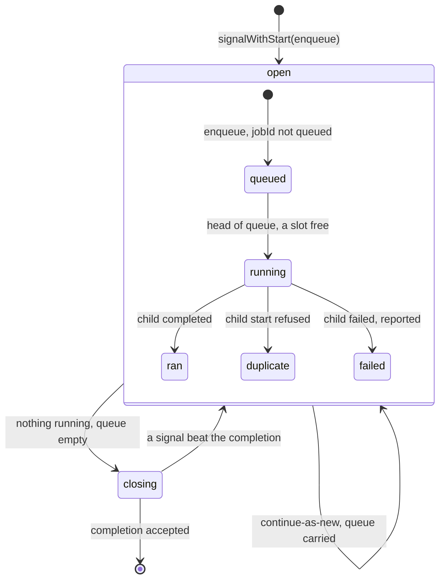
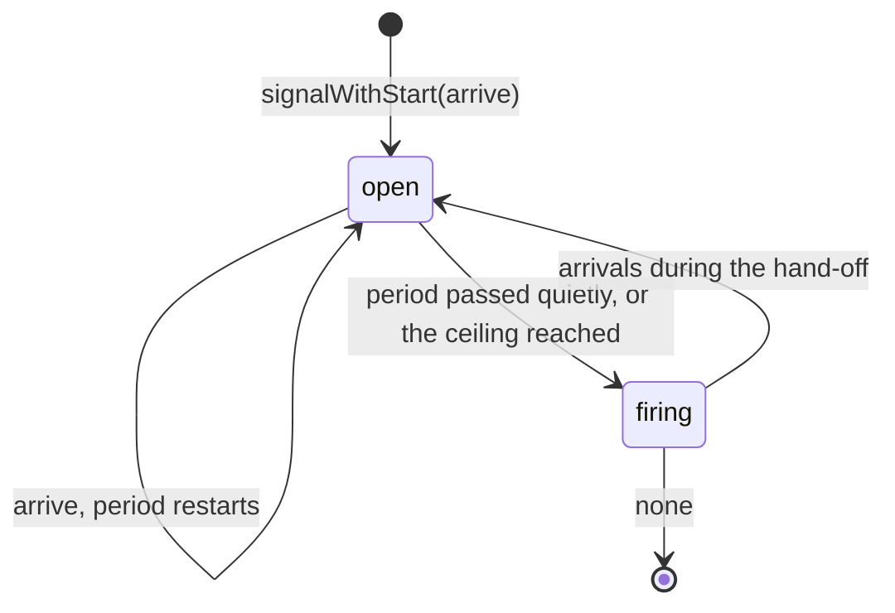
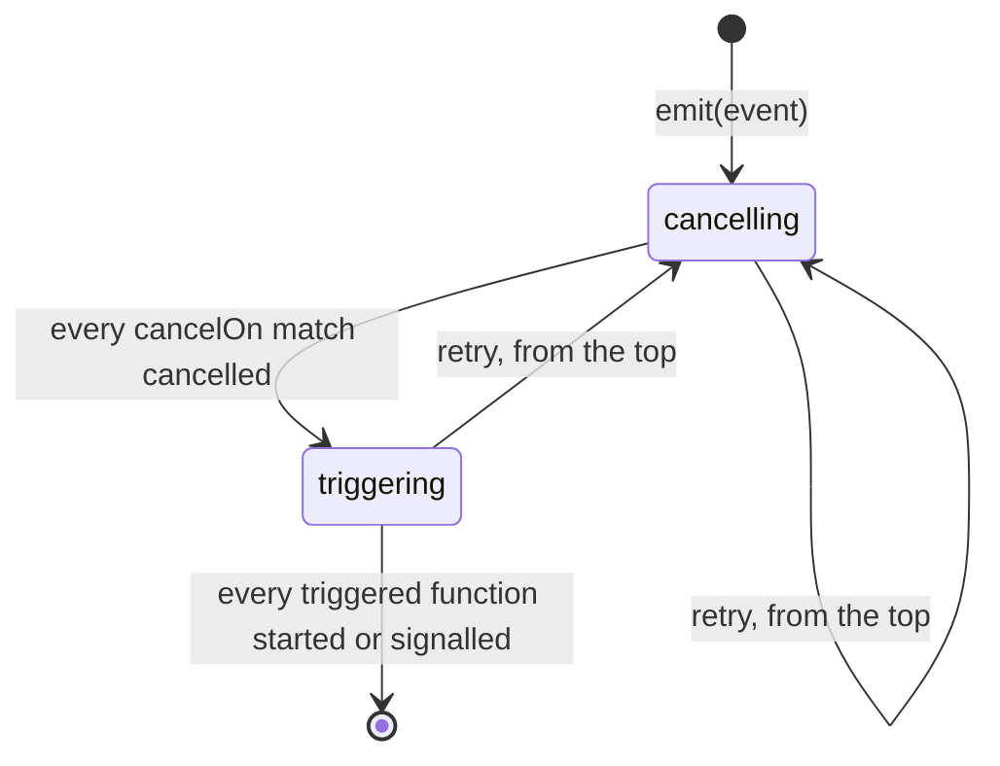
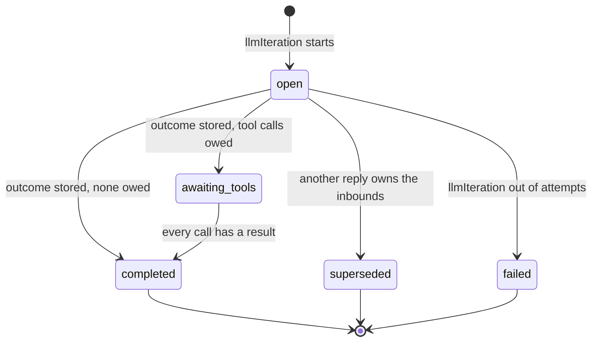

# Orchestration on Temporal `[proposed]`

The plan for moving cogmo's orchestration from Inngest to Temporal, with the evaluation and spike it rests on. It is a plan for *if* cogmo leaves Inngest, not a decision to leave. Sections become `[confirmed]` as their slices land; material taken from external research and not yet evaluated is `[research]`.

## Recommendation

- **Stay on Inngest until a tripwire fires:**
  1. Inngest gates a feature cogmo uses behind its cloud or a paid plan: concurrency keys, debounce, connect, or system events.
  2. A blocking upstream bug that cogmo can't fix or work around itself.
- **Then move to Temporal**, keeping function configuration declarative through a flow layer of about 450 lines ([The flow layer](#the-flow-layer-proposed)).
- **The cost of moving is the turn pipeline.** About half of the 179 step call sites port mechanically. `handle-message` needs the redesign in [handle-message on Temporal](#handle-message-on-temporal-proposed) and its own design review before any code.

Neither tripwire has fired: every feature cogmo uses works self-hosted, and the one blocking bug has a workaround.

## Why leave at all `[research]`

Researched 2026-11-20.

| Evidence | Detail |
|-|-|
| Licence | Server and CLI are SSPL, with delayed publication under Apache 2.0 ([README](https://github.com/inngest/inngest)). Not OSI open source. |
| Realtime | No self-hosted support. Community PR [inngest/inngest#2537](https://github.com/inngest/inngest/pull/2537) has been open since 2025-06-11. Cogmo's SSE design works without it ([transport/adapters.md](transport/adapters.md)). |
| `step.sandbox` | Inngest Cloud only, on a paid plan ([sandbox.md](sandbox.md) → Open Questions). |
| Dashboard auth | None when self-hosted ([discussion #1932](https://github.com/orgs/inngest/discussions/1932)); cogmo runs `--no-ui` (deploy.md). |
| Feature flags | `inngest start` reports ServerKind "cloud", so the feature-flags endpoint 404s ([#3600](https://github.com/inngest/inngest/issues/3600)). |
| Support | The self-hosting docs say support isn't guaranteed; the roadmap lists only diagnostics and retention guides ([docs](https://www.inngest.com/docs/self-hosting)). |
| Blocking bug | [#3549](https://github.com/inngest/inngest/issues/3549): connect worker death doesn't run `onFailure`. Open since 2026-01-15. Cogmo works around it ([decisions.md](decisions.md) → Worker-death reconciliation). |
| Sentiment | Mostly vendor-written comparisons. The consensus is the easiest developer experience and second-class self-hosting; in 2024 the founder said they had been hesitant to support self-hosting ([HN](https://news.ycombinator.com/item?id=40812427)). |
| In its favour | Actively released (v1.53.0 on 2026-11-12), and nothing cogmo uses is gated. |

**Outside contributions don't separate the engines.** PRs since 2025-01-01 from first-time or unaffiliated human accounts (GitHub `authorAssociation` FIRST_TIME_CONTRIBUTOR, FIRST_TIMER or NONE; bots excluded):

| Repo | Merged | Open | Closed without merge |
|-|-|-|-|
| inngest/inngest | 0 | 55 | ~66 |
| inngest/inngest-js | 4 (one person, Sept 2025) | ~60 | 32 |
| temporalio/temporal | 3 | 211 | 75 |
| temporalio/sdk-typescript | 3 | 6 | 31 |
| hatchet-dev/hatchet | 1 | 15 | 99 |

Repeat contributors are excluded (they show as CONTRIBUTOR, as do staff with private org membership), and some PRs are drive-by junk. None of these companies merges outside work, so cogmo can't count on fixing any of them upstream. What separates them is what each withholds from self-hosting.

## Engine choice `[proposed]`

| Engine | Licence, gating | Fit | Verdict |
|-|-|-|-|
| **Temporal** | MIT, nothing gated | Signals, updates, queries, `signalWithStart`, Schedules, child workflows, continue-as-new, `patched()` and worker versioning; a time-skipping test environment and a history replayer. No event bus, debounce or per-key limits: the flow layer builds them. Workflow code runs in a deterministic V8 sandbox, so all I/O moves into activities. The TS SDK ships monthly and supports Node 20, 22 and 24; 26 works ([Measurements](#measurements)). | **Target** |
| Hatchet | MIT; its cloud adds operations only | v1, Postgres-only possible (`SERVER_MSGQUEUE_KIND=postgres`). Event triggers, concurrency keys, per-key rate limits, cron, durable sleep and event waits. Its durable tasks may only sleep, wait for events or spawn children, "should not directly access your database or an external API", and must be deterministic given the event history ([durable tasks](https://docs.hatchet.run/v1/durable-tasks)): every LLM and tool call becomes a child task with a queue hop each, and nothing enforces the determinism. No debounce, no event-based cancel. | Out on the execution model |
| DBOS | Library MIT, Postgres only, no server | Queues (concurrency, rate limit, priority, dedup), a debouncer, cron, send/recv. No event-triggered functions. Conductor, its recovery and dashboard layer, is proprietary and needs a paid key in production ([licence](https://dbos.dev/conductor-license)). | Out: the gating cogmo would be leaving |
| Restate | BSL | No built-in cron. | Out on licence |
| Absurd | Apache-2.0 | A SQL file and a thin SDK: no concurrency, debounce or throttle. | Too thin |

## What cogmo uses from Inngest

About 40 `createFunction` call sites. Paths are under `apps/server/src/`.

| Feature | Users |
|-|-|
| Concurrency `{ limit: 1, key }` | Per conversation: `handle-message` (`agent/handle-message.ts:163`), `pipeline-stage-runner` (`agent/pipeline/stage-runner.ts:96`), observer (`agent/evolution/observer.ts:577`), `recover-conversation` (`agent/recover-conversation.ts:47`), `idle-timer` (`agent/idle-timer.ts:19`). Per task: the coding orchestrators (`agent/coding/orchestrator.ts:145`, `:177`), `verify-orchestrator.ts:106`, `scheduling/fire-handler.ts:28`, the Telegram coding-progress function (`transport/adapters/telegram/inngest-functions.ts:33`). Per run: both failure reconcilers (`agent/reconcile-on-failure.ts:106`, `agent/coding/reconcile-on-failure.ts:138`), `pipeline/gate-resolver.ts:202`. Per skill: `skills/cron-fire-handler.ts:105`. |
| A key shared across functions | `conversationTurnConcurrency`, `scope: "env"`: chat turns and stage turns in one queue (`inngest/concurrency.ts:19`) |
| Global limits | Limit 1: `scheduling/ticker.ts:91`, `model-catalog/refresh-function.ts:32`, `skills/cron-ticker.ts:97`, `skills/deps-reaper-function.ts:73`, `skills/mirror-reconcile.ts:161`, `skills/runs-sweeper.ts:48`, `transport/boundary/janitor.ts:52`. Limit 2: `coding/cleanup-orphan-run-branches.ts:100`. |
| Debounce | Native, keyed on conversation, with period and timeout (`agent/debounce.ts:74`). A sub-second fallback runs on `cancelOn` timers and carries a documented race (`agent/debounce.ts:85`, `:97`). |
| `cancelOn` | `idle-timer.ts:18`, the fallback debounce timers (`debounce.ts:106`, `:122`), `pipeline/gate-waiter.ts:52`, `transport/boundary/waiter.ts:39` |
| Function `idempotency` | `coding/announce-task-failure.ts:113`, `coding/auto-register-skill.ts:159`, `coding/cleanup-run-branch.ts:109`, `pipeline/gate-waiter.ts:51`, `transport/boundary/waiter.ts:38` |
| Event dedup ids | On many `sendEvent` calls. The inbound edge sets none (`transport/namespaces/sessions.ts:186`). |
| Cron triggers | The tickers, reapers and sweepers above |
| `waitForEvent` | One: a stage waits for the origin turn's `response/ready` (`pipeline/stage-runner.ts:221`) |
| System event | `inngest/function.failed`, for worker-death reconciliation |
| Not used | Throttle, rate limit, priority, singleton |

## Where state lives `[proposed]`

[state-machines.md](../.agents/rules/state-machines.md) assumes a unit's state is a Postgres row. The flow layer's units (lane, debounce window, fan-out) hold theirs in Temporal workflow history. The rule maps as follows:

| Rule | Postgres unit | Workflow-internal unit |
|-|-|-|
| Durable id | Row key | Workflow id, derived from an event id or a key in event data. Never a clock, model output or a fresh uuid. |
| Status as a `pgEnum` | Column | The server's execution status (running, completed, failed, cancelled, terminated, continued-as-new) plus a workflow-local discriminated union, matched with `.exhaustive()` and readable through a query handler |
| Conditional UPDATE | `WHERE id AND status = <from>` | The server serializes every command on a workflow id. The guard is the id plus a start policy (`REJECT_DUPLICATE`, `TERMINATE_EXISTING`, `signalWithStart`), decided by the server atomically, and the caller branches on what it returns. |
| Per-state data, JSONB + Zod + CHECK | Column | Workflow arguments and signal payloads, Zod-parsed in the dispatcher before they are sent |
| A failed state records why | Enum column | A failed job is reported as a `flow/function.failed` event carrying the failure's `type`; the domain row it concerns records the reason |

**What may live in history:** orchestration state only: a queue, a timer, a loop position, ids and verdicts. History is deleted after the namespace's retention period and nothing else can query it.

**What stays in Postgres:** every domain lifecycle (`coding_tasks`, `pipeline_runs`, `skill_runs`, `turn_observations`, `scheduled_tasks`), unchanged, and the turn's per-iteration state ([Turn iteration](#turn-iteration-proposed)), which follows state-machines.md to the letter.

## The flow layer `[proposed]`

Inngest's declarative flow control gives one line for a single writer per key, queued runs that hold no worker slot, queues that span functions, and short runs that fit event decoupling. Its costs are a fixed menu whose semantics the vendor owns (cogmo already outgrew debounce once), engine-internal state nothing can query, unit tests that can only assert config shape, and lock-in. The flow layer keeps the declarative surface and builds it from Temporal primitives cogmo owns and can test.

The spike's implementation is `apps/server/spike/temporal/flow/` on branch `evaluate-inngest-alternatives-temporal`. It moves to `src/temporal/flow/` with the changes marked **beyond the spike** below.

### Surface

```typescript
defineFunction({
  id: "handle-message",
  trigger: "inbound/ready",
  workflowType: "turnWorkflow",
  concurrency: conversationTurnLane,   // { scope, key(data), limit }
  // debounce:   { key(data), periodMs, timeoutMs }
  // cancelOn:   { event, field }
  // idempotency: (data) => string
  // cron:       "* * * * *"
});
```

| Config | Compiles to |
|-|-|
| `trigger` | A dispatcher route: an emitted event starts or signals each function it triggers |
| `concurrency` | A [lane](#lane) workflow per key. Functions naming the same `scope` and key share it. |
| `debounce` | A [debounce window](#debounce-window) workflow per key |
| `cancelOn` | The run's workflow id is `<functionId>:<field value>`, and the dispatcher cancels that id when the event arrives. A new trigger restarts the run (`TERMINATE_EXISTING`). |
| `idempotency` | The run's workflow id is `<functionId>:<key>`, started with `REJECT_DUPLICATE` |
| neither | The run's workflow id is `<functionId>:<event id>`, started with `REJECT_DUPLICATE` |
| `cron` | A Temporal Schedule `cron:<functionId>` with overlap policy `SKIP`, whose action emits `flow/cron.fired` with id `<functionId>:<scheduled time>`; the function is then triggered like any other `[research]` |
| `retries: n` | The handler's activities take `maximumAttempts: n + 1` |

Beyond the spike:

- **Lane keys carry a scope.** The lane id is `lane:<scope>:<value>`, where the scope is the function id unless functions share a lane by name (`conversation-turn`). The spike keys on the bare value, which would merge two functions keyed on the same task id.
- **`cancelOn` and `concurrency` don't combine.** A cancel can't reach a job still queued in a lane, and a `cancelOn` function is already one run per value. `defineFunction` rejects the pair at boot. `idle-timer` has both today (`agent/idle-timer.ts:18-19`) and keeps `cancelOn`.
- **`cancelOn` with `idempotency`** must name the same value, and starts with `REJECT_DUPLICATE` instead of restarting. Both users do (`pipeline/gate-waiter.ts:51-52`, `transport/boundary/waiter.ts:38-39`).
- **Functions sharing a lane must declare the same limit**, checked at boot: the lane takes its limit from whichever producer starts it.
- **Every event has an id** ([Event fan-out](#event-fan-out)).

### Lane

**Unit:** one concurrency key's queue, workflow id `lane:<scope>:<value>`. A job in it is one run of a function; its id is the run's workflow id from the table above.



| From | To | Guard | Writes |
|-|-|-|-|
| — | `open` | `signalWithStart` on the lane id: the server starts a run only when none is open | Workflow start with `{ key, limit, carried: [] }`, and the signal |
| — | `queued` | `enqueue` handler: the job id is not already queued | Queue append |
| `queued` | `running` | Fewer than `limit` running; the job is the queue's head; fewer than 200 started in this run | Child workflow start: id = job id, `REJECT_DUPLICATE` |
| `running` | `ran` | The child completed | Counter |
| `running` | `duplicate` | The server refused the start: the id is running, or closed within retention | Counter |
| `running` | `failed` | The child failed, timed out, or was cancelled or terminated | `reportFailure` activity: emits `flow/function.failed`, id `failed:<jobId>`, with the failure's `type` and details |
| `open` | `closing` | Nothing running, queue empty, every signal handler finished | Completion command |
| `closing` | `open` | A signal reached the server first: it refuses the completion, and the next workflow task sees the job | — |
| `closing` | completed | The server accepted the completion. The next enqueue starts a new run. | — |
| `open` | `open`, new run | 200 jobs started or the server suggests it; nothing running | Continue-as-new, the queue in its arguments |

Illegal: two open runs for one key and a job running twice. The server's workflow-id uniqueness excludes both.

| Crash point | State left | Why it is safe, or the residual |
|-|-|-|
| The process dies with a job running | `open`, the job `running` | The job's activity times out and retries once a worker is back. The lane holds its slot, and later jobs wait in order. |
| Inside `reportFailure`, before Temporal records it | `running` | The activity retries. The event id `failed:<jobId>` makes consumers see one failure. |
| Between the child's end and the report | — | Not a window: the child's result and the next command are in one history, and replay schedules the report. |
| `reportFailure` keeps failing | `running`, the slot held | It retries without limit. Its only dependency is the Temporal server, without which nothing on the lane could run. |
| Workflow-task failure: a bug or a non-determinism error | `open`, stalled | The server retries the task indefinitely, and every job on the key waits. Residual: needs an alert on failing workflow tasks; a deploy fixes it. The replayer runs in CI ([Testing](#testing-proposed)). |
| A deploy with the lane open | `open` | History replays under the new code, so a change to the lane's command order goes behind `patched()`. Lanes close when empty and continue-as-new every 200 jobs, so an old history is short-lived. |
| Two producers enqueue at once | Both `queued` | The server orders the signals. Order is arrival at the server. |
| The same event delivered twice | One job | Dropped while queued, `duplicate` while running or within retention after it closed. Beyond retention the domain's own keys decide. |
| An enqueue races the lane's completion | `open`, or a new run | The server refuses a completion while a signal is unprocessed. Residual: the spike exercised lanes finishing and restarting between jobs but couldn't force the exact window, and the same refusal is assumed for continue-as-new. |
| The lane is terminated by an operator | Queue lost; the running child is terminated with it | Operator action only. Domain rows are untouched; a turn's inbounds are re-batched by the next arrival. |

Queued jobs are entries in the lane's state and hold no worker slot.

### Debounce window

**Unit:** one key's window, workflow id `debounce:<functionId>:<key>`. A window fires the function with the burst's last event, and the fired run's id derives from that event's id.



| From | To | Guard | Writes |
|-|-|-|-|
| — | `open` | `signalWithStart` on the window id | Workflow start with `{ functionId, periodMs, timeoutMs }`; latest event; the window's start time |
| `open` | `open` | `arrive` before the period or the ceiling elapses | Latest event; the period timer restarts. The ceiling, `timeoutMs` from the window's first arrival, doesn't move. |
| `open` | `firing` | The period passed with no arrival, or the ceiling was reached | `startRun` activity with the latest event, which enqueues or starts the function's run |
| `firing` | `open` | An event arrived during the hand-off | A new window start time |
| `firing` | completed | No arrival since the fire; every signal handler finished | — |

| Crash point | State left | Why it is safe, or the residual |
|-|-|-|
| Inside `startRun`, before Temporal records it | `firing` | The retry starts the same run id, which the lane or `REJECT_DUPLICATE` collapses to one run. |
| `startRun` keeps failing | `firing` | It retries without limit and depends only on the Temporal server. Arrivals meanwhile are kept as the latest event and open the next window. |
| The process dies while the window is `open` | `open` | The timer is the server's. It fires late by at most the downtime. |
| Workflow-task failure or replay | Unchanged | The window reads time only through the sandbox's deterministic clock. A stalled window delays its key until a deploy, as a stalled lane does. |
| A deploy with a window open | `open` | Period and ceiling are the window's arguments, so a config change applies from the next window. A window lives at most `timeoutMs`, or as long as arrivals keep coming when there is no ceiling. |
| Two arrivals at once | `open` | The server orders the signals; the later one is the latest event. |
| An arrival races the window's completion | `open`, or a new window | The same server-side refusal as the lane's, with the same residual. |
| A steady stream with no ceiling | `open`, history growing | Beyond the spike: after a fire, the window continues-as-new when the server suggests it, carrying the latest event. |

A window passes on one event, and nothing is lost by that: the handler names its trigger inbound, and the turn batches every unanswered inbound from Postgres ([transport/debounce.md](transport/debounce.md)).

### Event fan-out

**Unit:** the fan-out of one event, keyed on the event's id. The dispatcher (`flow/dispatcher.ts` in the spike) is the event bus Temporal lacks. It stores nothing: the unit's state is the set of workflows its ids name, and every operation is idempotent on those ids, so a fan-out resumes by running again from the top.

| Emitter | Event id |
|-|-|
| An edge announcing a committed row | The row: `arrived:<inboundMessageId>` |
| A workflow | `<workflow id>:<emit name>`, the role an Inngest step id plays, or a row id where one exists (`fire:<inboundId>`) |
| A debounce hand-off | The window's last event id |
| A cron schedule | `<functionId>:<scheduled time>` |
| A lane's failure report | `failed:<jobId>` |



| Step | Guard | Writes |
|-|-|-|
| Cancel, per function whose `cancelOn` names the event | The run id `<functionId>:<field value>` exists; not-found is success | Cancellation request |
| Trigger, debounced function | `signalWithStart` on the window id | `arrive` signal |
| Trigger, laned function | `signalWithStart` on the lane id | `enqueue` signal carrying the job |
| Trigger, other function | Start with `REJECT_DUPLICATE` (`TERMINATE_EXISTING` for `cancelOn` alone); already-started is success | Workflow start |

Cancels run before triggers, so an event that both cancels and triggers a function restarts it.

A workflow emits through the `emit` activity, since a workflow can't start arbitrary workflows. An activity or an edge calls the dispatcher directly.

| Crash point | State left | Why it is safe, or the residual |
|-|-|-|
| Inside `emit`, part of the fan-out done | Some functions started | The activity retries the whole fan-out; each operation lands on the same ids. |
| An edge dies between its commit and the emit, or mid-fan-out | The row committed, the event partly or not delivered | Residual, as today: the inbound edge sends outside any step (`transport/namespaces/sessions.ts:186`). The next arrival's turn batches the stranded inbound. [Open questions](#open-questions-and-residuals) lists the durable alternative. |
| `emit` fails after its retries | Partly delivered | The workflow fails, and its lane reports it. The emits that end a turn follow its persisted reply, so the reply is stored and the Observer and idle timer miss one turn. |
| A retried cancel lands after the function was triggered again | The newer run cancelled | Residual, `idle-timer` only: a missed `conversation/idle` until the next reply. The two `cancelOn` + `idempotency` waiters never restart, so they are unaffected. |
| Workflow-task replay | — | The dispatcher runs in activities and at edges, never in workflow code. |
| A deploy that changes the function registry mid-retry | The retry fans out under the new registry | A function in both registries is deduped by id; one added between attempts runs once. |
| Two emits of one event id | One run per function | Every id derives from the event. |
| Redelivery after the retention period | A second run | Residual: the idempotency window is the namespace's retention. Set it no shorter than the longest redelivery horizon; domain keys (`scheduled_tasks.idempotency_key`, `skill_runs.idempotency_key`) are unaffected. |

`waitForEvent` has one user, whose wait is bounded at 30 seconds and whose timeout proceeds anyway. It becomes a bounded poll: a loop of a read activity and a workflow sleep. No signal registry is built for it.

### Semantic differences from Inngest

| Behaviour | Inngest | Flow layer |
|-|-|-|
| Debounce granularity | 1 s minimum; cogmo's sub-second fallback has a cancel-listener race | Any period; 300 ms tested. The fallback path, its three events and its race are deleted, which is [transport/debounce.md](transport/debounce.md) → Future migration. |
| Order within a key | Not promised | FIFO by arrival at the server |
| What a concurrency slot holds | An executing step; a sleeping run frees it, and a retried step can run between a younger run's steps (`inngest/concurrency.ts:13-17`) | A whole run, sleeps and retries included |
| `cancelOn` function, second trigger | Queues another run | One run per match value; the new trigger restarts it |
| Idempotency window | 24 h | The namespace's retention period |
| Fan-out | Atomic in the event bus | Not atomic; idempotent by id |
| Worker death | Fails the run; `onFailure` may not fire | The workflow waits: an activity times out and retries when a worker returns |
| A failed run | `onFailure`, and `inngest/function.failed` | The lane's `flow/function.failed` event. Every function with an `onFailure` or a reconciler today is laned. |

## The step model `[proposed]`

`Durable.run(id, closure)` (`inngest/durable.ts:126`) memoizes a closure that captures whatever the function body built. Temporal has no equivalent: workflow code is sandboxed and deterministic, and I/O runs in **activities**, named functions registered on the worker that take serializable arguments.

- **An activity is a use case with its deps bound at boot:** `createSchedulingActivities(deps)` returns `{ dispatchScheduledFire: (args) => dispatchScheduledFire(deps, args) }`. A use case that plans one step moves unchanged.
- **A use case that plans several steps splits:** each step body stays a use-case file and becomes an activity, and the planning becomes workflow code in the owning domain module (`src/agent/scheduling/fire.workflow.ts`). `src/temporal/` holds the client, the worker, the flow layer, the event definitions and one bundle entry that re-exports every workflow, as `src/inngest/` holds infrastructure today.
- **The `Durable` port is replaced** by one typed activities interface per domain module, reached through `proxyActivities`. `sendEvent` becomes the `emit` activity, `sleep` the workflow's `sleep`.
- **Workflow files import only** `@temporalio/workflow`, `@temporalio/common`, types, and pure modules. `node:crypto`, pino and the stores can't enter the sandbox; a unit test that bundles the workflows fails on a violation. Workflow logging uses `@temporalio/workflow`'s `log`.

All 179 non-test step call sites, classified:

| Class | Sites | What it needs |
|-|-|-|
| **A. Mechanical** | 91 | Worker deps plus serializable inputs: the turn's admit, record, load, compact and persist bodies; most coding plan, execute and verify transitions and teardowns (29 sites, which need the worker's filesystem); observer loads and persists; pipeline run transitions; crons, tickers, reapers, sweepers |
| **B. Per-run state rebuilt in the activity** | 50 | The body closes over something the bare body built, which the activity rebuilds from ids and reads: a logger (6); the `LlmProvider`, through `resolveProvider(model)`; the scoped `Service`; the `DeliveryHandle`; the live tool catalog (`agent/handle-message/freeze-turn-inputs.ts:118`); the voice bundle; tool handlers bound to the live registry; coding container closures; class instances with private state (the askpass lease, the pre-submit hand-back); output through closure mutation (`agent/coding/allocate-task-worktree.ts:72-78`) |
| **C. Engine semantics** | 38 | 31 event emits relying on bus dedup or triggers, covered by the dispatcher; 6 cancellable sleeps and waits, covered by `cancelOn` and workflow timers; and `llm-iter<N>`, covered below |

Rules every activity follows:

- **Idempotent on durable state.** An activity runs at least once: a crash after its commit and before Temporal records the result re-runs it. The keyed-insert shape and its three constraints in [inngest.md](../.agents/rules/inngest.md) carry over unchanged.
- **Ids in, verdicts out.** Arguments and results live in history, in the clear, under a 2 MB payload limit. Content stays in Postgres and object storage.
- **No secrets in arguments or results.** A credential the bare body loads today, such as the GitHub PAT, is loaded inside the activity that uses it ([scheduling.md](scheduling.md) → Don't return secrets through `step.run`).
- **Timeouts are explicit.** Every activity sets `startToCloseTimeout`; one that streams or runs for minutes sets `heartbeatTimeout` and heartbeats.
- **I/O in `catch` and `finally` is an activity.** The coding orchestrators clean up outside steps (`agent/coding/orchestrator.ts:285-296`, `:575-584`); that cleanup becomes activities inside `CancellationScope.nonCancellable`, so a cancelled workflow still runs it.

### Errors

Use cases keep returning `Result`. It converts once, in the wrapper that registers a use case as an activity, which replaces `asNonRetriable` (`agent/turn-step-runner.ts:59`):

| Use-case outcome | Channel |
|-|-|
| A value, or an expected outcome the workflow branches on (`skipped`, `superseded`, `stale`) | The activity's return value: a serializable tagged union, matched in the workflow with `.exhaustive()`. A neverthrow `Result` doesn't serialize, so the wrapper returns `{ ok: true, value } \| { ok: false, error }`, the shape of `agent/tool-step-result.ts`. |
| A transient failure: network, 5xx, 429 | A plain throw. The activity's retry policy owns it. |
| A failure terminal for the unit: a provider's 4xx, missing config | `ApplicationFailure.create({ type, nonRetryable: true, details })`, the type being the error union's `kind`. A provider refusal rides in `details` as a `ProviderRefusal` (`agent/turn-step-runner.ts:36`), not as JSON in a cause's message. |
| A bug | A plain throw. It retries to `maximumAttempts`, then fails the workflow. |

A workflow that handles an activity failure reads `ActivityFailure.cause.type` and parses `details` with Zod; it catches only where the conversion target is the designed failure channel, as [inngest.md](../.agents/rules/inngest.md) requires of `step.run` today. A cancellation is never swallowed.

`retries: 2` on a function becomes `maximumAttempts: 3` on its activities. A tool call's handler failure is non-retryable, as today (`agent/turn-step-runner.ts:100`).

## handle-message on Temporal `[proposed]`

This section is the proposal the turn's own design review starts from. It ships last ([Migration plan](#migration-plan-proposed)).

### Why the loop can't port as it is

Across iterations the loop holds, in the function body:

- the provider, the budgets and counters, and OTel spans;
- an opened transcript with a private head-hash chain (`agent/transcript.ts:109-111`) over messages that carry base64 attachments, hashed with `node:crypto` (`util/canonical-json.ts:1`);
- the `superseded` closure (`agent/handle-message.ts:330`);
- `onEvent` into a `DeliveryHandle`, whose stream handles live in process-local adapter maps (`transport/adapters/telegram/adapter.ts:22`, `transport/adapters/web/index.ts:84`).

The body also does I/O outside any step on every invocation: `getProfile` (`agent/handle-message/freeze-turn-inputs.ts:91`), `deliveryRouter.prepare` (`:105`), the live tool catalog (`:118`), `voiceResolver` (`agent/handle-message.ts:202`), `renderTurnView`. Workflow code can do none of it, and the messages can't ride in history under the payload limit.

### The DB is the turn's state

The turn workflow holds ids, verdicts and the iteration counter. Every activity rebuilds what it needs from Postgres, keyed on the turn's user row.

| Activity | Replaces | Returns |
|-|-|-|
| `admitTurn` | `load-conversation`, `last-assistant`, `load-turn-snapshot`, `load-inbound` | `skipped` with a reason, or the batch's cursors |
| `recordUserMessage` | `transcribe-voice`, `create-user-message` | The turn row's id |
| `freezeTurn` | `freeze-core-memory-scope`, `freeze-turn-inputs`, `freeze-model-limits`, `load-last-tokens`, `load-system-prompt` | Voice mode, batch-delivery flag |
| `prepareTurnContext` | `auto-recall`, `count-tokens-<n>`, `summarize-prefix-outcome`, `persist-summary`, `open-system-prompt-epoch`, `render-turn-context` | — |
| `llmIteration(n)` | `llm-iter<N>` | `superseded`, `final`, `degrade`, or `tools` with the call plan: positions and their `parallelSafe` flags |
| `toolCall(n, p)` | `tool-iter<N>-<P>` | `ok` or `rejected`, without the content |
| `completeIteration(n)` | `emit-tool-results-iter<N>` | — |
| `degradedReply` | `degraded-reply`, `truncation-notice-iter<N>` | — |
| `finishStream`, `persistTurn`, `deliverReply` | `finish-stream`, `persist-new-messages`, `batch-delivery`, `redeliver-unstreamed`, voice delivery | `persisted` with the message id, or `superseded` |
| `emit` | `emit-cooldown-cleared`, `emit-conversation-degraded`, `send-response`, `flush` | — |

**Frozen inputs are a row.** `freezeTurn` writes `turn_inputs`: one insert-once row per turn (`turn_message_id` unique, `inputs JSONB -- FrozenTurnInputsSchema`) holding the tool table as text, voice mode, batch-delivery flag, core-memory scope, model limits and last-token count. It is written through `ON CONFLICT DO UPDATE` with a no-op SET, so a retry returns the stored row. The system prompt snapshot, the turn context and the summary are rows already.

**The request is re-rendered per iteration.** `load-turn-transcript` has no counterpart: `llmIteration(n)` loads the turn's transcript view, the frozen inputs and iterations `1..n-1`, renders attachments through the process memo, and sends. Repair budgets, stuck-loop fingerprints and the `streamed` ledger are derived from the iteration rows inside the activity.

**Head-hash chain.** Each iteration row stores the head of the request it sent. `llmIteration(n)` extends iteration `n-1`'s stored head over the messages added since, and first re-hashes the rebuilt prefix against the stored heads; a mismatch is the in-turn violation the loop reports today (`agent/loop.ts:1096-1103`), now guarding the re-render from rows. Tool inputs are canonicalized before the request that first carries them, as today, so the JSONB round-trip keeps their bytes.

**Stream handle and delivery.** Each activity that pushes calls `deliveryRouter.prepare` with the turn workflow's id where it passes Inngest's run id today, and receives the same process-local handle. Cogmo is one process, so every activity runs in the worker that owns the adapters. A completed activity never runs again, so nothing re-emits; a retried `llmIteration` re-streams into the same handle as edits. Process death keeps its residual: the handle is lost, and the tail streams into a new message ([crash-recovery.md](crash-recovery.md) → Process death). `llmIteration` heartbeats per stream event and aborts the provider stream on cancellation.

**Compaction is one activity.** Inside `prepareTurnContext`, `compactMessages` runs with an in-process runner. Its sub-results are already idempotent rows (`insertOrRecoverSummary`, the snapshot, the turn context), so a retry that finds the turn's summary skips the model call. A summarization that fails its in-activity attempts degrades to truncation inside the activity, as it does today. The activity returns no messages, so the image payloads that keep the pipeline out of a step today never reach history.

**Tool steps and parallel groups.** The workflow walks the call plan in order and runs consecutive `parallelSafe` calls as a `Promise.all` of `toolCall` activities. Each activity binds the live handler to the frozen table, builds the turn's `Service`, runs the handler with the idempotency key the loop mints today (`agent/loop.ts:626`), and writes an insert-once `turn_tool_results` row keyed `(turn_message_id, iteration, position)` holding the `ToolStepResultSchema` outcome. `completeIteration` pushes the iteration's `tool_result` events and closes it. Every built-in tool is durable today, so `ToolSpec.durable` is retired: every call is an activity.

**Superseded check and late replies.** The check stays the first statement of `llmIteration`, and `persistTurn` keeps its two conditions. A lane runs a turn to its end before the next starts, so the interleaving behind late replies, a failed turn's step retry between a younger turn's steps, can't happen on one lane, and with no function-level retry a batch has one run. The checks remain as the backstop for an operator-started run and for the migration window.

**The shared lane.** `handle-message` and `pipeline-stage-runner` declare one exported lane, `{ scope: "conversation-turn", key: conversationId, limit: 1 }`, as they share `conversationTurnConcurrency` today. A stage's bounded wait for its origin turn holds its own run's lane, not the origin conversation's.

**Latency.** Every workflow task costs about 50 ms ([Measurements](#measurements)), so the activities before the first token are folded into few. Local activities, which skip the task-queue round trip, are the unmeasured lever `[research]`.

### Turn iteration `[proposed]`

**Unit:** one model request and the tool calls it asks for. Id `(turn_message_id, iteration)`: the turn's user row and the workflow's loop counter, which replays from history. A re-plan can't shift either.

**Storage:** `turn_iterations` in `agent/store/`.

| Column | Type | Notes |
|-|-|-|
| `id`, `created_at` | UUIDv7, timestamptz | |
| `turn_message_id` | FK `messages.id`, NOT NULL | Unique with `iteration` |
| `iteration` | integer, NOT NULL | From 1 |
| `status` | pgEnum `turn_iteration_status` | `open`, `awaiting_tools`, `completed`, `superseded`, `failed` |
| `outcome` | JSONB, nullable -- `TurnIterationOutcomeSchema` | Content blocks, stop reason, usage, the `emitted` ledger, the request head, reported transformations, the repair consumed. Set exactly in `awaiting_tools` and `completed` (CHECK). |
| `superseded_reason` | pgEnum, nullable | `answered`, `rebatched`. Set exactly in `superseded` (CHECK). |
| `failure_kind` | pgEnum, nullable | `provider_refused`, `provider_unavailable`, `timed_out`, `internal`. Set exactly in `failed` (CHECK). |



| From | To | By | Guard | Writes |
|-|-|-|-|-|
| — | `open` | `llmIteration` | `INSERT … ON CONFLICT (turn_message_id, iteration) DO UPDATE` with a no-op SET, returning the row; iteration `n-1` is `completed`, in the same transaction | Row |
| `open` | `superseded` | `llmIteration` | `WHERE id = $1 AND status = 'open'`, when `isTurnSuperseded` holds | `superseded_reason` |
| `open` | `awaiting_tools` / `completed` | `llmIteration` | `WHERE id = $1 AND status = 'open'`, after the stream drains. The target is `awaiting_tools` when the outcome carries tool calls. | `outcome` |
| `awaiting_tools` | `completed` | `completeIteration` | `WHERE id = $1 AND status = 'awaiting_tools'`. In the same transaction, each call the workflow reports as failed gets an `is_error` result row, and every position has one. | Missing result rows |
| `open` | `failed` | `failIteration`, which the workflow runs when `llmIteration` fails for good | `WHERE id = $1 AND status = 'open'` | `failure_kind` |

Illegal: any transition out of `completed`, `superseded` or `failed`, and opening iteration `n` before `n-1` is `completed`. Each transition is a store method returning `{ kind: "transitioned" } | { kind: "stale"; status }`, and each activity is one use-case file.

`llmIteration` re-entered finds its row and branches on it: `open` re-sends; `awaiting_tools` or `completed` returns the stored outcome without a provider call; `superseded` returns `superseded`.

| Crash point | State left | Why it is safe, or the residual |
|-|-|-|
| Inside `llmIteration`, before the outcome commits | `open` | The retry checks `superseded` again and re-sends: one more billed request, re-streamed into the same handle while the process lives. |
| After the outcome commits, before Temporal records the activity | `awaiting_tools` / `completed` | The retry returns the stored outcome. No provider call, which closes a window that re-bills on Inngest. |
| Between a tool's side effect and its result row | `awaiting_tools`, no row for the position | A handler failure isn't retried: the workflow reports the position failed, and the model sees `is_error`. A timeout (the worker died) retries once with the same idempotency key, so keyed tools recover their row; the per-tool residuals in [crash-recovery.md](crash-recovery.md) → The crash window each durable tool still carries are unchanged. |
| Between the result rows and `completeIteration` | `awaiting_tools` | The transition is guarded. A retry after a partial push can show a `tool_result` card twice, as today. |
| `llmIteration` fails after its retries, or non-retryably | `open`, then `failed` | The workflow runs `failIteration` and fails. The lane emits `flow/function.failed` with the failure's type and the `ProviderRefusal`, and `report-turn-failure` notifies the user. If the process dies first, the workflow resumes and still records it. |
| The worker stays down | `open` | The activity's schedule-to-close timeout bounds the wait; past it the iteration fails as `timed_out`, not a reply hours late. |
| Workflow-task failure or replay | Unchanged | The workflow does no I/O and holds no content: replay re-derives the loop position from activity results. |
| A deploy mid-turn | Whatever the rows hold | The new build's activities read rows the old build wrote, so the row schemas are the contract: a field added to `outcome` or `inputs` is optional. A change to the workflow's command order goes behind `patched()`. |
| Two attempts of one iteration at once: a timed-out attempt still running beside its retry | One outcome | The first conditional UPDATE wins; the loser gets `stale` and returns the stored outcome. Residual: both streamed into one handle. |
| Two turns for one batch | One turn's rows | The lane excludes it. If it happens anyway, the superseded check and `persistTurn`'s conditions decide, with their residuals in [crash-recovery.md](crash-recovery.md) → Late replies. |
| The turn workflow is terminated | `open` or `awaiting_tools`, for good | Only the owning turn reads these rows. The lane reports the failure. |

**Errors.** `llmIteration`'s use case returns `Result<IterationVerdict, IterationError>`. Terminal for the turn: `provider_refused` (a deterministic 4xx, auth and billing included) and `internal`. Pausing: `provider_unavailable` (network, 5xx, 408, 425, 429), thrown as retryable. A terminal failure fails the turn, not the conversation: `recover-conversation` and its cooldown are unchanged.

**Cost bounds.** An iteration sends at most `maximumAttempts` requests (3), a turn at most that times its iteration cap, and a failed turn isn't retried. A sweeper deletes `turn_iterations`, `turn_tool_results` and `turn_inputs` rows older than the namespace's retention.

**Existing data.** The tables start empty. A turn runs on one engine from start to end ([Migration plan](#migration-plan-proposed)), so none is half-migrated. Retiring `durable` from the frozen tool table changes the configuration digest and opens one `configuration` epoch per conversation at its next turn ([crash-recovery.md](crash-recovery.md) → Tool durability policy).

## Inngest-specific contracts `[proposed]`

| Contract | Source | On Temporal |
|-|-|-|
| The whole body re-runs at every step boundary; count your replays | [crash-recovery.md](crash-recovery.md) → The Inngest model; inngest.md | Retired. Workflow code replays deterministically and does no I/O; an activity runs once per attempt. |
| Durability map: bare-body rows that run on every invocation | crash-recovery.md | Retired. Each bare-body read moves into the activity that uses it. |
| Streaming dedup across re-invocations by run id | crash-recovery.md | Kept for activity retries only, keyed on the turn workflow's id |
| Process death | crash-recovery.md | Same residual. The turn resumes when a worker returns, within the activity's schedule-to-close timeout, where today it fails. |
| Turn inputs are frozen in step memos; a memoized result is a contract with runs in flight; `step-not-found` across a deploy | crash-recovery.md; inngest.md | Frozen inputs are rows whose Zod schemas are the contract. Workflow changes go behind `patched()`; there is no step lookup by name to miss. |
| Late replies | crash-recovery.md | The interleaving is excluded by the lane; the checks remain as a backstop |
| Per-tool durability; step ids from iteration and position | crash-recovery.md; inngest.md | Every tool call is an activity. Its row and idempotency key keep `(turn, iteration, position)` plus the request digest. |
| `tool_result` emission as its own step; the continuation after a parallel group runs only in memoized invocations | crash-recovery.md; inngest.md | Retired as a hazard: code after `Promise.all` runs once. The emission is still I/O, in `completeIteration`. |
| Step results come back with sorted keys; state serialization | crash-recovery.md; inngest.md | Retired for history: payloads are stored as the bytes the SDK wrote. JSONB reorders keys, so tool-input canonicalization stays. The JSON round-trip still drops a `Date`; the compile-time check on `Durable.run` (`inngest/durable.ts:91`) moves to the activity interfaces. |
| A step boundary abandons the function; `finally` runs once at the end | inngest.md | Replaced. A workflow unwinds: `finally` runs on failure and on cancellation, and its I/O must be activities in a non-cancellable scope. |
| Don't catch around `step.run`; `StepError` identity | inngest.md | The same rule over `ActivityFailure`, classified by `cause.type`. Cancellation is rethrown. |
| Bare-body wall-clocks restart per invocation | inngest.md | Retired. The sandbox clock is deterministic; durations are measured in activities. |
| `NonRetriableError` mapping | `agent/turn-step-runner.ts:59` | Non-retryable `ApplicationFailure` at the activity wrapper ([Errors](#errors)) |
| `onFailure`, and the `inngest/function.failed` reconcilers for worker death | [decisions.md](decisions.md) → Worker-death reconciliation | One path: the lane's `flow/function.failed`. Worker death no longer fails a run, so the two reconcilers are deleted with the functions they watch. |
| Replay tests through `@inngest/test`'s `steps:` | crash-recovery.md → Test coverage | [Testing](#testing-proposed) |

`.agents/rules/inngest.md` is replaced by a Temporal rule file in the slice that moves the last function. It keeps the idempotency-key rules and adds: workflow code is deterministic and does no I/O; changes to a workflow's commands go behind `patched()`; nothing secret or large enters history.

## Testing `[proposed]`

| Tier | Today | On Temporal |
|-|-|-|
| Unit, use cases | Fake `Durable` (`src/test/fake-durable.ts`) | An activity's use case is a plain function over fake deps. No orchestration fake. |
| Unit, workflows | `@inngest/test` with memoized `steps:` | `@temporalio/testing`'s time-skipping environment with mocked activities: timers, lanes, debounce windows and cancellation run in virtual time `[research]`. |
| Unit, flow config | Asserts config shape only (`agent/debounce.test.ts`) | Asserts behaviour: the spike's ten tests |
| Replay safety | One test per memoized step | The `Replayer` runs recorded histories against the current workflow code and fails on a non-determinism error. One history per workflow and per flow-layer mechanism is committed and re-recorded when a change is deliberate `[research]`. |
| Integration | An Inngest dev server per worker slot | One Temporal dev server from `dev/containers.ts`, a namespace per worker slot, a task queue per file. The dev server's visibility store rejects `ORDER BY`, so tests don't list workflows in order. |

The spike's tests run against the dev server `@temporalio/testing` downloads (`TestWorkflowEnvironment.createLocal()`), in real time. Each mechanism was removed in turn and its test went red:

| Test | Mutation | Result |
|-|-|-|
| Turn and stage serialize on one conversation, in arrival order | Lane limit 2 | Red |
| Burst collapses into one turn, with the last inbound | No debounce | Red |
| Redelivered event runs once | No job dedup | Red |
| Idle timer is cancelled by the next inbound | No `cancelOn` | Red |
| Real `dispatchScheduledFire`, retried after commit, reuses its row | The use case's retry guard removed | Red |
| No job is lost while a lane finishes | Drain guard removed | **Green** |

The drain guard, waiting for `allHandlersFinished`, is a no-op while signal handlers are synchronous; the server's refusal protects the job ([Lane](#lane)).

## Deployment `[proposed]`

| Piece | Setup |
|-|-|
| Server | `temporalio/server`, one container running every service role, configured from the environment (`DB=postgres12`, `POSTGRES_SEEDS`, …). It refuses to start without a dynamic config file at `/etc/temporal/config/dynamicconfig/docker.yaml`. |
| Postgres | Two databases, `temporal` and `temporal_visibility`, on the instance cogmo already uses. `temporalio/admin-tools` creates and migrates them: `temporal-sql-tool create-database`, `setup-schema -v 0.0`, `update-schema -d …/postgresql/v12/{temporal,visibility}/versioned`. A server upgrade re-runs `update-schema` first. `temporalio/auto-setup` is deprecated and not used. |
| Namespace | One, created with `temporal operator namespace create`. Its retention period is the idempotency window. |
| Redis | Not needed |
| Network | The frontend's gRPC port is reachable by cogmo only, as Inngest and Hindsight are today (deploy.md → Securing internal services). The server's API authentication is an [open question](#open-questions-and-residuals). |
| UI | Optional and off by default. `temporalio/ui` has no authentication of its own, so it stays on a private network. |
| Worker | In the cogmo process, started by `src/boot/` after the stores. Still one process and one image. |

`@temporalio/worker` is a runtime dependency with a native bridge, and the SDK's supported Node versions stop at 24. Cogmo runs on 26: each SDK bump re-runs the flow tests on cogmo's Node before it merges.

## Migration plan `[proposed]`

Both engines run side by side until the last slice. Three rules keep a unit from being skipped or processed twice:

- **A function lives on one engine.** Functions sharing a concurrency key move together.
- **The publisher is the bridge.** Every emit goes through one publisher that requires an event id and delivers to whichever engines host the event's consumers: the dispatcher for Temporal-hosted functions, `inngest.send` with the same id for Inngest-hosted ones. Inside an Inngest function the publisher call sits in a step. Nothing forwards an event it received, so there are no loops.
- **A run finishes on the engine that started it.** Before a slice deploys, the function's Inngest runs drain. A function that sleeps (`idle-timer`, the gate and boundary waiters) is re-armed from its rows instead: the slice starts a Temporal waiter for every parked gate and pending boundary, ids from the row's key, so a re-run starts none twice. A lost idle timer costs one Observer fire.

| Slice | Content |
|-|-|
| 0 | A tripwire fires; this doc is reviewed against the Inngest version current then. |
| 1 | `src/temporal/`: client, worker in boot, the flow layer with its tests, the publisher, the container factory, deployment docs. No function moves. |
| 2 | Class-A leaves: the crons, tickers, reapers and sweepers, `scheduled-task-fire`, `idle-timer`, the waiters and janitor, the coding leaf functions, the model-catalog refresh. One PR per group. |
| 3 | The debounce router. The fallback state machine and its events are deleted. |
| 4 | The Observer, `recover-conversation`, the skills cron fire, the pipeline gate resolver. |
| 5 | The coding orchestrators: class-B rebuilds, cleanup as activities, their worker-death reconciler deleted. |
| 6 | `handle-message` and `pipeline-stage-runner` together, after the turn's design review. Cogmo is single-user, so this slice deploys in a maintenance window with no turn in flight. |
| 7 | Inngest removed: `src/inngest/`, `@inngest/test`, the server and Redis from the deployment; `.agents/rules/inngest.md`, crash-recovery.md, scheduling.md and architecture.md → Orchestration Coupling rewritten. |

## Measurements

From the spike, on Node 26.13.1 with `@temporalio/*` 1.25.0.

p50 from a worker on the same host, zero-length work:

| Path | Temporal 1.32.2 + Postgres 18 | Inngest 1.52.0 `inngest start` + Postgres 18 + Redis, connect |
|-|-|-|
| Emit → the turn's first step | 80–95 ms | 300 ms |
| Next queued turn on the same key | 170–200 ms | 145 ms |
| Debounce overhead beyond its period | 800 ms (300 ms period) | 1,550 ms (1 s period) |

Every Temporal workflow task waits about 50 ms between scheduled and started, on the dev server and the real server alike. Worker poller settings don't change it (`maxCachedWorkflows` 0, `nonStickyToStickyPollRatio` 1, autoscaling pollers). A turn of k workflow steps pays about k × 50 ms of orchestration. Inngest's per-step cost within one run wasn't measured.

Memory, `docker stats` after the bench (idle in parentheses):

| | Server | Its Postgres | Redis |
|-|-|-|-|
| Temporal 1.32.2 | 119 MiB (66) | 174 MiB (150) | — |
| Inngest 1.52.0 | 122 MiB (34) | 61 MiB (36) | 11 MiB |

Porting: `scheduled-task-fire`'s use case runs unchanged as an activity, and its controller is a 29-line workflow plus a 3-line activity factory. Workflow bundling takes the repo's TypeScript as it is: NodeNext `.js` specifiers and `import type` from `src/`.

## Open questions and residuals

Open:

- **Durable edge emits.** An edge can start one `emit:<eventId>` workflow instead of fanning out itself, which closes the commit-then-emit window at the cost of a workflow task on the inbound path. Decide with the latency budget.
- **Server authentication.** Whether network isolation is enough, or the frontend needs mTLS or an API-key authorizer.
- **Local activities** for the turn's short reads: unmeasured.
- **Sandbox-safety of the pure stack.** Whether ts-pattern, Remeda and Zod bundle into workflow code is untested; the spike's workflows import none of them.
- **Time-skipping and the replayer** are unused by the spike. The time-skipping test server is a separate downloaded binary, which the dev shell and CI must be able to run.
- **Tracing.** Whether `@temporalio/interceptors-opentelemetry` gives one trace per turn across activities.
- **Per-process state in tool handlers** beyond the file-freshness map ([crash-recovery.md](crash-recovery.md) → Durable LLM iterations) hasn't been audited. Any would be lost between activities only on process death, as today.
- **A second worker.** Stream handles and the coding worktrees pin activities to one process. More than one worker needs a task queue per process.
- **The scheduling ticker** could become one Temporal Schedule per task. Not planned.

Residuals accepted by this design, each stated where it arises: the completion-versus-signal window is untestable ([Lane](#lane)); a stalled workflow task blocks its key until a deploy; edge emits aren't atomic and a retried cancel can hit a successor run ([Event fan-out](#event-fan-out)); two attempts of one iteration can both stream ([Turn iteration](#turn-iteration-proposed)); the idempotency window is the retention period.
