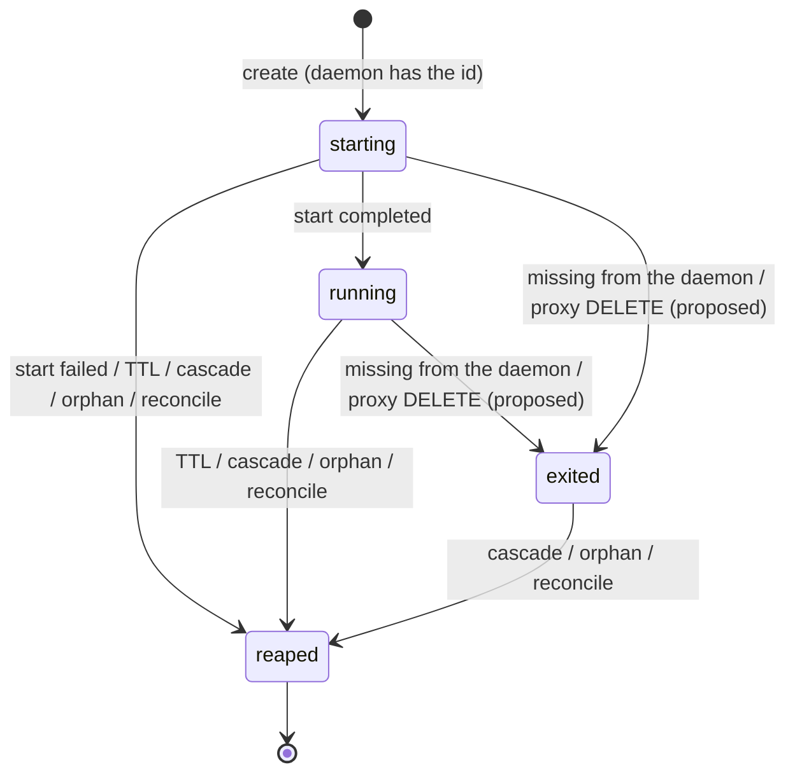
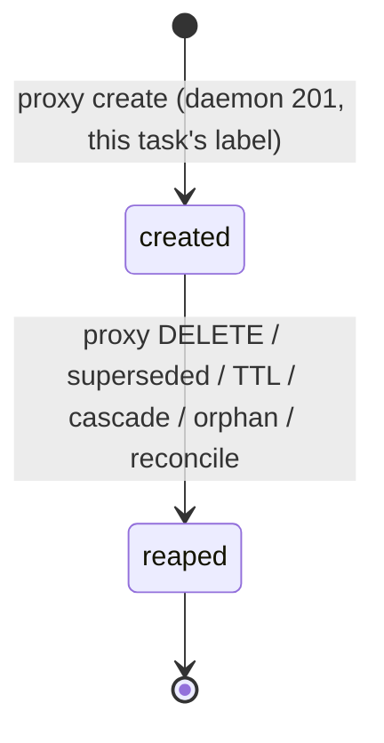

# Sandbox

Sandbox infrastructure. Any Cogmo feature needing isolated execution uses this module. Active consumers: coding-delegation tasks (worktree-bearing, long-lived, see [coding-delegation.md](coding-delegation.md)) and skills tier-2 (worktree-less, ephemeral Python subprocess workers, see [skills.md](skills.md)). Future consumers include untrusted MCP servers and one-off tool sandboxes.

## Purpose `[confirmed]`

Run arbitrary commands and downstream tooling in isolated environments. Two backend families share one abstraction:

- **Local-Docker** — task containers run directly against the host's Docker daemon, with a Cogmo proxy injecting policy at every container create. Userns boundary via sysbox. Suited to hosts that have Docker + sysbox installed.
- **Managed cloud** (Daytona) — task containers run in a third-party sandbox provider. Provider owns isolation and lifecycle; Cogmo drives via the provider's API.

Both paths offer:

- **Strong isolation by default** — userns on the local backend (sysbox), VM-class on managed backends.
- **One abstraction for downstream code** — the orchestrator, coding tool, and skills runner code against `SandboxClient` / `SandboxSession`, not against a specific provider.
- **Per-consumer images** — coding-delegation runs `cogmo/devbase` (with `claude-code` baked in); skills tier-2 runs `python:3.14-slim` (or a Cogmo-baked successor) by manifest. Image is per-session, not per-backend.

On the local backend, tooling that drives Docker, such as testcontainers and `docker compose`, spawns host-visible siblings through the Cogmo proxy. Until the proxy inserts child rows (Proxy Design → Authorization boundary `[proposed]`), the reaper kills those siblings within a minute. Image builds are not supported there. On managed backends it spawns provider-internal siblings, and the provider's sandbox boundary is the policy boundary.

A unified policy plane across both backend families is a non-goal. Policy lives where it can be enforced — Cogmo's Docker proxy on local, the provider's sandbox boundary on managed.

## Backend Architecture `[confirmed]`

### Two interfaces

`SandboxClient` is the factory — owns provider config, mints sessions, performs lifecycle operations. `SandboxSession` is the handle — owns one running task environment, exposes exec / file / git operations. The split mirrors the [OpenAI Agents SDK](https://github.com/openai/openai-agents-js/tree/main/packages/agents-core/src/sandbox) shape, which uses the same pattern to plug Daytona, E2B, Modal, Cloudflare Containers, etc. behind one abstraction.

```ts
interface SandboxClient<TState> {
  readonly backendId: string;
  readonly capabilities: SandboxCapabilities;

  /** Verify the backend is reachable + configured. Throws on misconfig. */
  healthCheck(): Promise<{ ok: true; runtime: string }>;

  /**
   * Boot-time reconciliation: kill any sessions tagged with a different
   * `cogmo.instance` than the current run. Runs once at startup; the
   * per-minute `reaper` keeps things tidy after that. No-op on managed
   * backends until they grow an orphan-reconcile pass of their own.
   */
  reconcileCrashedInstances(currentInstanceId: string): Promise<{ orphansReaped: number }>;

  /**
   * Ensure `image` is reachable from the backend (locally cached on
   * Local-Docker, registry-reachable on Daytona). Idempotent and cheap
   * when satisfied. Consumers call this before `create()` so the first
   * task doesn't pay an unbounded pull inside its own latency budget.
   */
  ensureImagePresent(image: string): Promise<void>;

  create(spec: SessionSpec): Promise<SandboxSession<TState>>;
  resume(state: TState): Promise<SandboxSession<TState>>;

  /**
   * Discover the live root session (depth-0 container created by the
   * orchestrator) for `taskId`, or null when none is currently alive.
   * Used in the orchestrator's get-or-create path after an idle TTL
   * where a prior session may or may not still exist.
   */
  tryResumeByTaskId(taskId: string): Promise<SandboxSession<TState> | null>;

  /** Tear down the session and its underlying sandbox (cascade). Idempotent. */
  delete(session: SandboxSession<TState>): Promise<void>;

  /**
   * Tear down every session whose state was created with the given
   * `taskId`, regardless of whether the orchestrator still holds a
   * handle. Used by failure cascades and the reaper. Idempotent.
   */
  deleteByTaskId(taskId: string): Promise<void>;

  serializeState(state: TState): Record<string, unknown>;
  deserializeState(payload: Record<string, unknown>): TState;

  /** Release backend-level resources (close docker connections, listeners). */
  shutdown(): Promise<void>;
}

interface SessionSpec {
  /** Logical task id — propagates to backend lineage tracking and labels. */
  taskId: string;
  /** Container image. The backend assumes `ensureImagePresent` has succeeded. */
  image: string;
  resourceLimits: ResourceLimits;
  /** When the session should be reaped if not torn down sooner. */
  expiresAt: Date;
  /**
   * Working-tree material to materialize at session start. Optional —
   * coding-delegation supplies it, skills tier-2 omits it because skill
   * workers don't run in a checkout. Backend resolves the field per its
   * `workingTreeTransport` capability (bind-mount on Local-Docker,
   * git-clone on Daytona).
   */
  worktree?: WorktreeSpec;
  /**
   * Persistent per-task scratch (Local-Docker named volume mounted at the
   * image's home dir). Optional — coding-delegation uses it to persist
   * the Claude Code CLI's session state across exec calls; skills tier-2
   * omits it because the `recycle` isolation contract forbids state
   * surviving the task. Daytona ignores this field — managed sandboxes
   * have provider-owned persistence.
   */
  homeVolume?: HomeVolumeSpec;
  askpass?: AskpassMaterial;
  /** Process env for the container (`CLAUDE_CODE_OAUTH_TOKEN`, …). Never host `process.env`. */
  env?: Record<string, string>;
  /**
   * `[proposed]` Whether the session gets a Docker API proxy socket
   * (Proxy Design → Which sessions get a socket). Required, so every
   * caller states it.
   */
  dockerSocket: boolean;
}

interface SandboxSession {
  readonly state: SandboxSessionState;

  exec(cmd: readonly string[], opts?: ExecOptions): Promise<ExecResult>;
  execStreaming(cmd: readonly string[], opts?: ExecOptions): Promise<ExecStreamingHandle>;

  read(path: string): Promise<ReadableStream<Uint8Array>>;
  write(path: string, data: ReadableStream<Uint8Array> | Uint8Array, opts?: WriteOptions): Promise<void>;

  cleanup(): Promise<void>;
}

/**
 * Buffered exec result. `stdout` / `stderr` are read fully into memory —
 * intended for short, bounded commands. Backends cap buffered output at
 * `SANDBOX_EXEC_BUFFER_LIMIT` (default 1 MiB per stream); when a command
 * exceeds the cap, `truncated` is set and the stream contents are clipped
 * to the cap. Consumers expecting larger output use `execStreaming`.
 */
type ExecResult = {
  stdout: string;
  stderr: string;
  exitCode: number;
  wallTimeSeconds: number;
  truncated: boolean;
};

/**
 * Streaming exec handle. `stdout` / `stderr` are demultiplexed Node
 * `Readable`s, per-chunk rather than per-line. They end when the exec
 * settles, and fail with the transport's error only when it breaks while
 * output is flowing; `exited` reports the outcome either way.
 *
 * `exited` settles once and never rejects. `wait()` is its throwing form:
 * the transport's own error, or an `ExecError` whose `failure` is the
 * `timed_out`, `disposed` or `no_exit_code` value `exited` carries.
 *
 * `dispose()` tears the exec down. Local-Docker stops the command's process
 * group (TERM, then KILL) from a second exec and closes the attach socket;
 * the Daytona PTY kills its process; a Daytona session command has its
 * session deleted. Idempotent. Resolves once every teardown it caused has
 * finished or given up.
 */
interface ExecStreamingHandle {
  stdin?: Writable;
  stdout: Readable;
  stderr: Readable;
  readonly exited: Promise<Result<{ exitCode: number }, ExecFailure>>;
  wait(): Promise<{ exitCode: number }>;
  dispose(): Promise<void>;
}

type ExecFailure =
  | { kind: "timed_out"; deadline: "total" | "idle"; timeoutMs: number }
  | { kind: "disposed" } // dispose(), or ExecOptions.signal aborted
  | { kind: "transport_failed"; error: Error }
  | { kind: "no_exit_code"; reason: string };
```

### Wall-clock and idle timeouts `[confirmed]`

Streaming-exec callers pass two independent timeouts on `ExecOptions`:

| Field | Triggers when |
|-|-|
| `timeoutMs` | total wall-clock since `execStreaming()` was called, start included |
| `idleTimeoutMs` | no stdout/stderr chunk for `idleTimeoutMs` once the command runs; restarted once more when the output ends, to bound fetching the exit code |

Both default off (no cap). Either settles the exec as `timed_out` at once and tears it down after (see Exec lifecycle below); a deadline that fires once the exec has settled does nothing. `ExecOptions.signal` is the caller's own cancellation: aborting it disposes the exec.

Why two, not one. The Daytona wedge incident (4-day stuck task, run id `01KRM7A886F293XVTJPVB9CZ91`) was a transient WS hang on `getSessionCommandLogs`: the underlying WebSocket held open silently, the daemon never sent close, and `await handle.wait()` blocked forever. A single total-deadline cap would have caught it, but the cap that fits one workload (e.g. `git checkout` 60s) is wrong for another (`claude -p` streaming for tens of minutes). Splitting into total + idle lets `claude` opt into "stream as long as you want, but never go silent for >N minutes" while keeping `git` calls bounded by their natural wall-clock. This is the same shape e2b ships ([e2b-dev/E2B #1128](https://github.com/e2b-dev/E2B/issues/1128) — streaming calls only honored connect timeout, not read), Modal exposes ([`Sandbox.create(timeout=..., idle_timeout=...)`](https://modal.com/docs/guide/timeouts)), and WebSocket best practice recommends as the "75% rule" — ping at 0.75× the shortest proxy idle. Daytona's own [#2510](https://github.com/daytonaio/daytona/issues/2510) describes the stream-doesn't-close bug; [#2513](https://github.com/daytonaio/daytona/issues/2513) the missing async completion API. Both are upstream limitations the timeout pair routes around.

Per-callsite defaults are owned by the caller, not the backend — see [coding-delegation.md → Per-callsite exec timeouts](coding-delegation.md#per-callsite-exec-timeouts-confirmed). Backends never inject a default; passing nothing means no cap (skills tier-2, and any caller that genuinely wants an unbounded exec).

### Exec lifecycle `[confirmed]`

Every backend runs its execs through one lifecycle: a pure transition table (`src/sandbox/exec-state.ts`, effects as data) driven by `runExec` (`src/sandbox/exec-run.ts`). A backend is an `ExecBackend` adapter with three operations: `start` (launch the command, deliver its output and the end or failure of its output stream), `fetchExit` (the exit code, or why there is none) and `teardown` (release what `start` acquired).

```
awaiting_stdin ─stdin_ended─► starting ─started─► running ─stream_ended─► draining ─exit_code─► settled
any live state ─ deadline · dispose · start_failed · stream_failed ─► settled
```

`awaiting_stdin` exists only for a backend that needs the caller's whole stdin before it can start (the Daytona PTY). `draining` fetches the exit code, and the PTY's stderr tmpfile with it.

- **Settlement never waits on teardown.** A deadline, `dispose()` or an aborted `signal` settles `exited` at once; teardown is an effect of settling, bounded by its own timeout. A transport that cannot be torn down (a `deleteSession` that fails, a WebSocket that never closes) leaves a logged failure, not a hung caller.
- **What a teardown stops.** Local-Docker: the Engine API has no exec kill, and closing the attach socket leaves the process running, so each command runs under a `sh` wrapper that records its process group, and teardown signals the group (TERM, then KILL) from a second exec. Daytona PTY: `kill()`. Daytona session: `deleteSession`, which the SDK does not document as stopping the command's processes.
- **The exit code is fetched before teardown,** which can erase it (Daytona's `getSessionCommand` 404s once the session is deleted). Local-Docker re-inspects until the daemon has reaped the exec, since its attach stream can end while `ExitCode` is still null, and reports `no_exit_code` if it never is.
- **Deadlines bound the whole exec,** start included: an upload, `createPty` or `sendInput` that never returns settles as `timed_out`. A start still in flight sees the settlement on its `AbortSignal` and stops before its next remote step; whatever it acquires late is torn down again.
- **The first settling event wins.** Output after settlement is dropped and restarts nothing; only output while `running` restarts the idle deadline. What the transport reports while the start is in flight is delivered after the start's own outcome, so the order never depends on microtask timing.
- **A failed teardown is retried** by the next `dispose()`, or by one that arrived while it ran, and changes no outcome. `dispose()` resolves once the teardowns it caused, retries and a late start's included, have finished or given up.

### Discriminated options and state

`SandboxClientOptions` and `SandboxSessionState` are discriminated unions keyed on `type: "local-docker" | "daytona" | …`. State is JSONB-storable per the project's `jsonbZod()` rule — a Daytona sandbox id or a Docker container id round-trips through Postgres so `resume(state)` can rejoin sessions that outlive the orchestrator process. `resume()` is the crash-recovery contract.

### Capability flags

```ts
interface SandboxCapabilities {
  siblingContainers: "host-proxy" | "sandbox-internal" | "unsupported";
  hostBindMount: boolean;
  customImage: boolean;
  volumes: "docker" | "managed" | "none";
  workingTreeTransport: "bind-mount" | "git-remote";
}
```

Hard transport differences (how working-tree material moves into the sandbox) live behind capability flags so the orchestrator can branch on transport without backend awareness. Soft policy differences (e.g. whether the Cogmo proxy logs every child container create) just don't fire on backends that lack them.

### Per-backend capability matrix

| Capability | Local-Docker | Daytona |
|-|-|-|
| `siblingContainers` | `host-proxy` | `sandbox-internal` |
| `hostBindMount` | `true` | `false` |
| `customImage` | local pull | registry pull |
| `volumes` | `docker` | `managed` |
| `workingTreeTransport` | `bind-mount` | `git-remote` |
| Userns isolation | sysbox (default) | provider-owned |
| Cogmo cgroup parent | yes | n/a |
| Cogmo Docker proxy | yes | n/a |
| `ensureImagePresent` | dockerode inspect + pull | `snapshot.get` + `snapshot.create` to ensure a named snapshot is ACTIVE; `create()` then references the snapshot |
| Buffered exec | dockerode | `executeCommand` |
| Streaming exec | dockerode demux | session-logs WebSocket + `stdbuf` |
| `resume(state)` | container-id inspect | sandbox-id rehydrate |
| Worktree-less sessions | yes (skills tier-2) | yes (skills tier-2) |

### Backend selection

Selected at deploy time via `SANDBOX_BACKEND` env var with values `local-docker` (default) or `daytona`. Switching backends is a config change; downstream code never references a backend by name. A single Cogmo deployment runs exactly one backend — selection is process-wide, not per-task.

## Local-Docker Backend

The local-Docker backend runs task containers as siblings on the host's Docker daemon, with a Cogmo-managed proxy injecting policy on every `POST /containers/create`. **Ubuntu 22.04 LTS or newer** is the supported deployment OS — sysbox ships first-class `.deb` packages for it and the kernel feature set is exercised widely there.

### Topology `[confirmed]`

Host daemon runs normally. Cogmo adds:

1. **Container supervisor** — creates task containers directly against the host daemon with `HostConfig.Runtime = "sysbox-runc"` by default.
2. **Docker API proxy** — per task container, Cogmo allocates a Unix socket at `${SANDBOX_PROXY_SOCKET_DIR}/<task-id>.sock` (default `/var/lib/cogmo/sockets/`, image-provisioned and chowned to the runtime user), mounted into the task container at `/var/run/docker.sock`.
3. **Sibling-container spawn model** — when the task container (or its tooling) calls the proxy to create a child, the child is a *sibling* on the host daemon, not a truly nested container. The parent relationship lives in Docker labels, and also in Cogmo's DB once the proxy inserts child rows (Proxy Design → Authorization boundary `[proposed]`). The proxy injects `HostConfig.Runtime = "sysbox-runc"` on children by default so every container in the tree is userns-isolated.

Topology 2 — nested `dockerd` inside the task container — is deferred. Only added if a specific use case requires a private daemon (rare for personal scale).

### Runtime Selection `[confirmed]`

**Default:** `sysbox-runc`. Selected via `SANDBOX_RUNTIME` env var with values `sysbox` (default) or `runc`. No silent fallback — if `SANDBOX_RUNTIME=sysbox` and the runtime isn't registered on the host, Cogmo refuses to start a task. Explicit configuration over magic.

**Per-task escape hatch:** `coding_tasks.allow_privileged_runc = true` drops back to plain `runc` for that task. Reserved for workloads that break under sysbox (direct device access, certain kernel caps). Expected usage: rare.

**Reason this is the default:** userns isolation is cheap insurance for Cogmo-edits-Cogmo scenarios. One-time install cost, consistent policy across every container in the tree. See [decisions.md](decisions.md) for the full comparison against pure-runc.

#### Dev machine

No parity. Coding delegation is a prod/staging feature — local `pnpm dev` does not start the sandbox module and does not need sysbox installed. Developers working on sandbox code run it against a local VM or a dedicated Ubuntu host. Unit tests use plain Docker with no runtime injection.

### Data Model `[confirmed]`

Owned by `src/sandbox/store/`.

```sql
-- Enumerated types (Drizzle pgEnum in the store schema)
CREATE TYPE container_runtime AS ENUM ('sysbox-runc', 'runc');
CREATE TYPE container_status  AS ENUM ('starting', 'running', 'exited', 'reaped');
CREATE TYPE container_reaped_reason AS ENUM ('ttl_expired', 'cascade', 'dead_instance', 'crash_reconcile', 'start_failed', 'unknown');

containers (
  id               UUID v7 PK,
  docker_id        TEXT NOT NULL UNIQUE,            -- Docker's container ID
  parent_id        UUID REFERENCES containers(id),  -- null = created by Cogmo directly
  root_task_id     UUID NOT NULL,                   -- denormalized, NO FK — not every container belongs to a coding task
  depth            INT NOT NULL,                    -- 0 = task container, 1+ = spawned by tooling
  image            TEXT NOT NULL,
  runtime          container_runtime NOT NULL,
  labels           JSONB NOT NULL,                  -- ContainerLabelsSchema = z.record(z.string(), z.string())
  resource_limits  JSONB NOT NULL,                  -- ResourceLimitsSchema = z.object({ cpus, memory_bytes, pids })
  status           container_status NOT NULL,
  reaped_reason    container_reaped_reason,         -- why the row is `reaped`; CHECK chk_containers_reaped_reason: (status = 'reaped') = (reaped_reason IS NOT NULL)
  ttl_expires_at   TIMESTAMPTZ NOT NULL,
  created_at       TIMESTAMPTZ NOT NULL DEFAULT now(),
  started_at       TIMESTAMPTZ,
  exited_at        TIMESTAMPTZ,
  instance_id      UUID NOT NULL                    -- references cogmo_instances.id
)
```

No exit code: Cogmo never observes one. A reap removes the container before anything inspects it, and a container the stale pass finds missing from the daemon took its exit code with it.

`networks` and `volumes` have the same lineage columns and a `created | reaped` status. They hold the objects the proxy creates for a task (Proxy Design → Authorization boundary `[proposed]`), and nothing inserts them until then. `[proposed]` Both tables gain `reaped_reason sandbox_object_reaped_reason` with a CHECK that ties it to the status, and `volumes.docker_id` trades its UNIQUE for a partial unique index on live rows (Network and volume state machine).

`parent_id` + `root_task_id` + `depth` computed at insert time from the parent row. No recursive CTE in the hot path.

```sql
cogmo_instances (
  id         UUID v7 PK,
  host       TEXT NOT NULL,
  pid        INT NOT NULL,
  started_at TIMESTAMPTZ NOT NULL DEFAULT now(),
  stopped_at TIMESTAMPTZ,                          -- null = open instance; set on graceful shutdown, or by the next boot's reconcile
  serve_instance_id UUID NOT NULL REFERENCES serve_instances(id)  -- [proposed] the serve process this sandbox instance belongs to
)
```

Row inserted in bootstrap before any sandbox operations; `stopped_at` set on graceful shutdown, or by the next boot's `reconcileCrashedInstances` once it has reaped the instance's containers (a crash leaves it NULL). Orphan detection joins `containers.instance_id → cogmo_instances.id` — any container tied to a row with non-null `stopped_at`, or a row that was never closed and whose pid no longer exists on the host, is an orphan.

`[proposed]` `serve_instance_id` ties the row to the `serve_instances` row the core boot stage inserts once per `cogmo serve` process ([skills.md → Data model](skills.md#data-model-confirmed)), whose database-generated id every per-process record keys on, so the sandbox stage mints no second process id. Its migration inserts one stopped `serve_instances` row and points every existing `cogmo_instances` row at it, which keeps the column NOT NULL from the start; a nullable column waiting on a backfill would need a second migration to tighten it.

The Daytona backend does not use these tables — its state lives in `SandboxSessionState` (provider sandbox id) and Daytona's own infrastructure.

### Label Schema `[confirmed]`

Every container Cogmo creates or proxies gets these Docker labels:

| Label | Value | Purpose |
|-|-|-|
| `cogmo.managed` | `"true"` | Identifies Cogmo-owned containers for orphan detection |
| `cogmo.instance` | `<run_id>` | Current Cogmo process's run id — on restart, anything with a different instance is an orphan |
| `cogmo.root_task` | `<task_id>` | Cascade scope — everything with the same value is reaped together when the task ends |
| `cogmo.parent` | `<docker_id>` | Parent container's Docker id (empty for root) |
| `cogmo.depth` | `<int>` | Depth in the tree |

Labels are the **mirror**; Cogmo DB is **authoritative**. Labels enable orphan detection via `docker ps --filter label=cogmo.managed=true` and survive Cogmo restarts for reconciliation.

### Proxy Design

The proxy lives in `src/sandbox/proxy/` and runs inside `cogmo serve` `[confirmed]`. Each task gets one Unix socket, `${SANDBOX_PROXY_SOCKET_DIR}/<task-id>.sock`, bind-mounted at `/var/run/docker.sock` into that task's depth-0 container and nowhere else. The socket a connection arrives on is the caller's identity, so there are no tokens. A shared `http.Server` parses every request, `router.ts` classifies it, and `policy.ts` rewrites a create body. Both are pure.

#### Enforced today `[confirmed]`

- `/swarm`, `/plugins`, `/nodes`, `/build`, `/session` and `/auth` are denied (403). The match runs after the path is percent-decoded and its dot-segments resolved.
- `POST /containers/create` is denied for `HostConfig.Privileged`, `NetworkMode: "host"`, a host-path `Binds` or `Mounts` bind source, and eight `CapAdd` capabilities (`policy.ts:37-148`). A create that passes has its `Runtime`, `CgroupParent` and the five Cogmo labels overwritten and is forwarded.
- Everything else is forwarded unchecked, under the raw `req.url` rather than the canonical path that was classified (`proxy/index.ts:270`, `:310`).
- Exec start, attach, `logs`, `events` and `distribution` are raw-piped from the moment the request line has been replayed, without waiting for the daemon's `101`.
- Every Local-Docker session gets a socket, skills tier-2 workers included.
- A child gets no `containers` row, so the orphan pass kills it within a minute (Container state machine → Failure modes). That includes the children testcontainers or `docker compose` start.
- The reaper's network and volume updates are unconditional (`reaper.ts:191`, `:213`).
- `unregisterTask` drops the task's scope before closing its connections (`proxy/index.ts:143`). A request that arrives meanwhile on an open connection gets a 500.

This is not an authorization boundary:

- A task can inspect, exec into, archive, kill or list any container on the daemon. A sibling task's container binds include that task's proxy socket, worktree and askpass directory (`supervisor.ts:252-259`).
- The create policy reads keys case-sensitively, so `hostconfig.privileged` passes. It strips a `CAP_` prefix case-sensitively before upper-casing (`policy.ts:139`), so `cap_sys_admin` becomes `CAP_SYS_ADMIN`, which is not in the deny set, and passes.
- Several escapes pass the create policy entirely:
  - `VolumesFrom` copies another container's binds, a sibling task's proxy socket included.
  - `NetworkMode` and `PidMode` of `container:<id>` join another container's namespaces.
  - `PidMode`, `IpcMode`, `UTSMode`, `UsernsMode` and `CgroupnsMode` of `host`, and `Devices`, `SecurityOpt` and `Sysctls`, are unchecked.
  - Any named volume mounts, another task's `cogmo-task-home-<task-id>` included, and `GET /volumes` lists those names.
- `/grpc`, BuildKit's gRPC endpoint, is missing from the deny list. It is blocked only because the daemon requires an upgrade there and the proxy's upgrade handler refuses routes it would forward.
- A pipelined request after a raw-piped one reaches the daemon unchecked.

The spec below replaces this.

#### Authorization boundary `[proposed]`

**Ownership.** A task owns the `containers` rows that carry its `root_task_id` and are not `reaped`: its depth-0 container, plus every child the proxy created for it (Child containers, below). The same rule covers `networks` and `volumes` rows in `created`. Ownership comes from the store on every request. Labels are only the mirror (Label Schema).

A ref in a path or body (a full id, a unique prefix or a name) is resolved through the daemon (`GET /containers/{ref}/json`, `/networks/{ref}`, `/volumes/{name}`), checked against the rows, and rewritten to the full id, so a rename between the check and the forward cannot redirect the request. The default `bridge` network is identified by its resolved id, not its name, because the testcontainers port forwarder passes the id.

Exec ids are kept in memory per task: the proxy records the id from each 201 to a `POST /containers/{id}/exec` sent through the task's socket. A task therefore cannot start or resize an exec that Cogmo created on its depth-0 container, even though inspect lists those ids. A process restart loses the set, which is harmless because the containers go with it (Crash Recovery).

**Caps and cost.** A task holds at most 16 live children (`containers` rows at depth ≥ 1 in `starting` or `running`), 8 networks and 8 volumes in `created`, each child within the task's resource limits. A create past a cap is `denied`. Each count is read before the forward, so two concurrent creates can land one over the cap, which is benign at single-user scale (store-pattern.md → admission caps). Each container, exec, network or volume request costs one daemon lookup and one store read. A list costs one store read. A create costs one insert. A container create also costs one image inspect, plus one `GET /version` when it names a `platform`.

**The forwarded request.** The proxy never forwards `req.url`. It forwards the canonical path it classified, with refs rewritten to full ids, plus the query, parsed and re-serialised.

- A version prefix below `v1.44` is `denied`. A request with no prefix goes to the daemon without one.
- `POST /containers/create` forwards the query keys `name` and `platform` and drops every other key. docker-modem copies every option into the query string as well as the body, so `Image=…&HostConfig=…` arrive as query keys; the daemon reads no create query key but those two.
- `POST /images/create` needs a non-empty `fromImage`, forwards `tag` and `platform`, denies `fromSrc`, `repo`, `message` and `changes`, and drops any other key.
- Other routes forward their parsed query. List `filters` pass through, because the responses are filtered anyway. A child `DELETE` always carries `v=true` (Lifecycle row).
- What reaches the daemon is the re-serialised value the checks ran on, never the client's bytes. A JSON integer above 2^53 therefore arrives rounded, which is harmless for every allowlisted field.
- A normal forward drops the hop-by-hop headers `Connection`, `Upgrade`, `Keep-Alive`, `TE`, `Trailer` and `Transfer-Encoding`, and Node re-frames the body.

**Outcomes other than a forward** form a sealed union, `ProxyRejection`, which the HTTP edge maps to a status once:

| Kind | Status | When |
|-|-|-|
| `not_found` | 404, in the daemon's wording for the object type (`No such container: <ref>`) | The ref is unknown, unowned or `reaped`, or a create names an image the daemon does not have (`No such image`). A ref to a sibling's or Cogmo's object gets the same answer as a missing one. Names still leak existence elsewhere (Residuals) |
| `denied` | 403, naming the route, query key or field | The route class, a query key, a body field or a cap is not allowed |
| `malformed` | 400 | The body is not a JSON object, a field fails its schema, a key holds a non-ASCII character or is `__proto__`, `constructor` or `prototype`, or two keys differ only in case |
| `too_large` | 413 | A body to be rewritten is over 1 MiB |
| `unavailable` | 503 | The store read or the daemon resolve failed, the scope has no depth-0 row yet, the scope is gone because the task is being torn down, or a volume 201 is labelled with this task but another instance (Network and volume state machine). The client may retry |
| `daemon_failed` | 502 | The daemon connection failed, or its create response could not be read |
| `record_failed` | 500 | The daemon created an object and inserting its row failed. The proxy tried to remove the object, except a volume (Network and volume policy). An object the proxy could not remove is left to the orphan pass |

**Route table.** Paths are matched after the version prefix is stripped and the path canonicalised. The first matching row wins, and a path no row matches is `denied`. Default-deny also covers routes the daemon adds later.

| Class | Routes | Outcome |
|-|-|-|
| Meta | `GET`/`HEAD /_ping`, `GET /version`, `GET /info` | forward |
| Create | `POST /containers/create` | create policy, forward, child row |
| Read | `GET /containers/{id}/json`, `/top`, `/logs`, `/stats`, `/changes`, `/export`; `GET`/`HEAD /containers/{id}/archive`; `POST /containers/{id}/wait`, `/resize` | owned, any depth |
| Write | `PUT /containers/{id}/archive` | Owned, depth ≥ 1 only. The depth-0 container's `/workspace` is a host bind, and the daemon extracts as host root with the tar's modes, so a write there could plant root-owned setuid files in the host worktree. testcontainers copies only into children |
| Lifecycle | `POST /containers/{id}/start`, `/stop`, `/restart`, `/kill`, `/pause`, `/unpause`, `/rename`; `DELETE /containers/{id}` | Owned, depth ≥ 1 only. The depth-0 container's lifecycle belongs to Cogmo (`denied`). `start` must have an empty body. `DELETE` denies the `link` query key and is forwarded with `v=true`. `start` and `DELETE` also update the child's row |
| Exec | `POST /containers/{id}/exec` (exec policy); `POST /exec/{id}/start`, `/resize`; `GET /exec/{id}/json` | Create needs an owned container, at any depth. The other three routes need an exec created through this task's socket |
| Attach | `POST /containers/{id}/attach`, `GET /containers/{id}/attach/ws` | owned, any depth |
| Lists | `GET /containers/json`, `/networks`, `/volumes` | Forwarded. The response keeps only owned objects, plus `bridge` in `/networks` |
| Events | `GET /events` | Forwarded. Each NDJSON line is dropped unless its `Actor.Attributes["cogmo.root_task"]` is the task's. Network and volume events carry no such attribute, so they are dropped too |
| Images | `GET /images/json`, `/images/{name}/json`, `/images/{name}/history`, `/distribution/{name}/json`; `POST /images/create` | Forwarded under the query policy above. Images are shared across tasks and hold no task state. A pull or distribution lookup whose registry host is `localhost`, a `*.localhost` name or an IP literal is `denied`, because otherwise the daemon would fetch from the host's loopback, which it trusts as an insecure registry by default, or from the LAN. IP literals are recognised in every form `inet_aton` accepts (`127.1`, `2130706433`, `0x7f.1`), and as bracketed IPv6 |
| Networks | `POST /networks/create` (network policy); `GET`/`DELETE /networks/{id}`; `POST /networks/{id}/connect`, `/disconnect` | The network must be owned, and connect or disconnect also needs an owned container. The body's `Container` ref is resolved and rewritten to its full id. A connect body may set `EndpointConfig.Aliases` only, and a disconnect body may set `Force`. On `bridge`, every task may use `GET`, plus connect and disconnect of an owned container: testcontainers reads the gateway there and attaches containers to its port forwarder. `DELETE` on `bridge` is `denied`. Every network object returned, by inspect or list, has its `Containers` map cut to owned containers |
| Volumes | `POST /volumes/create` (volume policy); `GET`/`DELETE /volumes/{name}` | owned |
| Denied | `/swarm`, `/nodes`, `/services`, `/tasks`, `/secrets`, `/configs`, `/plugins`, `/build`, `/session`, `/grpc`, `/auth`, `/commit`, `/system/df`; every `/{containers,images,networks,volumes,build}/prune`; `POST /containers/{id}/update`; `DELETE /images/{name}`; `/images/{name}/tag`, `/images/{name}/push`, `/images/{name}/get`; `/images/load`, `/images/get` | `denied` |

**Create policy.** The proxy builds a new body rather than patching the one it received:

1. The body is parsed, and every object that holds struct fields is checked against the key rules under `malformed`. Data-keyed maps are exempt, since their keys are data. The daemon decodes with Go's `encoding/json`, which matches field names case-insensitively, Unicode folding included (`ſ` matches `s`). Rejecting non-ASCII keys and keys that differ only in case leaves no key that could reach a field the proxy did not read.
2. Every struct field is read by its case-folded name and parsed through its own Zod schema. A number must be a JSON number, so `Memory: "1e12"` is `malformed`.
3. A struct field that is not on the allowlist is dropped if its value is zero, and `denied`, by name, otherwise. Zero means `null`, `false`, `0`, `""`, or a struct whose fields are all zero. The Docker CLI sends every `HostConfig` field, mostly as zeros. Unknown fields count too, so a field from a newer API version stays closed until it is listed.
4. An allowlisted field is kept exactly as sent, zero or not. Data-keyed maps keep every entry, empty values included: `ExposedPorts: {"5432/tcp": {}}`, `Volumes: {"/data": {}}`, `Tmpfs: {"/tmp": ""}`, and labels with empty values. An empty `Entrypoint: [""]`, which clears the image's entrypoint, is kept as well. The map-valued fields are `Labels`, `ExposedPorts`, `Volumes`, `HostConfig.Tmpfs`, `HostConfig.PortBindings` and `NetworkingConfig.EndpointsConfig`.
5. The output is a fresh object with only canonical field names, plus the injected values.

| Field | Rule |
|-|-|
| `Image` | Required. The proxy inspects it (`GET /images/{Image}/json`) and forwards the inspected `Id` in its place, so the image the checks ran on is the one the daemon runs, as refs are rewritten to ids elsewhere. An inspect 404 is answered directly as `not_found` (`No such image`), and the create is not forwarded. An empty `platform=` counts as absent. Any other `platform` is normalized as containerd does it (lower-case; arch aliases such as `x86_64` → `amd64` and `aarch64` → `arm64`; arm64's `v8` variant dropped) and compared with the daemon's own, read from `GET /version` (`Os`/`Arch`). Anything else, including any other variant, is `denied`, so the inspect and the create see the same image. The child row's `image` records the name the task asked for |
| `name`, `platform` | Dropped from the body. dockerode sends its options both as the query and as the body, and the proxy takes these two from the query only |
| `Cmd`, `Entrypoint`, `WorkingDir`, `User`, `Hostname`, `Domainname`, `ExposedPorts`, `Healthcheck`, `StopSignal`, `StopTimeout`, `Shell`, `Tty`, `OpenStdin`, `StdinOnce`, `AttachStdin`, `AttachStdout`, `AttachStderr`, `NetworkDisabled`, `Volumes` (anonymous) | allowed |
| `Env` | Allowed, except an entry whose name starts with `SYSBOX_` (in any case), which is `denied`: sysbox reads per-container configuration from those. Image `ENV` merges into the same OCI env, so the create is also `denied` if the inspected image's `Config.Env` has a `SYSBOX_` key |
| `Labels` | Allowed. Keys that start with `cogmo.`, in any case, are dropped and the Cogmo labels injected |
| `HostConfig.Memory`, `PidsLimit` | `null` or `0` is absent and set from the task's `ResourceLimits`. A negative value is `denied`, since the API reads it as unlimited (`PidsLimit: -1`), and so is a value above the task's limit |
| CPU: `HostConfig.NanoCpus`, or `CpuQuota` with `CpuPeriod` | One quantity in either form. With neither form present (`null` or `0`), `NanoCpus` is injected from the task's limit. With both forms, the request is `denied`, because the daemon refuses the pair. A negative `CpuQuota` (unlimited) is `denied`. CPUs are `NanoCpus / 1e9`, or `CpuQuota / CpuPeriod` with the daemon's default period of 100000 when `CpuPeriod` is absent, and above the task's limit they are `denied`. A `CpuPeriod` without `CpuQuota` is dropped |
| `HostConfig.MemoryReservation`, `MemorySwappiness`, `CpuShares`, `CpusetCpus`, `CpusetMems` | allowed |
| `HostConfig.ShmSize` | at most the effective `Memory` |
| `HostConfig.MemorySwap` | `null` or `0` (the CLI's default) is set to the effective `Memory`. Any other value must equal it, so `MemorySwap: -1` (unlimited swap) is `denied` |
| `HostConfig.OomScoreAdj` | ≥ 0 |
| `HostConfig.Ulimits` | `nofile` and `nproc` only |
| `HostConfig.CapAdd` | Docker's default set (`AUDIT_WRITE`, `CHOWN`, `DAC_OVERRIDE`, `FOWNER`, `FSETID`, `KILL`, `MKNOD`, `NET_BIND_SERVICE`, `NET_RAW`, `SETFCAP`, `SETGID`, `SETPCAP`, `SETUID`, `SYS_CHROOT`), plus `IPC_LOCK`, plus `SYS_NICE` when the task's runtime is `sysbox-runc`. Under `runc` (`allow_privileged_runc`), `SYS_NICE` is `denied`, because the real capability allows `SCHED_FIFO`, which the CFS quota does not throttle. Names are compared after upper-casing and stripping a leading `CAP_`. `ALL`, and anything else, is `denied` |
| `HostConfig.CapDrop`, `GroupAdd`, `Init`, `ReadonlyRootfs`, `AutoRemove`, `ExtraHosts`, `Dns`, `DnsOptions`, `DnsSearch`, `ConsoleSize` | allowed |
| `HostConfig.SecurityOpt` | `no-new-privileges`, `no-new-privileges:true` or `no-new-privileges=true` only |
| `HostConfig.RestartPolicy` | `Name` is `""`, `no` or `on-failure`. `MaximumRetryCount` is allowed |
| `HostConfig.IpcMode` | `""`, `private`, `none` or `shareable` |
| `HostConfig.CgroupnsMode` | `""` or `private` |
| `HostConfig.NetworkMode` | `""`, `default`, `bridge`, `none`, or an owned network, which is rewritten to its id |
| `NetworkingConfig.EndpointsConfig` | Keys must be `bridge` or owned networks, rewritten to ids. Each endpoint may set `Aliases` only |
| `HostConfig.PortBindings` | `HostPort` must be empty or `"0"`. `HostIp` is rewritten to the `bridge` network's gateway, so a published port is reachable from task containers and the host, and is not bound on the host's other interfaces |
| `HostConfig.Tmpfs`; `HostConfig.Mounts` with `Type: tmpfs` | allowed |
| `HostConfig.Binds`; `HostConfig.Mounts` with `Type: volume` | The source must be an owned volume, with no `VolumeOptions.DriverConfig`. A host path, an unowned volume or any other mount type is `denied` |
| `HostConfig.Runtime`, `CgroupParent` | overwritten from the scope |
| Every other field, including `Privileged`, `VolumesFrom`, `VolumeDriver`, `Devices`, `DeviceRequests`, `DeviceCgroupRules`, `PidMode`, `UTSMode`, `UsernsMode`, `Cgroup`, `Sysctls`, `MaskedPaths`, `ReadonlyPaths`, `Links`, `PublishAllPorts`, `OomKillDisable`, `LogConfig`, `StorageOpt`, `Annotations`, `MacAddress` and the `Blkio*`, `CpuRealtime*` and `KernelMemory*` families | `denied` when non-zero |

**Exec policy.** The body of `POST /containers/{id}/exec` is rebuilt the same way. Allowed: `Cmd` (required), `Env` (with the `SYSBOX_` rule), `WorkingDir`, `User`, `Tty`, `AttachStdin`, `AttachStdout`, `AttachStderr`, `DetachKeys` and `ConsoleSize`. `Privileged`, or any other field with a non-zero value, is `denied`.

**Network and volume policy.** Both bodies are rebuilt the same way as a create body. `CheckDuplicate`, which the daemon has ignored since API 1.44, is dropped.

- **Network create** accepts `Name`, `Labels` (handled as on a container create) and `Internal`. `Driver` must be `""` or `bridge`. `Options`, any `IPAM` other than the default, `EnableIPv6`, `Attachable`, `Ingress`, `ConfigOnly`, `ConfigFrom` and `Scope` are `denied`, because driver options and custom subnets reach host interfaces and routes.
- **Volume create** accepts `Name` and `Labels`. `Driver` must be `""` or `local`. `DriverOpts` is `denied`, because the local driver's `o=bind` is a host bind mount, and so is `ClusterVolumeSpec`. A `Name` that starts with `cogmo-`, in any case, is `denied`: Cogmo's own volumes (`cogmo-task-home-<task-id>`, the skills deps cache, `cogmo-cache-*`) use that prefix. The deps cache name is operator-configurable (`COGMO_SKILLS_DEPS_VOLUME`), so the configured name is also denied by exact match, whatever its prefix.
- **A volume create can return a volume that already existed.** The daemon's volume create is idempotent: an existing name returns 201 with the existing volume. So a 201 whose `Labels` lack this task's `cogmo.root_task` is someone else's volume. The proxy answers `denied`, inserts no row, and never removes it.
- **The rows** follow the Network and volume state machine (below). A failed network insert removes the network, because a network create always makes a new object. A failed volume insert removes nothing, because the 201 may name a volume the task already had. A rowless volume carrying this instance's label is left to the orphan pass.
- **Removal.** Every Cogmo removal of a container (reap, cascade, the create rollbacks) passes `v=true`, and so does a task's `DELETE` of a child. Anonymous volumes, from `Volumes` or an image's `VOLUME`, therefore go with their container. Those volumes carry no labels and get no row, so no cap counts them and the orphan pass never sees them (Residuals).

**Upgraded streams.** Only a request that Node surfaces as an `upgrade` is raw-piped, and only after the ownership check. Exec start and `/attach` must carry `Upgrade: tcp`, and `/attach/ws` must carry `Upgrade: websocket`. An upgrade on any other route, or with any other value, is `denied`.

The proxy writes the request line, the headers and the `Content-Length` body to a fresh daemon connection, because the daemon reads exec start's JSON body before it answers. An upgrade with a chunked body is `malformed`. Every byte after the body, from `head` or the socket, is held until the proxy reads the daemon's status line. A `101` opens both directions, and from then on the proxy pipes plain bytes without understanding the protocol inside. Any other status is relayed to the client and both connections end, so bytes sent as a pipelined request never reach the daemon as HTTP.

Every other route goes through `http.request` as a normal request, whose response streams: `logs` with `follow`, `events`, and exec start without `Upgrade`. The client connection stays under Node's parser, so a request pipelined after one of these is classified on its own.

**Child containers.** When the daemon answers 201 to a create, the proxy reads `Id` and inserts the child's `containers` row in `starting` before it answers the client. The row records the parent (the task's depth-0 row), depth 1, the task's `root_task_id`, `instance_id` and `ttl_expires_at`, and the effective `resource_limits`. If the insert fails, the proxy force-removes the container and answers `record_failed`. After that, `start` moves the row to `running` and `DELETE` moves it to `exited`, and the TTL, cascade, orphan and reconcile reaps apply as to any row (Container state machine). The use case lives in `src/sandbox/insert-child-container.ts`.

The create's daemon request and its insert are bound to neither the client's connection nor the task's abort signal. `unregisterTask` works in this order:

1. Drops the scope, so a request arriving on an open keep-alive connection gets `unavailable`.
2. Stops accepting connections.
3. Waits for in-flight creates, up to 30 seconds.
4. Aborts every connection, and any create still in flight with them.

A create cut off by step 4 leaves either a rowless container, which the orphan pass removes once the grace window has passed, or a row inserted after the cascade listed rows, which lives until its TTL (Container state machine → Failure modes).

`TaskScope` carries `resourceLimits` and `ttlExpiresAt`. Depth stays at 1: a child gets no socket, since host-path binds and `VolumesFrom` are denied, so it cannot create containers of its own.

**Which sessions get a socket.** `SessionSpec.dockerSocket: boolean` is required, so every caller states it. Coding delegation sets it to `true`. Skills tier-2 sets it to `false`, so a tier-2 skill's Python cannot reach the daemon.

**Residuals.**

- There is no aggregate cap. Each child may use up to the task's limits, so 16 children can hold 16 times the task's budget until slice-level enforcement is built (Hierarchical enforcement via cgroup parent, below). Nothing caps the images a task pulls or the disk they use.
- Networks draw from the daemon's address pools. With 8 per task, a handful of concurrent tasks can still exhaust a small default pool, and new networks then fail for everyone.
- A pull can move a shared local tag to the registry's current digest, under every task that uses that tag.
- `GET /info` exposes host details: kernel, CPU and memory, daemon configuration, registry mirrors and container counts.
- BuildKit stays denied (`/build`, `/session`, `/grpc`), so tasks cannot build images.
- Anonymous volumes are freed only when their container is removed. A child the task stops but keeps holds its anonymous volumes until the cascade or the TTL pass.
- Networks and volumes created through the proxy before slice 5 carry no Cogmo labels and have no rows, so nothing ever collects them.
- Names leak existence. A container or network create with a taken name gets the daemon's 409, which names the holder's id. A volume create of a foreign name gets `denied`. Neither grants access.
- The network layer is outside the proxy. Every depth-0 container, and every child on `bridge`, shares Docker's default bridge with other tasks and with skills workers, until skills workers move to an internal network whose only route is the egress proxy ([skills.md → Egress proxy](skills.md#egress-proxy-proposed)). They can reach each other's listening ports, and ports published on the gateway are reachable from every task. Per-task networks for depth-0 containers are tracked in `todo.md`.
- A registry name that resolves to a private address still reaches it on pull. A registry allowlist is tracked in `todo.md`.

**Rollout.** No consumer depends on a field or route this spec denies, so it ships with no enforcement flag.

- The Claude CLI makes no Docker API calls, and `cogmo-devbase` ships no docker CLI (`images/devbase/Dockerfile`). A Docker client has to come from the repo under work, which in practice means testcontainers-node over dockerode. Everything `dev/containers.ts` sends is allowed:
  - `name` (the port forwarder always sets one), `Env`, `Cmd`, and `ExposedPorts` with `PortBindings` (`HostPort: "0"`). dockerode sends these as both query and body, and the extra query keys are dropped;
  - user-defined networks with aliases (`/networks/create`, then `/networks/{id}/connect`);
  - `PUT /archive` for copied files;
  - waits on logs, exec and HTTP;
  - `GET /networks/bridge` for the gateway, and `exposeHostPort`'s connect to `bridge`.
- Ryuk needs a host-path bind of the socket, which is already denied, and optionally `Privileged`. Cogmo sets `TESTCONTAINERS_RYUK_DISABLED=true` in a coding session's env (`SessionSpec.env`), and the cascade does Ryuk's job.
- The skills tier-2 runner never opens the socket.
- No workflow relies on proxy-created children, which the orphan pass reaps (Enforced today).

**Test plan.** Unit tests in `src/sandbox/proxy/` run on `proxy.test.ts`'s fake daemon socket. Each asserts the status, and for a rejection that nothing reached the daemon.

- Create and exec policy:
  - one test per denied field set to a non-zero value, and the same field zero-valued passing;
  - case variants (`hostconfig`, `HOSTCONFIG.privileged`) are read;
  - duplicate case-folded keys, a non-ASCII key, a `__proto__` key and a string `Memory` are `malformed`;
  - a caller's `cogmo.*` labels are replaced;
  - a `SYSBOX_` env entry is denied;
  - every `CapAdd` value outside the allowlist, plus `ALL` and `cap_sys_admin`, is denied;
  - `SYS_NICE` is allowed under `sysbox-runc` and denied under `runc`;
  - each resource cap absent or `0` (injected), at the limit (allowed), negative (`denied`) and above the limit (`denied`);
  - `MemorySwap` absent or `0` (set to `Memory`), equal (allowed), and `-1` with `Memory: 0` (`denied`);
  - `CpuQuota` with and without `CpuPeriod`, `CpuPeriod` alone, `NanoCpus` with `CpuQuota` (`denied`), and `NanoCpus` injected only when neither form is present;
  - an image whose `Config.Env` has a `SYSBOX_` key is denied;
  - the `PortBindings` rewrite, and a fixed `HostPort`;
  - each `NetworkMode` form;
  - `ExposedPorts`, `Volumes`, `Tmpfs`, empty-valued labels and `Entrypoint: [""]` reach the daemon unchanged;
  - a body `name` is dropped and the query `name` forwarded;
  - on create, a query key other than `name` and `platform` is dropped, and on `/images/create` `fromSrc` is denied;
  - a recorded testcontainers-node create request, its duplicated query included, passes changed only by the injections, the dropped query keys and `Image` rewritten to the inspected id;
  - an image the daemon does not have gets `not_found` without a forward;
  - host platform forms (`Linux/x86_64` and `linux` on amd64, `linux/arm64/v8` on arm64) and an empty `platform=` are forwarded, and a non-host platform or variant is denied.
- Routes:
  - for each class, an owned ref is forwarded under its full id and canonical path;
  - a sibling task's id, Cogmo's own container and an unknown id all return the same 404;
  - a name and a prefix both resolve;
  - depth-0 lifecycle routes and a depth-0 `PUT /archive` are `denied`;
  - list responses omit siblings, `/events` drops their lines, and `GET /networks/bridge` lists only owned containers;
  - each Denied row, an unlisted path and a version prefix below `v1.44` are `denied`;
  - every registry-host form named in the Images row is denied;
  - while slices 2–4 are live, `DELETE /volumes/{name}` is denied, an owned container's connect and disconnect on `bridge` are forwarded, and every other connect or disconnect is denied;
  - a store failure returns 503, and a request during teardown returns `unavailable`.
- Streams:
  - a privileged create pipelined after `GET /logs` on the same connection is denied;
  - when the daemon answers an upgrade with 404, none of the client's following bytes are forwarded and both connections end;
  - an upgrade to an unowned exec returns 404;
  - exec start without `Upgrade` is handled as a normal request, with `Upgrade` and `Connection` stripped;
  - an exec start whose JSON body comes with `Upgrade: tcp` reaches the daemon whole, and the bytes after it wait for the `101`;
  - an upgrade with a chunked body, or with the wrong `Upgrade` value for its route, is rejected;
  - starting an exec this socket did not create returns 404.
- Child rows, with the store on PGlite:
  - a create yields a `starting` row with the scope's lineage;
  - a failed insert removes the container;
  - `start` moves the row to `running`, and `DELETE` to `exited`;
  - stopping and restarting a child leaves it running;
  - the 17th live child is denied;
  - a child `DELETE` and every Cogmo container removal (reap, cascade, create rollback) reach the daemon with `v=true`;
  - a teardown during an in-flight create still leaves a row for the cascade;
  - the orphan pass skips a fresh rowless container labelled with the live instance, and reaps it once the grace window has passed.
- Networks and volumes, with the store on PGlite:
  - a volume 201 that lacks this task's label is denied, inserts no row and removes nothing;
  - a `cogmo-` volume name is denied;
  - a reaped volume name can be created again;
  - every transition is a conditional UPDATE that returns `stale` on a second writer;
  - the 9th network and the 9th volume are denied;
  - a foreign live conflict-arm row is superseded and the new row inserted, and a 201 labelled with another instance is `unavailable` with no write;
  - two concurrent same-task creates of one name converge on one row: the loser's `ON CONFLICT` raises `40001`, and the transactor's retry lands on the conflict arm;
  - `reapVolume` supersedes without removing when the volume's labels do not match its row, transitions without removing on an inspect 404, and returns `in_use` on a 409;
  - the configured `COGMO_SKILLS_DEPS_VOLUME` name is denied even without the `cogmo-` prefix.
- One integration test in `supervisor.integration.test.ts` creates a child through a real task socket. It asserts that the next reaper tick leaves the child running and that the cascade removes it.

**Slices.** The spec ships in this order, one PR per slice, tracked in `todo.md`. As each slice lands, its part of "Enforced today" is removed and its part of this section becomes `[confirmed]`. Every route a slice does not touch keeps today's behaviour until a later slice does.

1. **Create and exec policy:** the create and exec policies, the create query policy, the `v1.44` version floor on the create and exec routes (the two bodies this slice parses against 1.44 semantics; slice 2 extends it to every route), Ryuk disabled in coding sessions, and the deny matrix. Until slice 5, named-volume mounts are denied outright, and `NetworkMode` and `EndpointsConfig` accept only `default`, `bridge` and `none`. The child cap needs rows, so it arrives with slice 3.
2. **Ownership:** container and exec ownership, depth-0 lifecycle and `PUT /archive` denies, container list and event filtering, the canonical forwarded request with the version floor and the hop-by-hop strip, `SessionSpec.dockerSocket`, and default-deny for every path outside the route table. Image, network and volume routes stay forwarded as today until slice 5, except `DELETE /volumes/{name}` and network connect and disconnect. From this slice on, connect and disconnect are allowed only for an owned container on `bridge`, which testcontainers' port forwarder needs, and every other connect or disconnect is `denied`, as is `DELETE /volumes/{name}`. Unchecked, they would let a task delete another task's volume, attach a sibling's container to its network, or detach one from `bridge`. Children still have no rows, so a task owns only its depth-0 container in the meantime.
3. **Child rows:** child rows, the child cap, the orphan pass's grace window, the teardown order, and `v=true` on every Cogmo container removal and on a task's child `DELETE`.
4. **Upgraded streams.**
5. **Images, networks and volumes:** the image query and registry-host rules, the network and volume policies with their caps, the Network and volume state machine and its migration, owned networks and volumes in the create policy, and the `bridge` inspect filter.

#### Builds `[confirmed]`

Builds are denied. The proxy could carry BuildKit's `Upgrade` to gRPC-over-HTTP/2 as plain bytes, but policy on build contents, such as which `FROM` registries are allowed or whether a `RUN` mounts host paths, would mean parsing the BuildKit gRPC session ([moby/buildkit](https://github.com/moby/buildkit), [`frontend/gateway/pb`](https://github.com/moby/buildkit/tree/master/frontend/gateway/pb)). That work is deferred until a task needs builds.

References: [buildkite/sockguard](https://github.com/buildkite/sockguard) (the ownership-label model and endpoint selection), [CpuID/dockerd-ci-proxy](https://github.com/CpuID/dockerd-ci-proxy) (label injection on create), [Tecnativa/docker-socket-proxy](https://github.com/Tecnativa/docker-socket-proxy) (endpoint categories to block).

### Reaper `[confirmed]`

Inngest cron, runs every minute (the cron floor). Three passes:

1. **TTL expired** — `WHERE ttl_expires_at < now() AND status IN ('starting','running')`. Kill post-order: children first (sort by `depth DESC`), then parent.
2. **Orphan detection** — `docker ps --filter label=cogmo.managed=true`. Anything present on the daemon but missing from the DB, or labelled with a dead `cogmo.instance`, gets killed. `[proposed]` A container that is labelled with a live instance and has no row is skipped while its daemon `Created` time is under 2 minutes old. That covers the gap between a create and its row insert, in both the supervisor and the proxy. A container labelled with a dead instance is reaped at once.
3. **Stale DB rows** — containers in DB with `status IN ('starting','running')` but missing from `docker ps` get marked exited with no exit code.

Root-task cascade (not on cron — triggered by task completion/failure): `WHERE root_task_id = $t AND status != 'reaped' ORDER BY depth DESC` → stop + remove.

Every status write is a conditional transition from the status the pass read (Container state machine below), so a row a cascade or an overlapping tick finished first is left as it is and not counted.

Networks and volumes have a TTL pass of their own, whose update is unconditional today. `[proposed]` Once the proxy inserts their rows, every pass and the cascade reap them through the conditional transitions in the Network and volume state machine, after the task's containers.

### Lifecycle `[confirmed]`

Task startup (`LocalDockerSandboxClient.create`):

1. The proxy registers `${SANDBOX_PROXY_SOCKET_DIR}/T.sock` with a placeholder scope (the task container's docker id is not known yet) so the container can mount it at `/var/run/docker.sock` from its first instant.
2. The daemon creates the task container: `HostConfig.Runtime`, labels, binds, cgroup parent. A failure releases the proxy registration.
3. A `containers` row is inserted with the daemon's `docker_id`, `status = 'starting'`. A failure force-removes the container and releases the registration before the error propagates.
4. The proxy scope is upserted with the row id and docker id, for ownership checks on `DELETE` etc.
5. The daemon starts the container and the row moves `starting → running`. A start failure reaps the container (`start_failed`).

Task teardown (`deleteByTaskId`):

1. Cascade reap of every row in the task scope that is not `reaped`, depth DESC (`cascade`).
2. Removes the socket's entry from the proxy's map.
3. Ends every connection made through the socket and its upstream leg to the daemon — hijacked streams (`logs -f`, `events`, attach) included, so teardown never waits on a running container.
4. Closes the socket's listener and removes the socket file.

`[proposed]` Once the proxy inserts child rows, teardown reverses steps 1 and 2. It runs `unregisterTask` first, in the order given under Proxy Design → Child containers: drop the scope, stop accepting, wait up to 30 seconds for in-flight creates only, then abort every connection. A child created during teardown therefore has its row before the cascade lists the task's rows. Streaming routes (`logs -f`, `/events`, attach, exec) are not waited for: new requests on them get `unavailable` once the scope is gone, and live streams end at the abort.

### Container state machine `[confirmed]`

**Unit.** One `containers` row, keyed by its `id`; `docker_id` is the daemon's name for the same object and is UNIQUE. Every status write is a conditional UPDATE on `id`.

**States** — the `container_status` pgEnum:

| State | Meaning |
|-|-|
| `starting` | Row inserted; the daemon has the container; `start` has not completed |
| `running` | `start` completed; `started_at` set |
| `exited` | The daemon no longer has the container, and Cogmo did not remove it (a task may have, through the proxy) |
| `reaped` | Cogmo killed and removed the daemon object; `reaped_reason` says why. Terminal |



| From | To | By (reason) | Guard | Writes |
|-|-|-|-|-|
| — | `starting` | `create` | `INSERT`; `docker_id` UNIQUE | row |
| `starting` | `running` | `create`, after `start` | `WHERE id = $1 AND status = 'starting'` | `started_at` |
| `starting` | `reaped` | `create` (`start_failed`), after kill + remove | `status <> 'reaped'` | `exited_at`, `reaped_reason` |
| `starting`, `running` | `reaped` | reaper TTL pass (`ttl_expired`) | `status <> 'reaped'` | `exited_at`, `reaped_reason` |
| `starting`, `running`, `exited` | `reaped` | `deleteByTaskId` (`cascade`) | `status <> 'reaped'` | `exited_at` (`coalesce`: kept when the row was `exited`), `reaped_reason` |
| `starting`, `running`, `exited` | `reaped` | reaper orphan pass (`dead_instance`), boot `reconcileCrashedInstances` (`crash_reconcile`), for a listed daemon object with a row | same | same |
| `starting`, `running` | `exited` | reaper stale pass | `status = <read status>` | `exited_at` |
| — | `starting` | `[proposed]` proxy create, after the daemon's 201 | `INSERT`; `docker_id` UNIQUE | row: parent = the task's depth-0 row, depth 1 |
| `starting` | `running` | `[proposed]` proxy `start`, after the daemon's 204 | `WHERE id = $1 AND status = 'starting'` | `started_at` |
| `starting`, `running` | `exited` | `[proposed]` proxy `DELETE`, after the daemon's 204: the task removed it, Cogmo only relayed. The row does not record which path wrote `exited`, because both mean the daemon object went without Cogmo removing it and nothing branches on the difference | `status = <read status>` | `exited_at` |

Every reap kills and removes the daemon object *before* the transition (Failure modes below), and its guard is `status <> 'reaped'` rather than the status the pass read: a reap is legal from every live state, and a row another path moved forward meanwhile (`create` committing `starting → running` while a cascade kills) must still land on `reaped` — the container is gone. **Illegal**, so the store's `ContainerTransition` type does not express them: anything out of `reaped`; `exited → running`; `running → starting`.

The transition is `SandboxStore.transitionContainerStatus(tx, { id, at } & ContainerTransition)` — `{ from, to }` for `running` and `exited`, `{ to: "reaped", reason }` for a reap — returning `{ kind: "transitioned" } | { kind: "stale"; status }`, the shape of `DrizzleCodingStore.transitionTaskStatus`; a missing row throws, since every caller holds a row it read and rows are never deleted. One use case per transition: `markContainerRunning` (`src/sandbox/mark-container-running.ts`), `markContainerExited` (`src/sandbox/mark-container-exited.ts`) and `reapContainer` (`src/sandbox/reap-container.ts`; `reapDiscoveredContainer` for a daemon object whose row may be missing). `stale` is an expected outcome, never an `Err`: another path finished the row first. A reap or the stale pass logs it at debug and does not count it; `markContainerRunning` logs it at warn, because `create` then removes the container it started and throws.

**Reason.** A reap carries its reason — `ttl_expired | cascade | dead_instance | crash_reconcile | start_failed`, the store's `ContainerReapReason` — and the transition's UPDATE writes it to `reaped_reason`, a nullable `container_reaped_reason` column that `chk_containers_reaped_reason` ties to the status (state-machines.md → "A failed or skipped state records why"). Nothing on a row reaped before the column existed records why, so the enum's sixth value, `unknown`, is theirs: the migration writes it, and `ContainerReapReason` excludes it so no reap can. A stale reap leaves the first writer's reason, as it leaves its `exited_at`.

**Failure modes.**

| Crash point or race | Row | Daemon | Why safe, or the residual |
|-|-|-|-|
| Daemon create succeeds, row insert fails | none | container | `create` force-removes it and releases the proxy scope. If the remove fails too, the orphan pass removes a labelled container with no row on its next tick (`[proposed]` once the grace window has passed) |
| Process dies between create and insert | none | container | Orphan pass: no row ⇒ orphan |
| A reaper tick lists the daemon while a live `create` is between `createContainer` and the row insert | none, yet | killed by the orphan pass | This is a residual, under the same rule as the proxy child. The insert then succeeds, `start` 404s, and the start-failure reap marks the row `reaped` (its kill and remove 404s are tolerated), so the `create-container` step fails and retries. The window is one DB round trip against a once-a-minute tick. `[proposed]` The orphan pass's grace window closes it |
| The `create-container` step retries after `create` threw | the failed attempt's, terminal or absent | removed by the failed attempt | The retry creates a new container and row for the same task; `tryResumeByTaskId` skips terminal rows. What a failed attempt could not remove follows its own row here (`start` throws; insert fails) |
| Process dies between insert and `running` | `starting` | created or running | A crashed instance keeps `stopped_at` NULL, so the reaper's orphan pass counts it live and its rows are never orphans. The next boot's `reconcileCrashedInstances` reaps every container labelled with an open prior instance, then closes those instance rows, so the orphan pass retries anything reconcile could not kill. `tryResumeByTaskId` resumes only a daemon container that reports `running` |
| `start` throws | `reaped` | removed | `start_failed`. Residual: if the kill + remove throws, the row stays `starting` over a stopped container, and the TTL pass reaps it at expiry |
| `starting → running` is `stale` | `reaped` or `exited` | removed by `create` | A TTL pass (short TTL) or a cascade reaped the row mid-start, or the stale pass found it missing. `create` kills and removes the container it started — no pass looks at a terminal row again — releases the proxy scope and throws. Residual: if the daemon refuses that kill, the container stays on the daemon under a terminal row and a live instance label, which the TTL, stale and orphan passes all skip until the instance row closes |
| A second live process shares the database | its rows | its containers | Invariant: one `cogmo serve` per database. Reconcile reaps every container labelled with an *open* instance other than its own and closes those rows, so a second live process — a CLI running the stage, or old and new processes overlapping on a deploy — loses its containers, and once its row is closed the orphan pass kills every container it creates on the next tick. A liveness check by host and pid is the follow-up (`todo.md`) |
| `deleteByTaskId` or a TTL pass reads a `starting` row, then `create` commits `starting → running` before the reap's transition | `reaped` | removed by the reap | The reap's guard is `status <> 'reaped'`, so it lands. Residual: `create` has already handed back a session over a removed container; the task's first exec fails with a 404 and the task fails rather than running on a removed container |
| `deleteByTaskId` and a reaper pass race on one row | `reaped` once | removed once; the second kill/remove sees 304/409/404, which both tolerate | The second transition is `stale`, logged at debug. `exited_at` is the first writer's |
| The daemon refuses a kill or remove (not 304/409/404) | unchanged | container | `killAndRemoveContainer` returns `DaemonError` and the row keeps its status. The reaper logs it, moves on, and retries next tick; reconcile logs it, moves on, and closes the instance row so the orphan pass retries each tick; `deleteByTaskId` rethrows it at the `SandboxClient` boundary |
| A reaper tick overlaps the next | as above | as above | Both read the same rows; the loser's transitions are `stale` and not counted, so counts are exact per row. `createSandboxReaper` sets no concurrency limit; overlap is safe by construction |
| Crash between kill + remove and the transition | `starting` / `running` | gone | A step or tick failing: the next tick's stale pass marks it `exited`, so the row over-reports a live container for at most one tick. Residual when the process itself dies: the row belongs to a dead instance, whose rows the TTL and stale passes never read, so it stays live-looking with no container. `tryResumeByTaskId` skips it on the inspect 404; nothing else reads it |
| Remove returns 409 (daemon removal in progress) | `reaped` | finishing removal | Self-heals as the daemon completes. Until then a `reaped` row with a live instance label is not an orphan and is left alone |
| Rows reaped before `reaped_reason` existed | `reaped`, reason `unknown` | gone | One migration, one transaction: the column, a backfill of `unknown` on reaped rows, the `exit_code` drop, then the CHECK, which validates every row. ADD COLUMN's ACCESS EXCLUSIVE lock holds off every other writer until commit, so nothing lands between the backfill and the CHECK; a failure rolls the file back whole |
| A process on the old build runs after the migration | its rows, unchanged | its containers | Every old-build container read and insert names `exit_code` and fails with `42703`, and a reap that reaches the UPDATE fails the CHECK after the kill + remove: the same live-looking row as "Crash between kill + remove and the transition"; see "A second live process shares the database". Because old-build queries name `exit_code`, a rollback to the previous build is not supported past this migration; observation.md sequences column drops a release later, and at single-user scale the simpler path is accepted |
| A coding task's teardown step is retried by the new build | `reaped` once | removed once | `deleteByTaskId` re-reads the task's rows and skips those already `reaped`; a row the old build touched is in one of the two states above and is reaped now if still live |
| `docker rm` outside Cogmo | `running` | gone | Stale pass → `exited` |
| `listContainers` fails in a tick | unchanged | unchanged | The stale pass is skipped: an empty listing is indistinguishable from "all gone" |
| Proxy-created child | none | container, labelled with the live instance | This is a residual. The proxy injects labels but writes no row, so the orphan pass treats the child as an orphan and kills it on its next tick. The rows below replace this one once child rows land (Proxy Design → Child containers) |
| `[proposed]` Proxy create: the daemon refuses | none | none | The response is relayed and nothing is inserted |
| `[proposed]` Proxy create: the daemon answers 201 and the row insert fails | none | container | The proxy force-removes the container and answers 500. If the remove fails too, the orphan pass removes the container once the grace window has passed |
| `[proposed]` Proxy create: the daemon's response is lost after it created the container | none | container | The proxy answers 502. The orphan pass removes the container once the grace window has passed |
| `[proposed]` Proxy create: the process dies between the 201 and the insert | none | container, labelled with the dying instance | The next boot's reconcile reaps it along with the instance's other containers |
| `[proposed]` A reaper tick lists a child between the 201 and the insert | none, yet | left alone | The grace window skips a rowless container labelled with the live instance that is under 2 minutes old |
| `[proposed]` Teardown races an in-flight proxy create that settles within the wait | `starting`, then `reaped` | removed by the cascade | `unregisterTask` waits up to 30 seconds for in-flight creates before the cascade lists rows. A create is bound to neither the client's connection nor the task's abort signal, so its insert lands even after the socket has closed |
| `[proposed]` An in-flight create outlives the 30-second wait | none, or `starting` after the cascade | container | Step 4 of `unregisterTask` aborts the create. If the daemon had not answered, the container, if one was made, is rowless, and the orphan pass removes it once the grace window has passed. If the insert commits after the cascade listed the task's rows, the row stays `starting` and the child lives until its TTL, when the TTL pass reaps it |
| `[proposed]` A request on an already-open keep-alive connection during teardown | unchanged | untouched | `unregisterTask` drops the scope first, so the request is answered `unavailable` and nothing is forwarded |
| `[proposed]` Proxy `start` is `stale` with status `running` | `running` | running | The child was stopped and started again. Its row left `starting` on the first start, so the proxy answers 204 and writes nothing |
| `[proposed]` Proxy `start` is `stale` with status `reaped` or `exited` | `reaped` / `exited` | removed by the proxy | A TTL pass or cascade reaped the row mid-start, or the stale pass found it missing. The proxy kills and removes the container the daemon just started and answers 404 |
| `[proposed]` Proxy `start` succeeds and its transition write fails | `starting` | running | The proxy answers 204. The row under-reports `running`, which is harmless because every reap covers `starting` |
| `[proposed]` Proxy `DELETE` succeeds and the `exited` write fails | `starting` / `running` | gone | The stale pass marks the row `exited` on its next tick |
| `[proposed]` A task names a sibling's container, or Cogmo's | unchanged | untouched | Nothing is forwarded, and the answer is the daemon's 404 for a missing container, so the existence of the target does not leak |
| `[proposed]` The ownership read fails | unchanged | untouched | The proxy answers 503 and forwards nothing (fail closed) |
| `[proposed]` A run is in flight across the deploy that enables enforcement | the old instance's rows, reaped | removed | A deploy restarts `cogmo serve`, and the old instance's containers are reaped, by reconcile or by the orphan pass once that instance's row is closed. A resumed task gets a new depth-0 container, so every container that talks to the new proxy was created by the new build. The old build wrote no child rows, so nothing needs backfilling. The grace window covers live-instance labels only, so old-instance children are reaped at once |
| `[proposed]` A task's tooling sends a field or route the allowlist rejects (Ryuk's socket bind, `--privileged`, a fixed host port, `docker build`) | none | none | The task gets a 403 naming the field or route. Its test run fails visibly, and nothing is created |

### Network and volume state machine `[proposed]`

**Unit.** One `networks` or `volumes` row, keyed by its `id`. `docker_id` is the daemon's name for the object: the network id, which is never reused, or the volume name, which can be. `networks.docker_id` stays UNIQUE. On `volumes`, a partial unique index on `docker_id WHERE status = 'created'` replaces the UNIQUE, so a reaped name such as compose's `<project>_data` can be created again.

**States**, the existing `network_status` and `volume_status` pgEnums:

| State | Meaning |
|-|-|
| `created` | The proxy inserted the row after the daemon's 201 |
| `reaped` | The daemon object is gone, and `reaped_reason` says why. Terminal |



**Reason.** `reaped_reason` is a nullable `sandbox_object_reaped_reason` column on both tables. Its values are `removed_by_task`, `ttl_expired`, `cascade`, `dead_instance`, `crash_reconcile`, `superseded` and `unknown`. A CHECK holds `(status = 'reaped') = (reaped_reason IS NOT NULL)`. `unknown` exists only for the migration, which backfills it on any row already `reaped` before it adds the CHECK. In slice 5's one migration file: the enum, both columns, the backfill, the CHECK, and the swap of the volumes UNIQUE for the partial index.

| From | To | By (reason) | Guard | Writes |
|-|-|-|-|-|
| — | `created` | proxy create, after a 201 carrying this task's `cogmo.root_task` | Network: `INSERT`. Volume: `INSERT … ON CONFLICT (docker_id) WHERE status = 'created' DO UPDATE` with a no-op SET, returning the live row (inngest.md). If the returned row has another `root_task_id` or `instance_id`, and the 201's labels name this task and this instance, it is superseded (next row) and the insert runs again in the same transaction. A 201 labelled with this task but another instance means the old object still exists, so the proxy answers `unavailable` and writes nothing | row: parent = the task's depth-0 row, depth 1, the task's TTL |
| `created` | `reaped` | proxy volume create (`superseded`): a 201 labelled with this task and this instance proves that this request created the object, so the old row's object is gone | `WHERE id = $1 AND status = 'created'` | `reaped_reason` |
| `created` | `reaped` | proxy `DELETE`, after the daemon's 204 (`removed_by_task`) | `WHERE id = $1 AND status = 'created'` | `reaped_reason` |
| `created` | `reaped` | reaper TTL pass (`ttl_expired`), cascade (`cascade`), orphan pass (`dead_instance`) and reconcile (`crash_reconcile`). Each runs after the daemon remove; for a volume, `reapVolume`'s inspect 404 stands in for the remove | `WHERE id = $1 AND status = 'created'` | `reaped_reason` |
| `created` | `reaped` | `reapVolume` (`superseded`), when the inspected volume's labels do not match the row: another task or instance holds the name now | `WHERE id = $1 AND status = 'created'` | `reaped_reason` |

`SandboxStore.transitionNetworkStatus` and `transitionVolumeStatus` replace the unconditional `updateNetworkStatus` and `updateVolumeStatus`. Each returns `{ kind: "transitioned" } | { kind: "stale"; status }`, and `stale` is not counted. One use case each: `reapNetwork`, `reapVolume`, and `insertOrSupersedeVolume` (`src/sandbox/insert-or-supersede-volume.ts`), which owns the conflict-arm branch. A `stale` from its supersede UPDATE is an invariant violation and throws, because the conflict arm holds the row's lock until the transaction ends. `reapVolume` inspects the volume first. On a 404 it transitions the row and removes nothing by name. When the `cogmo.root_task` and `cogmo.instance` labels match the row, it removes the volume and then transitions the row. On a mismatch it transitions the row to `superseded` without removing anything. It returns `{ kind: "reaped" } | { kind: "superseded" } | { kind: "stale"; status } | { kind: "in_use" }` (the remove's 409, retried next tick) as values, and a daemon refusal as `Err` (`daemon_failed`). The cascade reaps a task's networks and volumes after its containers. The orphan pass and reconcile list `cogmo.managed` networks and volumes as they do containers, grace window included. Once `volumes.docker_id` is no longer unique, every volume lookup by name (`getVolumeByDockerId`, and the orphan pass's "has a row" check) matches only `created` rows.

| Crash point or race | Row | Daemon | Why safe, or the residual |
|-|-|-|-|
| Volume 201 without this task's label (an existing volume) | none | untouched | The proxy answers `denied`, inserts nothing and removes nothing, so another task's volume and Cogmo's are never taken over |
| Two creates of one volume name in one task | one `created` row | one volume | The second insert lands on the conflict arm and returns the first row |
| Task A's `DELETE /volumes/foo` gets 204, then its `removed_by_task` write fails or the process dies; task B then creates `foo` | A's row `reaped` (`superseded`), B's row `created` | B's volume | B's 201 carries B's labels, so the conflict arm's row from A is superseded and B's row inserted. A pass that later reads A's row and inspects the volume finds B's labels, and supersedes the row without removing anything |
| A pass read A's `created` row before B's create | A's row `reaped` | B's volume untouched | An inspect before B's 201 gets a 404, so the row transitions and nothing is removed by name. An inspect after it sees B's labels, so the row is superseded. Residual: between an inspect that saw A's labels and the remove, someone else removes A's volume and another task recreates the name. The remove then takes the new volume unless it is already mounted (409), and the new owner's mount fails loudly rather than losing data silently |
| A task resumed on a new instance recreates a name whose old object still exists | the old row, unchanged | the old volume, untouched | The 201 returns the old volume, labelled with the dead instance, so the proxy answers `unavailable`. The orphan pass or reconcile then removes the dead instance's volume and transitions its row (`dead_instance` or `crash_reconcile`), so the client's retry creates a fresh volume and inserts with no conflict |
| A dead instance's `created` row whose object is gone | `created` | none | Residual. The TTL pass reads only its own instance's rows, and the orphan pass and reconcile start from daemon objects, so they never reach the row. Two paths do: the task's cascade, keyed on `root_task_id`, reaps it on a live instance (the remove's 404 counts as removed), and so does a later create of the same name, as `superseded`. Until one of them runs, the row counts against its task's 8-volume cap |
| Teardown races an in-flight network or volume create | as for containers | object | The 30-second wait in `unregisterTask` covers every create: container, network and volume. A create cut off by step 4 leaves a rowless object for the orphan pass, or a row the cascade missed, which the TTL pass reaps |
| Network 201, insert fails | none | network | The proxy removes the network and answers `record_failed`. If the remove fails, the orphan pass removes the network once the grace window has passed |
| Volume 201 with this task's label, insert fails | none | volume | The proxy answers `record_failed` and removes nothing. The orphan pass removes the rowless volume once the grace window has passed, and the daemon refuses with 409 while a container still mounts it, so the pass retries on a later tick |
| Process dies between the 201 and the insert | none | object, labelled with the dying instance | The next boot's reconcile removes it |
| The daemon refuses a remove (409: endpoints attached, volume in use) | `created` | object | Nothing transitions. The pass logs it and retries next tick. The cascade removes containers first, so their endpoints and mounts are gone by then |
| Crash between the remove and the transition | `created` | gone | The next pass's remove gets a 404, which counts as removed, and the transition lands. The reason may be `ttl_expired` or `cascade` where the task's `DELETE` did the removing, which nothing branches on |
| Two passes, or a pass and the proxy's `DELETE`, race | `reaped` once | removed once | The second transition is `stale` |
| A reaped volume's name is created again | a new `created` row | volume | The partial index admits it. The old row stays `reaped` |
| A run on the old build after the migration | its rows | its objects | The old build writes no network or volume rows. Its reaper's unconditional `status = 'reaped'` update would now fail the CHECK on a TTL-expired row, but the old build has no such rows to update |

### Crash Recovery `[confirmed]`

At boot, `reconcileCrashedInstances` runs in the background:

1. Bootstrap inserts this run's `cogmo_instances` row.
2. It lists the containers labelled `cogmo.managed=true`. Each one labelled with another open instance row in this database is killed and removed, and its row, if it has one, moves to `reaped` (`crash_reconcile`).
3. It closes those instance rows, so the orphan pass retries anything reconcile could not kill. A container from a gracefully stopped instance, whose row is already closed, is left to the orphan pass.

Networks and volumes are not reconciled. `[proposed]` Once the proxy inserts their rows, reconcile lists `cogmo.managed` networks and volumes as it does containers (Network and volume state machine). The proxy runs in the same process, so a proxy crash is a process crash and this pass covers it. An extracted proxy (Deployment Topology) would have to rebuild its socket map from the live depth-0 rows.

### Networks, Volumes, Images `[confirmed]`

**Networks and volumes** `[proposed]`: tracked like containers, with the same `root_task_id` cascade, once the proxy's network and volume routes insert their rows (Network and volume state machine). The common case is a `docker compose` that brings up services and a network, all reaped together when the task ends.

**Images:** shared across tasks, not reaped per task. Pulls are forwarded with no registry allowlist. `[proposed]` A separate GC job keyed on disk budget would prune dangling and untagged images and evict by LRU with a maximum age, every N minutes or when disk passes a threshold.

#### Cache volume scoping

Package-manager caches are scoped by **integrity story**, not by a blanket per-repo rule. Three classes:

| Cache | Scope | Volume naming | Rationale |
|-|-|-|-|
| npm store (`~/.npm/_cacache`), cargo registry (`~/.cargo/registry`), go modules (`~/go/pkg/mod`), apt (`/var/cache/apt/archives`) | **Global** | `cogmo-cache-<kind>` | Ecosystem enforces integrity on read — SHA-512 from lockfile (npm), `go.sum` (go), `Cargo.lock` (cargo), GPG signature (apt). A forged artifact fails the check and is re-downloaded. Sharing recovers hundreds of MB and speeds cold starts with no added attack surface beyond the sandbox boundary itself. |
| pip wheels (`~/.cache/pip`) | **Per-repo** | `cogmo-cache-<repo-id>-pip` | `requirements.txt` rarely pins hashes by default; pip won't verify wheel content unless `--require-hashes` is used. A compromised task could plant a wheel that a later task installs without verification. Per-repo contains the blast radius. |
| Build caches — Go build (`~/.cache/go-build`), Rust `target/`, Bazel output | **Per-repo** | `cogmo-cache-<repo-id>-<kind>` | No ecosystem integrity — output is content-addressed on inputs but unsigned. Sandbox-escape-to-cache-poison is a live threat class (Bazel RBE and Nix treat it seriously). Also: cross-repo hit rate is near zero because hash keys encode project-specific inputs. Nothing to gain from sharing, real risk from sharing. |
| Installed trees — `node_modules`, `.venv`, Rust `target/debug/` | **Never cached cross-task** | — | Per-project by nature; live inside the worktree. |

Global caches get an additional GC pass in the same disk-budget job as images — LRU eviction when disk > threshold. Per-repo caches live for the lifetime of the `coding_repos` row; removed when the repo is deregistered.

The attack surface this leaves is: a sandbox escape that reaches a shared cache volume. The download caches with integrity checks harmlessly reject the forgery. The remaining exposure (pip, build caches) is kept per-repo so a compromised task on repo A can't affect repo B even if the sandbox falls.

### Resource Accounting `[proposed]`

Per root task: cumulative CPU-seconds, memory-seconds, disk bytes written, network bytes. Polled from Docker stats API, aggregated across all containers sharing a `root_task_id`, written to `coding_tasks.resource_usage`. Accounting is observational — the numbers exist for budget reporting and post-hoc analysis, not for live enforcement (the cgroup parent below does the enforcement).

#### Hierarchical enforcement via cgroup parent `[confirmed]` (slice naming + assignment) / `[proposed]` (aggregate-budget enforcement)

Siblings in our topology are separate cgroups under the host root by default, so "children sum ≤ parent" is not automatic the way it is in nested-dockerd setups. We fix this by attaching every container in a root task to a shared cgroup parent — the kernel then hierarchically enforces the task's total budget regardless of how many children spawn or what each one requests.

**In place:** the slice naming + assignment infrastructure. Every container in a task tree (depth-0 task container + every proxy-created child) lands in the same systemd slice (`cogmo-task-<dashless-uuid>.slice`). Docker creates the slice on demand the first time a container references it; systemd auto-cleans the empty slice once all containers in it are removed. Per-leaf limits via Docker's `NanoCpus` / `Memory` / `PidsLimit` already cap the task container directly.

**Deferred:** aggregate-budget enforcement at the slice level. Setting CPU/memory/pids limits at the slice itself requires either Cogmo running as root (security regression) or systemd `Delegate=yes` on Cogmo's own unit + writing to `/sys/fs/cgroup/.../cpu.max` directly. The slice name is plumbed end-to-end so wiring delegated-slice limits later is a small follow-up. Trigger: when the spawn-many-children case becomes routine and a single child can steal the whole task budget.

Outcome of the deferred enforcement: the task's total budget would be a hard ceiling enforced by the kernel. Individual child limits become advisory — a child asking for 4 CPU when the task has 4 still works, it just competes with siblings via normal fair-share scheduling. No policy code in the proxy, no sum-of-sibling bookkeeping, no admission race conditions.

Matches how Kubernetes pod-level cgroups enforce pod resource limits under the hood. Requires cgroupv2 on the host — Ubuntu 22.04+ default, consistent with our deployment OS choice.

**Deployment target:** Linux + systemd. Cgroupfs fallback for non-systemd hosts is out of scope; document linux-with-systemd as the supported config.

### Deployment Topology `[proposed]`

**Single image, two subcommands.** `cogmo serve` runs the main orchestrator; `cogmo sandbox-proxy` runs the socket proxy. Same binary, same codebase, no duplicate artifacts. Both subcommands apply only when the local-Docker backend is selected.

#### In-process proxy

Default shipping configuration. `cogmo serve` boots the proxy as a module on its own event loop — no IPC, no separate service. Crashes in either part bring down the other, acceptable at personal scale because Cogmo restarts are rare and Inngest's durable resume handles task-state recovery across the outage window.

#### Extracted sidecar

Two processes sharing the image:

- `cogmo serve` — main orchestrator. No docker daemon access.
- `cogmo sandbox-proxy` — socket proxy. Holds `docker` group membership. Owns the proxy-socket directory (`${SANDBOX_PROXY_SOCKET_DIR}`).

Industry-standard separation (every reference proxy runs this way — see Reference Implementations below). Extracted when an in-process crash first disrupts a live task.

#### Control plane — tRPC

Main ↔ proxy communicate via a tRPC router in `src/sandbox/clients/local-docker/rpc/router.ts`. The router is the local-Docker supervisor projected over the wire — same shape, same domain schemas, just network-accessible. Zod procedures make it drift-proof via TS inference on both sides.

```ts
// abbreviated
export const sandboxRouter = t.router({
  createTaskContainer: t.procedure
    .input(TaskContainerSpecSchema)
    .output(TaskContainerHandleSchema)
    .mutation(({ input }) => supervisor.createTaskContainer(input)),
  stopTask: t.procedure
    .input(z.object({ taskId: z.string() }))
    .mutation(({ input }) => supervisor.stopTask(input.taskId)),
  listContainersForTask: t.procedure
    .input(z.object({ taskId: z.string() }))
    .output(z.array(ContainerRowSchema))
    .query(({ input }) => store.listContainersForTask(input.taskId)),
});
export type SandboxRouter = typeof sandboxRouter;
```

All `containers` / `networks` / `volumes` *state* continues to flow through PostgreSQL; the router is for lifecycle operations that need a synchronous ack.

#### Transport — deployer's choice

Configured via environment:

| `SANDBOX_PROXY_LISTEN` | Use case | Auth |
|-|-|-|
| `unix:///var/lib/cogmo/sandbox.sock` | Single host, systemd or Compose with shared bind-mount (default) | Filesystem perms |
| `tcp://127.0.0.1:<port>` | Single host, no shared filesystem | Loopback-only, implicit trust |
| `tcp://<bind>:<port>` | Split hosts (proxy colocated with docker daemon, main elsewhere) | Deployer supplies mTLS or an authenticating reverse proxy; Cogmo does not mint credentials |

tRPC's HTTP client accepts a custom `fetch`, so the Unix-socket case is wired via undici's `Agent({ socketPath })`. No code difference between transports beyond the URL.

## Daytona Backend `[confirmed]`

The Daytona backend runs task sandboxes on Daytona's managed cloud (default) or self-hosted Daytona instance. Daytona owns sandbox isolation and lifecycle. Cogmo drives via the [Daytona TypeScript SDK](https://www.daytona.io/docs/typescript-sdk/daytona/).

**Two phases shipped:** Phase 3a (PR #173) lifted skills tier-2 onto Daytona — worktree-less, ephemeral, ephemeral askpass-less. Phase 3b (PRs #183 / #192 / #196) wired coding-delegation through the `git-remote` working-tree transport: orchestrator force-pushes a `cogmo/run/<task-id>` ref, the SDK's `git.clone` rehydrates it inside the sandbox, askpass material is uploaded via `fs.uploadFiles`. Both flows share the same `SandboxClient` interface; consumers branch on `capabilities.workingTreeTransport`.

Production-ready for the coding-delegation `git-remote` flow against a single user's traffic. Skills tier-2 tasks do not run here: their supervisor needs a stdin that streams, which the PTY path buffers until it ends (see [skills.md → Warm pool](skills.md#warm-pool-confirmed)). Subsections that need real-traffic validation before they graduate to fully-trusted status carry their own `[proposed]` markers below — `Streaming exec` and `Keepalive` specifically.

### Authentication & deployment

API-key auth. The key is stored as `daytona_api_key` in the encrypted `secrets` table per [infrastructure.md](infrastructure.md) → Secrets — the same path LLM provider keys, channel tokens, and the GitHub PAT take. The setup wizard prompts for it on first run; non-interactive bootstrap accepts a `COGMO_DAYTONA_API_KEY` (with `_FILE` variant) which is migrated into the secrets table on first boot and not consulted thereafter.

Base URL is configuration, not credential — `DaytonaSandboxClientOptions.apiUrl` carries the value (`undefined` = Daytona Cloud), populated at startup. Override via `DAYTONA_API_URL` env. The choice is deployment-time; Cogmo doesn't switch between cloud and self-hosted at runtime.

`DaytonaSandboxClientOptions.organizationId` is similarly deployment-time — populated from `DAYTONA_ORGANIZATION_ID` env. Required when the API key has multi-org access; Daytona returns 403 on `list({}, 1, 1)` if the org isn't pinned.

#### Keepalive `[proposed]`

Daytona's default `autoStopInterval` reaps idle sandboxes after 15 minutes. Coding tasks stream model output for tens of minutes with arbitrary inter-token latency, which Daytona reads as "idle." The client starts a `refreshActivity()` ticker per live sandbox, firing every 5 minutes, to reset the auto-stop countdown. The ticker stops on `delete(session)` / `deleteByTaskId(taskId)` / `shutdown()`. `setInterval` handles are `unref()`'d so the Node process can exit cleanly when nothing else holds the loop open.

### Working-tree transport — git as transport

Applies only when `SessionSpec.worktree` is set — i.e. coding-delegation tasks. Skills tier-2 sessions omit `worktree` and skip the git ceremony entirely (`create()` → `exec()` → `delete()`).

Working-tree material moves between orchestrator and sandbox via an ephemeral branch on the repo's GitHub remote. This matches the published pattern of remote AI-agent-sandbox products that need to push state into a managed VM: Codex Cloud and Devin both clone task state into their sandbox via git, and Daytona ships `sandbox.git.clone()` and `sandbox.git.push()` as first-class SDK methods — signalling the same expected flow. Local-IDE products (Cursor edits a checkout in place; Codespaces clones for the user's IDE) operate on a different axis and aren't precedent for the orchestrator-pushes-state direction.

Per-task lifecycle (worktree-bearing sessions):

1. Orchestrator pushes the local worktree to `cogmo/run/<task-id>` on the repo's configured GitHub remote.
2. Sandbox `sandbox.git.clone(remoteUrl, /workspace, branch=cogmo/run/<task-id>, ...)` using the per-task PAT material slice 4 already provisions.
3. Claude Code commits inside the sandbox.
4. Sandbox `sandbox.git.push(...)` back to the same temp branch.
5. Orchestrator `git fetch`es the branch into its local mirror; downstream slice-4 verify+PR-open code consumes the result branch.
6. Cleanup: temp branch deleted on task teardown (success or failure).

Why git: native delta compression on push/fetch (matters for repos > 100MB), no inbound network requirement (managed sandboxes don't accept inbound ssh — rules out rsync), no bespoke tar/upload code, and slice 4 already pushes a result branch — the Daytona path adds the start-state push, nothing else.

#### Orphan branch cleanup `[confirmed]`

Cleanup follows the **hybrid event-driven primary + cron safety-net** pattern dominant across Renovate, Dependabot, GitHub-native, and the off-the-shelf stale-branch-action ecosystem. Two Inngest functions, both in `src/agent/coding/`:

1. **Event-driven primary** (`cleanup-run-branch.ts`). Subscribes to `coding/task/pr-opened` and `coding/task/failed` (idempotency keyed on the event name and `event.data.taskId`, so duplicate fires of one event for the same task collapse to one execution). On `failed` it keeps the branch, the only copy of a failed git-remote task's work ([coding-delegation.md → Failed-run branch retention](coding-delegation.md#failed-run-branch-retention-confirmed)); on `pr-opened` it resolves the GitHub identity, derives `ref = heads/${runBranchFor(taskId)}`, calls `octokit.git.deleteRef`. Default Inngest retries (3) handle transient 5xx and secondary rate-limit; 404 + 422 are swallowed (already-deleted is idempotent success); 409 (protected branch) and other statuses propagate. Identity is loaded inline (NOT inside `step.run`) so the PAT + SSH private key never become a step return value — Inngest persists step returns into its state store, and we don't want credentials there. This catches 99% of cases immediately.

2. **Weekly cron safety-net** (`cleanup-orphan-run-branches.ts`). Cron `0 4 * * 0` — Sunday 04:00 UTC, `retries: 2` so a transient list-repos / sendEvent failure doesn't lose the entire week's sweep. Lists managed coding repos, fans out via `step.sendEvent` (one `coding/run-branch-sweep/repo` event per repo) to a per-repo handler with its own retry lane and `concurrency: { limit: 2 }` to bound GitHub-token pressure. The per-repo handler walks `cogmo/run/*` refs via `octokit.paginate(octokit.git.listMatchingRefs, ...)` (so >100-ref repos still get fully swept), batch-loads the matching `coding_tasks` rows via `getTasksByIds`, and force-deletes refs whose task is **(terminal AND its retention clock — `plan_approved_at`, else `created_at` — is >7 days old) OR has no row at all**. Non-terminal tasks are never swept regardless of age — stuck approvals belong to the user. Per-delete failures `continue` the loop with an `errors++` counter so one bad ref doesn't block the rest of the week's sweep.

The 7-day retention applies only to the cron's stale criterion. The event-driven path deletes immediately on `pr-opened`; a failed task's branch waits out the retention so the user can fetch the work. New events introduced for this design: `coding/task/failed` (emits from every failure path in plan + execute + verify), `coding/run-branch-sweep/repo` (cron fan-out).

The slice-4 PR namespace `cogmo/<idShort>` (different namespace from `cogmo/run/*`) stays untouched until the user merges/closes — GitHub's repo-level `delete_branch_on_merge` setting handles those for free. The cron's prefix filter `heads/cogmo/run/` matches only the run-branch namespace, so PR branches are out of scope by construction.

### Streaming exec `[confirmed]`

Two backends share the `ExecStreamingHandle` contract, selected per call by `opts.attachStdin`. Output-only execs (`attachStdin: false` or omitted) take the **session-logs WebSocket** path; execs that need real stdin (`attachStdin: true`) take the **PTY** path. Downstream code stays backend-agnostic — both are `ExecBackend` adapters on the shared [Exec lifecycle](#exec-lifecycle-confirmed).

**Output-only (session-logs WS, `exec-streaming.ts`).** `executeSessionCommand({ runAsync: true })` returns a command id, then `getSessionCommandLogs(sessionId, commandId, onStdout, onStderr)` opens a WS with separated stdout/stderr callbacks. This is the right path for pure-output commands because (a) the WS provides demuxed streams, matching the local-Docker dockerode shape downstream code depends on, and (b) session commands are cheaper than PTY sessions.

**Stdin-attached (PTY, `exec-pty.ts`).** Daytona's session-command stdin (`sendSessionCommandInput` over HTTP) has no remote-EOF channel: for `runAsync: true` the daemon pins the FIFO open with a long-running `sleep`, so any caller that relies on stdin EOF as a shutdown signal (e.g. `claude --input-format stream-json`) wedges. `createPty()` exposes a real bidirectional WebSocket with `kill()` and `disconnect()` RPCs; the wrapper:

- Buffers caller writes on the returned `Writable`; on `.end()`, uploads the payload to a tmpfile under `/tmp/cogmo-pty-stdin-<uuid>.bin` via `fs.uploadFile` and creates the PTY session.
- Sends one shell line into the PTY: `exec bash --norc --noprofile -c 'cat <stdinPath> | exec <argv> 2> <stderrPath>'`. The outer `bash --norc --noprofile -c` swap replaces Daytona's default interactive shell atomically with a non-interactive bash — no readline, no `PROMPT_COMMAND`, so the OSC title / mode-reset chain bash normally emits when transitioning out of interactive mode doesn't pollute stdout. The inner `cat <stdinPath> | exec <argv>` pipes stdin: claude 2.1.138 silently exits 0 with no output when stream-json input arrives via a regular file FD (`cmd < file`), so the `cat | exec` pattern hands the CLI a real pipe FD whose EOF arrives when `cat` drains. `exec` replaces the inner bash with the target binary so PTY exit = target binary exit, no marker parsing.
- Sets `NO_COLOR=1` in the PTY's env block to suppress ANSI escapes on stdout (PTY's stdout is still a TTY for the child).
- Redirects child stderr to `/tmp/cogmo-pty-stderr-<uuid>.log` so the PTY's combined onData channel carries clean stdout JSONL; the wrapper downloads + emits the stderr file via the stderr `Readable` after the PTY exits.
- On teardown, kills the PTY unless it reported an exit code, disconnects, and deletes both tmpfiles via `fs.deleteFile` (best-effort; sandbox teardown sweeps `/tmp` anyway).
- Registers `PtyHandle.wait()` as soon as the PTY exists. In `@daytona/sdk` 0.214 it settles on the `exited` control frame or on the WS closing: a normal close (1000) with no parseable reason reads as exit 0; an abnormal close (1006) resolves it with no exit code, which the exec reports as `no_exit_code` and still kills the PTY, since the remote command may run on; and a `wait()` first called after such a close never settles. `kill()` sets no exit code either, and one that 404s finds the PTY gone.

WS reality the wrapper hides:

- **Callbacks are per-chunk, not per-line.** Consumers wanting lines do their own splitter (`split2` etc.) on the returned `Readable`.
- **Exit code arrives separately.** The WS closes when the command exits; the wrapper then fetches `getSessionCommand(sessionId, commandId)` to read the exit code, before deleting the session, after which it 404s.
- **No per-command kill.** `dispose()` calls `deleteSession(sessionId)`. So that it touches no other command, the wrapper allocates **one Daytona session per `execStreaming()` call**.
- **No WS heartbeat.** The wrapper relies on the client's per-sandbox `refreshActivity()` ticker (see Authentication & deployment) to keep the sandbox alive across long execs.
- **Command completion fires on the session shell's exit.** Daytona detects "the command finished" by the session's bash process exiting; it doesn't poll the target binary directly. `buildShellCommand` therefore invokes the argv as a normal child of bash (`cd <wd> && env K=V <argv>`) — never via bash's `exec` builtin, which would replace the shell process and prevent the completion event from firing. Daytona [#2513](https://github.com/daytonaio/daytona/issues/2513) tracks the missing async-exit notification; running the target as a shell child gives the shell a clean exit to report.
- **WS close is the only completion signal, and it isn't reliable.** Daytona [#2513](https://github.com/daytonaio/daytona/issues/2513) calls this out explicitly — there is no promise-based exit notification today; the WS closing is what tells the wrapper the command finished. Daytona [#2510](https://github.com/daytonaio/daytona/issues/2510) shows the WS sometimes fails to close. The total + idle timeout pair on `ExecOptions` (see [Wall-clock and idle timeouts](#wall-clock-and-idle-timeouts-confirmed) above) is the upper bound: a deadline settles the exec as `timed_out` without waiting for the WS, then tears it down with `deleteSession` (Daytona [#2510](https://github.com/daytonaio/daytona/issues/2510)'s recommended explicit-cleanup path). A `deleteSession` that fails leaves the WS open and is logged; it never holds the exec.

`claude` is wrapped by `stdbuf -oL -eL` inside the sandbox to defeat its block-buffering bug ([anthropics/claude-code#25670](https://github.com/anthropics/claude-code/issues/25670)). `stdbuf` is in coreutils on every reasonable base image. If a future image lacks it, fall back to `script -qfc 'claude …' /dev/null`.

Fallback if the WS proves flaky on a long task: HTTP-poll the same logs endpoint with a byte offset (~1s latency, AWS-SSM/CloudWatch pattern). Gated behind a feature flag, not a hot-swap.

### Custom image

The image declared in `SessionSpec.image` is referenced via Daytona's `Image.base("registry/path:tag")` — no Dockerfile rebuild on Daytona's side. Cogmo-owned images (`cogmo/devbase` for coding-delegation) are published to a registry Daytona can pull from (Docker Hub or GHCR); third-party images (e.g. `python:3.14-slim` for skills tier-2) come straight from their published location.

**Initially public-registry only.** The Daytona TS SDK does not expose a private-registry-credential API; private registries are added via the Daytona Dashboard → Registries panel before referencing the image. Cogmo-owned images publish to a public namespace (GHCR public) until that gap closes upstream or a deployer explicitly opts into the dashboard flow.

### Snapshot prewarm `[confirmed]`

Daytona's `daytona.create({ image })` lazy-pulls and snapshots the image on first use. The pull-and-build can take 5–15 minutes for a fresh cogmo-devbase tag, but the SDK's `waitUntilStarted` caps at a 60-second default — so the first coding-delegation task after any cogmo version bump times out before the snapshot is ready, and concurrent retries each kick off their own duplicate build server-side.

`DaytonaSandboxClient` pre-bakes a named snapshot via `daytona.snapshot.create({ name, image })` so subsequent `daytona.create({ snapshot: name })` calls hit Daytona's runner cache (~1 s provisioning). Mechanism:

- `ensureImagePresent(image)` derives a stable snapshot name from the image string (`ghcr.io/iskhakovt/cogmo-devbase:1.66.0` → `cogmo-cogmo-devbase-1.66.0`). `snapshot.get(name)` first; if `ACTIVE`, done. If `BUILDING`/`PENDING`/`PULLING` (race with another instance), poll until terminal. If `ERROR`/`BUILD_FAILED`/`INACTIVE`/`REMOVING`, fire-and-forget the stale row's delete and rebuild under a fresh `<base>-r-<hex>` name. If 404, build under the derived name. `snapshot.create()` blocks until terminal — the SDK polls server-side state internally; Cogmo wraps the call in a tight retry envelope that fires only on the Daytona-side internal-registry race signature (`repository … not found`), so persistent failures (Dockerfile errors, auth, validation) surface immediately.
- **Rebuild-under-fresh-name** sidesteps the async `REMOVING` race: Daytona's `snapshot.delete` returns 2xx immediately but the row drains in the background, and a follow-up `snapshot.create` against the same name 409s while the row is in `REMOVING`. The rebuild uses 32 bits of fresh entropy on the suffix, so the warm path doesn't wait for the stale row's cleanup. Daytona's own reaper eventually disposes of the orphan; if it doesn't, the per-version snapshot GC sweep (deferred, see below) backstops it.
- **409 recovery on first build** covers a separate race: Daytona's `snapshot.create` occasionally leaks a stub row when its internal retry re-attempts the same name after a transient `repository … not found` failure — attempt 0 fails before commit, attempt 1 then 409s on the conflict. Both `ensureImagePresent` and the lazy task-path `create()` go through a single `#buildWithConflictRecovery` helper that catches `DaytonaConflictError` once and rebuilds under `<name>-r-<hex>`. The same path also makes the concurrent-warmer race benign — if two callers both pass the initial `snapshot.get` NotFound, the loser pays a duplicate build but neither fails.
- `ensureImagePresent` memoises one in-flight promise per image. Concurrent callers share the same warm cycle; failures evict the cache so the next call retries fresh. The cache holds the name that's actually `ACTIVE` after `#ensureSnapshotActive` resolves — `create()` always dispatches against a verified-live snapshot.
- `ensureImagePresent` returns `void` and skips warming for unversioned tags (`:latest`, no tag) — `snapshot.create` rejects `:latest` with `Images with tag ":latest" are not allowed`. In that case `daytona.create()` falls back to the lazy `{ image }` path.
- `create(spec)` checks whether the image has a successful warm in the in-process map. If yes, dispatches `daytona.create({ snapshot, labels, autoStopInterval, envVars })`. If no, falls back to the lazy `daytona.create({ image, resources, ... })`. `CreateSandboxFromSnapshotParams` has no `resources` field — resources bake into the snapshot at `snapshot.create` time and the snapshot path inherits whatever was baked. The lazy `{ image }` path still receives `spec.resourceLimits` directly.
- `ensureImagePresent(image, resourceLimits)` forwards `resourceLimits` to `snapshot.create({ name, image, resources })` so the consumer's intent is baked into the snapshot at warm time. Without this, every snapshot-path session would silently inherit Daytona's platform default (1 cpu / 1 GiB RAM / 3 GiB disk) and erase consumer-specific choices — notably skills tier-2's 1 GiB disk floor and coding-delegation's 2 cpu / 2 GiB RAM defaults. Boot pairs each image with its consumer's limits explicitly; the per-task `step.run("ensure-image-present")` passes `spec.resourceLimits` so a task-time first warm bakes the right values too.

Boot fires `scheduleSandboxImageWarm` (devbase + skills image, each paired with its consumer's resource limits) non-blocking so the orchestrator's `cogmo serve` doesn't wait. The helper retries `ensureImagePresent` per image with 5s → 10s → 20s → 40s → 60s backoff (capped, ~20 attempts ≈ 20 min total) so a transient provider blip doesn't leave the image cold until the first task pays the cold start — the per-task `coding-task-start` Inngest function pins `retries: 0` because plan-mode CLI sessions aren't replay-safe, so the boot path owns the retry. After exhaustion the helper logs and gives up; the coding orchestrator's `step.run("ensure-image-present")` awaits the same memoised promise and triggers a fresh warm cycle on first task arrival (a failed prior warm has evicted the cache).

The snapshot name encodes the image tag, so a cogmo bump that changes the devbase tag triggers a fresh snapshot. Old snapshots accumulate on Daytona's account across releases; manual GC via the dashboard or a deferred snapshot-sweep cron handles that — single-user scale doesn't yet justify automated cleanup.

### Secret material

Per-task askpass material (PAT + SSH signing key) is uploaded via `fs.uploadFiles()` (the bulk endpoint — never serial `uploadFile`, see [daytonaio/daytona issue tracker](https://github.com/daytonaio/daytona/issues) and the [hermes-agent perf report](https://github.com/NousResearch/hermes-agent/issues/7362) showing 5 min → < 2 s for typical worktrees). Permissions are set in a follow-up `fs.setFilePermissions()` call (the upload endpoint takes no mode), targeting `0600` on the PAT + signing key, `0700` on the parent directory. Sandbox destruction wipes them — no separate cleanup step. Same path layout (`/tmp/cogmo-askpass/`) as the Local-Docker bind-mount so the in-container helper script is identical across backends. `/tmp` rather than the container root because Daytona's toolbox uploads as the sandbox image's non-root user (`vscode` in cogmo-devbase), which can't `mkdir /<anything>` at `/`.

### Git auth

The Daytona TS SDK's `sandbox.git.clone() / push()` convenience methods accept **HTTPS + username/password only** — the GitHub PAT goes in the `password` slot. SSH is not exposed at the SDK layer.

The slice-4 askpass design works as-is on Daytona because the two auth concerns split cleanly:

- **Push auth (HTTPS + PAT)** — `sandbox.git.push()` directly.
- **Commit signing (SSH key)** — already shells out via `git -c gpg.format=ssh -c user.signingkey=<path> commit -S` regardless of backend, so the SDK-level limitation never bites.

Any future SSH-clone path (private repo without a PAT, mirror over `git@`) shells out via `process.executeCommand` with `GIT_SSH_COMMAND` set — same workaround the local-Docker backend uses internally for `git push`.

### Out of scope for this backend

The Daytona backend does not run the Cogmo Docker socket proxy, the systemd cgroup parent, or the host-side reaper. Daytona owns sandbox isolation and lifecycle. Sibling containers spawned from inside the sandbox (testcontainers, `docker compose`) are visible only to Daytona, not to Cogmo's audit log — capability flag `siblingContainers: 'sandbox-internal'` advertises this. The Local-Docker backend's `containers` / `networks` / `volumes` / `cogmo_instances` tables are not used by the Daytona backend.

`ResourceLimits.pids` is silently ignored — Daytona's `Resources` shape has only `cpu` / `gpu` / `memory` / `disk` fields, no per-sandbox process-count cap. If pid-cap is load-bearing for a workload (fork-bomb defence inside the sandbox), set up cgroup limits via `process.executeCommand` after `create()` instead.

`ResourceLimits.disk_bytes` is optional and forwarded to Daytona's `disk` field (rounded up to GiB, floored at 1 GiB to honour the platform minimum). Omit to accept Daytona's platform default — currently 3 GiB. Skills tier-2 sets `disk_bytes: 1 GiB` in `DEFAULT_RESOURCE_LIMITS` (the image plus typical scratch fits in <500 MB; the 1 GiB floor is 3× over-provisioned and frees up two thirds of the per-sandbox storage charge versus the platform default). Local-Docker silently ignores `disk_bytes` — runc HostConfig has no native disk quota and the supervisor doesn't set one.

### Crash recovery

`SandboxSessionState` for the Daytona backend stores `{ type: "daytona", taskId, sandboxId }`. On orchestrator restart mid-task, `client.resume(state)` re-attaches to the existing sandbox via the Daytona API. If the sandbox was reaped (TTL exceeded, manual delete, provider-side eviction), `resume()` fails fast and the orchestrator marks the task failed.

### Deferred / Phase 3c

- **Real-Daytona integration test** (gated on `DAYTONA_API_KEY`), mirroring `runner.sysbox.integration.test.ts`. Exercises one full skills tier-2 invocation + one coding-delegation `git-remote` flow against a live Daytona Cloud sandbox so the SDK mocks can't lie about WS demuxing or session-cleanup behaviour.
- **Bootstrap-level integration coverage** for the Daytona path through `bootstrap()` — typecheck-only validation today.
- **Edge-case unit gaps:** `buildShellCommand` with empty `env: {}`, `getSessionCommand` failure post-WS-resolve, concurrent `tryResumeByTaskId` for the same taskId.
- **Daytona reaper / orphan reconcile.** `reconcileCrashedInstances` is a no-op today (Daytona auto-persists/auto-archives are the provider's job); a Cogmo-side audit pass that lists sandboxes labelled `cogmo.instance != current` and either resumes or deletes them would catch stale state from crashed retries.
- **Cost dashboarding.** Wire Daytona usage stats into `coding_tasks.resource_usage` JSONB so post-hoc spend analysis works on managed runs the same as local.
- **Cogmo-baked Daytona base image.** Bake `stdbuf` (`claude` block-buffering defeat) and other Cogmo-side deps. Cold-pull latency for `cogmo/devbase` was measured at ~28 s in May 2026 (snapshot route) and ~19 s on the lazy `{ image }` path; subsequent creates against the same image are ~1 s once Daytona's runner cache warms.
- **Snapshot GC.** Snapshots accumulate per-version on Daytona's account across cogmo releases. A periodic sweep that lists snapshots whose name doesn't match the currently-deployed image set and deletes them would bound the cost. Manual via the Daytona dashboard for now.
- **Daytona-side orphan sandbox sweep.** Pairs with the snapshot path: a `create` that throws mid-flight (e.g. SDK timeout while build is still running server-side) can leave a labelled sandbox alive. The orchestrator's `deleteByTaskId(taskId)` in the failure catch reaps the common case via the `cogmo.task` label index; a periodic cron that lists all `cogmo.task`-labelled sandboxes and reaps those whose `coding_tasks` row is in a terminal state would cover the gap where the in-catch delete races a `building_snapshot` state transition (Daytona refuses delete while transitioning).

## Module Structure `[confirmed]`

```text
src/sandbox/
  index.ts                     — public API: SandboxClient, SandboxSession, options, capabilities
  types.ts                     — shared schemas (labels, resource limits)
  factory.ts                   — selects backend from SANDBOX_BACKEND env
  supervisor.ts                — LocalDockerSandboxClient: container lifecycle, socket allocation, reconcile
  exec.ts, exec-run.ts, exec-state.ts — exec lifecycle (pure transition table + driver)
  docker-facade.ts             — narrow dockerode interface
  mark-container-running.ts, mark-container-exited.ts, reap-container.ts, kill-and-remove-container.ts
                               — one use case per container transition
  reaper.ts                    — TTL + orphan + stale passes (Inngest cron)
  runtime.ts                   — sysbox detection + runtime selection
  askpass.ts
  cgroup-parent.ts
  proxy/
    index.ts, policy.ts, router.ts, types.ts — Docker API proxy
  daytona/
    client.ts                  — DaytonaSandboxClient
    session.ts                 — DaytonaSandboxSession (exec, fs, git)
    exec-streaming.ts          — session-logs WS exec
    exec-pty.ts                — PTY exec for stdin-attached commands
    askpass-upload.ts, auth.ts, dispose.ts, probe.ts, shell-quote.ts
  store/
    schema.ts                  — cogmo_instances, containers, networks, volumes (Local-Docker only)
    index.ts                   — SandboxStore interface + Drizzle impl
```

The ephemeral-branch push and fetch for Daytona's `git-remote` transport live with coding delegation (`src/agent/coding/`). The tRPC control plane for an extracted proxy (Deployment Topology) is not built.

The Daytona backend in-tree alongside Local-Docker. If the provider list grows, individual backends extract to separate packages — the abstraction is designed for it (matches the OpenAI Agents SDK's in-tree-Docker + out-of-tree-everything-else pattern).

## Reference Implementations

### Abstraction `[proposed]`

| Project | Read for |
|-|-|
| [openai/openai-agents-python](https://github.com/openai/openai-agents-python/tree/main/src/agents/sandbox) | Canonical `BaseSandboxClient` / `BaseSandboxSession` shape, discriminated options + state, `resume()` contract, in-tree Docker + UnixLocal reference impls. |
| [openai/openai-agents-js](https://github.com/openai/openai-agents-js/tree/main/packages/agents-core/src/sandbox) | TypeScript projection of the same shape — closest match for our types. |

### Local-Docker Backend `[confirmed]`

| Project | Read for |
|-|-|
| [buildkite/sockguard](https://github.com/buildkite/sockguard) | Ownership-label mechanics, endpoints to intercept/block, authz check pattern. Archived but the closest conceptual match. |
| [CpuID/dockerd-ci-proxy](https://github.com/CpuID/dockerd-ci-proxy) | Label injection on create, self-identification pattern. Archived, tiny. |
| [Tecnativa/docker-socket-proxy](https://github.com/Tecnativa/docker-socket-proxy) | Endpoint category allowlist defaults. |
| [wollomatic/socket-proxy](https://github.com/wollomatic/socket-proxy) | Regex-based policy config as user-facing surface. |
| [nestybox/sysbox](https://github.com/nestybox/sysbox) | Runtime itself — installation, limitations, compatibility notes. |

### Daytona Backend `[proposed]`

| Project | Read for |
|-|-|
| [daytonaio/daytona TS SDK](https://github.com/daytonaio/daytona) | First-party SDK source — `sandbox.fs.uploadFiles`, `sandbox.git.clone/push`, `process.executeSessionCommand`, `getSessionCommandLogs`. |
| [Daytona TS SDK docs](https://www.daytona.io/docs/typescript-sdk/daytona/) | API reference. |

## Open Questions

- **Whether to support topology 2** for the Local-Docker backend (nested `dockerd` inside sysbox task container). Use case not yet concrete; keep as future escalation.
- **Whether to add a third backend** (E2B, Modal, Cloudflare Containers) before the Daytona path proves out under real workload. The abstraction is designed to absorb it; not justified by a current need.
