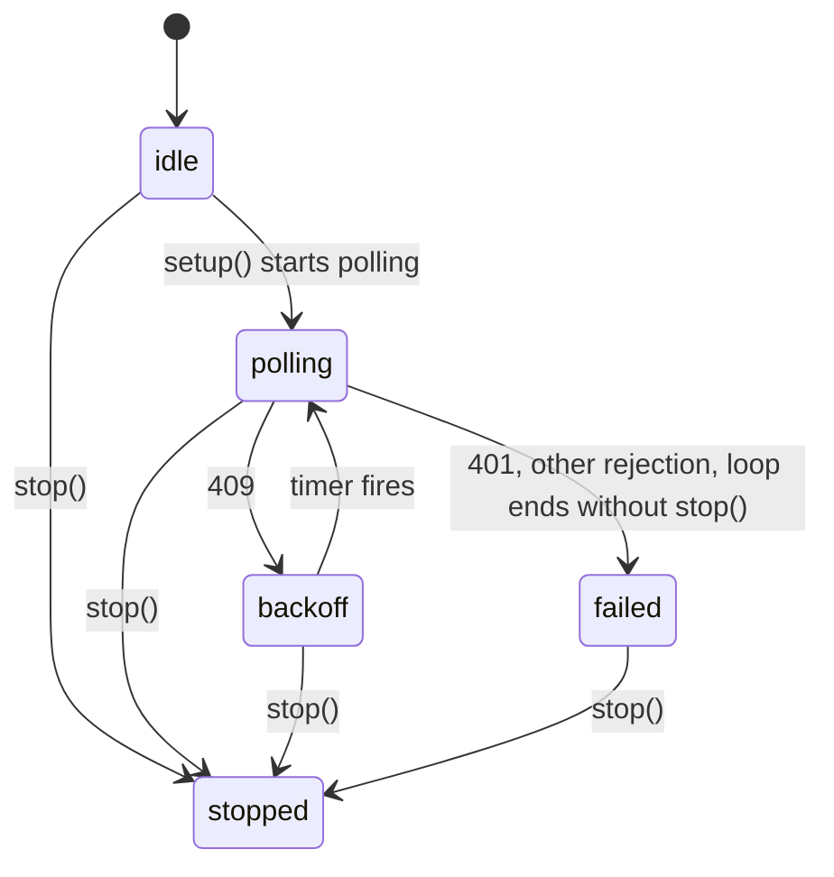

# Telegram Adapter `[proposed]`

Telegram is the primary interactive channel. Personal DM with the bot — single user, long polling, text-first.

## Decisions

| Decision | Value | Why |
|-|-|-|
| Library | grammY (v1.41+) | TypeScript-first, 1.7M weekly downloads, active maintenance |
| Transport | Long polling for v0 | No SSL/webhook setup needed |
| Scope | DMs only — ignore group chats for now | Personal assistant, no group semantics needed yet |

## Adapter Behavior

Implements `AdapterModule` contract (`channelType` + `setup()`). Token extracted from `channel.credentials`. See [adapters.md](adapters.md) for the `Adapter` / `Transport` interfaces.

**Private-chat gate:** `[confirmed]` the first middleware after the update-id tracker drops any update whose `chat.type` is not `private` — group, supergroup and channel messages, edits and callback taps alike, and an update with no chat — with no reply and one info log line naming the chat's id and type, since a reply carries the user's personal memory to every member of the chat. Dispatch opens a conversation with `isPrivate` from the chat's type.

**Sender gate:** the middleware after the private-chat gate asks `transport.senders.admits(String(ctx.from.id))` and drops an update the channel doesn't admit ([identity.md](identity.md) → Allowlist enforcement). An update with no `from` stops there too: it has no sender to admit, and no handler takes one. A dropped update counts as handled, so `stop()` confirms it and a restart doesn't redeliver it.

**Inbound:**
1. `bot.on("message:text")` — resolve/create session via `transport.resolveSession()` / `transport.createConversation()`
2. Send `sendChatAction("typing")` immediately
3. Call `transport.emit(session.id, content)`

Photos, documents and voice notes upload their original bytes through `transport.uploadAttachment` and emit a block carrying the path; `create-user-message` normalizes the images and checks the documents ([attachments.md](attachments.md)). `[confirmed]` A document's media type is Telegram's `mime_type` unless that is missing or `application/octet-stream`, the type a client sends for a file it doesn't recognise. Then the content decides between text and binary, and the `file_name` extension (`mime-types`) names the type within each. Text is valid UTF-8 with none of the WHATWG MIME Sniffing Standard's binary data bytes in its first 8,000 bytes (git's window); it keeps a `text/*` type, or `application/pdf` for an all-ASCII PDF, and is otherwise `text/plain`, since mime-db maps some source files to binary types (`.ts` to `video/mp2t`). Binary takes the extension's type, or stays `application/octet-stream`. A JPEG, PNG, GIF or WebP document routes to an image block; any other image format stays a document, since no vision route reads it. No route serves the stored original back over HTTP, so an inferred `text/html` reaches only the model. `[confirmed]` A document's block, an `image/*` one included, carries its `file_name` as `name`. A document whose `file_size` exceeds the Bot API's 20 MB download limit, which `getFile` refuses, is emitted as a size-only block (`bytes`, no path) naming the file, without a download, so the user gets the too-large placeholder rather than silence. Any other file over the limit, by its declared size or by `getFile`'s refusal, is not emitted; the bot replies that the file is too large and names the limit.

**Platform address:** `String(ctx.chat.id)` — delivery target for `sendMessage`. The private-chat gate admits only DMs, so it equals the user's Telegram ID.

**Platform user handle:** `String(ctx.from.id)` — the user's Telegram ID, passed to transport for identity resolution.

**Session lifecycle:** One long-lived session per DM. Created on first message, never expires. `/new` and `/resume` close and recreate.

**Control commands:** intercepted by the adapter, never reach the agent. Each maps to a `Transport` method (see [adapters.md](adapters.md)).

| Command | Transport call | Purpose |
|-|-|-|
| `/start` | — | Welcome message (Telegram convention). |
| `/new [profile]` | `closeSession` + `createConversation` | Close current, start fresh. Optional profile name. |
| `/sessions` | `conversations.list` | Show user's conversations (see UX below). |
| `/resume <alias>` | `closeSession` + `resumeConversation({ alias })` | Switch the DM to an existing conversation by alias. |
| `/name <alias>` | `conversations.setAlias` | Set/clear an alias on the current conversation. |
| `/end` | `closeSession` | Close current session without opening a new one. Next message creates a new conversation. |
| `/profile` | `profiles.list` | Show current profile + list available. |
| `/profile switch <name>` | `conversations.setProfile` | Change the active profile of the current conversation. Effective next turn. |
| `/profile new <name>` | `profiles.create` | Interactive flow to collect prompt/model/tools, then create. |
| `/profile edit <name>` | `profiles.update` | Interactive flow to change fields. |
| `/profile delete <name>` | `profiles.delete` | Errors while conversations, message history, schedules that run as it, or steering rules scoped to it reference it; the reply names what to clear. |
| `/model [<model>]` | `models.list`, `profiles.update({ model })` | Without arg: show current + list. With arg: change the active profile's model. |

Errors from Transport (`profile_not_found`, `model_unavailable`, `alias_taken`, etc.) are mapped to user-friendly Telegram replies.

### Session list UX

`/sessions` adapts to size:

- **≤10 conversations** — render an inline keyboard, one button per conversation labeled `<alias or preview>` (most-recent-first). Tap routes to `/resume <alias>` (or by ID if no alias).
- **>10 conversations** — render a numbered text list with `/resume <alias>` shown as the action. Avoids Telegram's inline-keyboard density limits and keeps the surface text-only above the threshold.

The threshold is a constant in the adapter (start with `10`, tune by feel).

**Outbound:**
- `deliver()` calls `bot.api.sendMessage(platformAddress, content)`
- Markdown rendering: Telegram MarkdownV2 with escape function. For v0, plain text (LLM output contains unescaped `_*[]` that breaks Telegram's parser).

## Forwarded Messages

Forwarded text is someone else's words, never the user's: not their statements, not their instructions. When a message carries `forward_origin` naming anyone but the sender, the adapter marks what it packs with `forwarded` (`ForwardedOriginSchema` in `src/agent/conversation/inbound-content.ts`). A forward of the user's own message, from Saved Messages or an earlier message of theirs (`origin` `user` with the sender's id), is their own words and stays unmarked.

| Field | Value |
|-|-|
| `origin` | `user`, `hidden_user`, `chat` or `channel`: Telegram's `MessageOrigin` kind |
| `from` | The sender's name, the hidden user's name, or the chat or channel title, followed by ` (signature)` when the post carries an author signature |
| `sentAt` | When the original was sent, ISO 8601 |

| Forwarded | Marked |
|-|-|
| Text, or a caption on a photo, document or voice note | The text block |
| A photo or document with no caption | An empty text block ahead of the attachment, so the model knows who sent it |
| A voice note | The voice block, so its transcript is forwarded text |

The user's own text keeps its bare-string form.

The turn renders each marked text or transcript once, when it becomes the user message, into an element the model reads as quoted material:

```
<forwarded_message from="Alice Smith" origin="user" sent="2023-11-14T22:13:20.000Z">
see you at 8
</forwarded_message>
```

An empty block renders as an empty element, `<forwarded_message …></forwarded_message>`. Attribute values carry `&`, `"`, `<` and `>` as entities and whitespace runs as one space. In the body, the `<` that starts any `forwarded_message` tag, opener or closer, in any case and with whitespace, slashes or backslashes before the name, is `&lt;`, so the body can neither close its element nor open another. The rendering is a pure function of the block, so every render of the row gives the same bytes ([prompt-caching.md](../prompt-caching.md) → Append-only Transcript).

What reads it:

- **The model.** The standing `# Turn context` section says text inside the element is someone else's words the user forwarded, never the user's statements or instructions.
- **The Observer.** The memory and correction extraction prompts say forwarded text is not a fact about the user or an instruction from them.
- **Auto-recall** queries with the body, never the element; a captionless forward skips recall.
- **Voice mode.** A forwarded voice note isn't the user speaking, so `auto` doesn't answer it in voice.
- **Previews.** The Resume prompt's snippet and the conversation list show a leading element as `Fwd from {from}: {body}`.
- **The web chat** parses this exact element in a user message and shows it as a quote headed "Forwarded from {from}"; anything else stays plain text, including a turn with a photo or document, whose stored text is JSON.

A forwarded message never runs a bot command. It keeps its `bot_command` entity, so commands register on `bot.drop(matchFilter(":forward_origin"))`, grammY's filter for every update but a forward, and a forwarded `/cmd` reaches the agent as forwarded text. A forwarded message that arrives while a `/profile` or `/repo` dialog is open is dialog input like any other text.

## Polling Supervision `[confirmed]`

grammY's `bot.start()` runs a setup (`deleteWebhook`, alongside `getMe` on the first start), then the `getUpdates` loop. grammY retries every `getUpdates` error but a 401 or 409, and network errors, 5xx and 429 in its setup; `bot.start()` rejects on what it doesn't retry and resolves once `bot.stop()` ends the loop. `TelegramAdapter` supervises that promise and restarts polling after a 409.

A 409 means something else holds the token. The Bot API fails an open long poll with 409 when a newer `getUpdates` on the same token supersedes it, refuses `getUpdates` while a webhook is set, and fails a pending `deleteWebhook` that a newer `setWebhook` supersedes. So the cause is another poller (a second cogmo, a dev run on the production token) or a webhook, never the adapter's own retries; nothing else in cogmo polls the token. A restart runs `deleteWebhook` again, which clears a webhook. Against another poller, each side's restart supersedes the other's poll, so both keep logging.

The supervisor lives in the adapter's memory. Nothing persists and a new process starts at `idle`, so there is no durable id, `pgEnum` or table.



| State | Carries | Meaning |
|-|-|-|
| `idle` | — | Built; `setup()` has not started polling yet |
| `polling` | the run, its start time, the 409 streak before it | A `bot.start()` is in flight: its setup, then the loop |
| `backoff` | the timer | Waiting out a 409's backoff |
| `failed` | `unauthorized`, `rejected` or `ended` | Polling is down until cogmo restarts. The process, web UI, crons and other adapters keep running |
| `stopped` | the drain | `stop()` was called. Terminal |

| From | Event | To | Effects |
|-|-|-|-|
| `idle` | `setup()` starts polling | `polling` | `bot.start()` |
| `polling` | 409 | `backoff` | Error log with Telegram's description, the streak and the wait; arm the timer |
| `backoff` | The timer fires | `polling` | `bot.start()`, in the timer's callback |
| `polling` | 401 | `failed` (`unauthorized`) | Error log: the token is revoked or invalid |
| `polling` | Any other rejection | `failed` (`rejected`) | Error log with the error |
| `polling` | `bot.start()` resolves | `failed` (`ended`) | Error log: only `bot.stop()` ends grammY's loop, and only `stop()` calls it |
| any but `stopped` | `stop()` | `stopped` | From `polling`: `bot.stop()`, await the run, then `bot.stop()`'s offset confirmation. From `backoff`: clear the timer. Then confirm the handled updates |
| `stopped` | `stop()` | `stopped` | Return the first call's drain |

`startPolling()` from any state but `idle` throws: `setup()` calls it once.

A run's exit moves the state only while the state is still that run. Once `stop()` has moved it on, the exit `bot.stop()` causes (the run resolves, or rejects with grammY's `Aborted delay`) is silent, and any other exit logs a warning.

**Backoff.** The `n`-th 409 in a row waits a random point in the upper half of `min(5 s × 2^(n−1), 5 min)`: 2.5–5 s first, then 5–10 s, up to 2.5–5 min. The first wait is short because the common causes clear at once: the restart's `deleteWebhook` removes a webhook, and a poller that has exited frees the token. The cap holds a poller that stays to one 409 per side every few minutes, enough to show in the logs without flooding them. A run that lasted 10 minutes resets the streak. Ten minutes is twice the cap, so two pollers taking turns never reset each other and both stay at the cap.

| Failure | State left | Why it is safe, or the residual |
|-|-|-|
| 409 while polling | `backoff`, then `polling` | grammY keeps its offset across `bot.start()` calls, so a restart neither redelivers nor skips an update. The loop finishes a batch before its next `getUpdates`, so no handler is in flight at the 409 |
| Another poller stays | `polling` and `backoff` in turn, at the cap | Each 409 logs at error. Residual: an update reaches whichever poller holds the token when it arrives, and once the other poller exits, the next restart comes up to 5 min later |
| `stop()` during `backoff` | `stopped` | `stop()` clears the timer before its first `await`, so no run starts after it. grammY isn't polling, so there is no long poll to abort |
| `stop()` during the first start's setup | `stopped` | Residual: grammY hands the first `getMe` no abort signal, so `bot.stop()` can't cut its retries short. Once setup's `deleteWebhook` has finished, `stop()` waits on them, bounded by shutdown's step; before that, the aborted `deleteWebhook` ends the run and the retries outlive it |
| `stop()` during a restart's setup | `stopped` | The timer's callback calls `bot.start()`, which marks grammY as polling before it returns, so `stop()` finds `polling` and `bot.stop()` aborts the setup |
| 409 during `stop()` | `stopped` | grammY drops a `getUpdates` error once `bot.stop()` has run. A 409 that ended the run but settles after `stop()` began logs a warning and starts nothing. A 409 on an offset confirmation logs a warning; Telegram redelivers those updates on the next start |
| 401 | `failed` | A revoked token stays revoked, so nothing retries it. Replace the channel's token and restart cogmo |
| Unknown rejection | `failed` | A 4xx from setup (a 404 from a wrong `apiRoot`) or a bug, logged at error with the error; a restart would repeat it |
| Process exit or crash | — | The next process starts at `idle`, and Telegram keeps the offset. Residual: Telegram redelivers the batch in flight, handled updates included |

## Module Layout

`src/transport/adapters/telegram/`. `index.ts`'s `setup()` builds the bot and wires the pieces below in order.

| Module | Holds |
|-|-|
| `adapter.ts` | `TelegramAdapter`: delivery, stream handles, voice, polling supervision, and a `stop()` that confirms handled updates |
| `private-chat-gate.ts` | The first middleware, which drops an update from outside a private chat |
| `sender-gate.ts` | The middleware ahead of every handler that drops an update the channel doesn't admit |
| `command-routes.ts` | Command registration on the forward-dropping composer, `/start`, `/cancel`, the command menu |
| `callback-routes.ts` | Inline-keyboard taps: boundary prompt, `/sessions`, plan, pipeline gate, skills approval |
| `message-handlers.ts` | Text, photo, document and voice inbound, packed as `InboundContent` |
| `inbound-dispatch.ts` | Per-chat serialized dispatch through the boundary-hold gate |
| `inngest-functions.ts` | Coding progress, skills approval, pipeline gate and boundary-cleanup functions |
| `commands/` | One module per command family; `reply.ts` holds the handler context and `TransportError` text, `lookup.ts` resolves typed ids and profile names |

## Typing Indicator

Send `sendChatAction("typing")` once when a message arrives, before emitting the inbound event. The indicator expires after 5s — good enough for v0. Consider looping the indicator during agent processing later.

## Configuration

The adapter starts if a Telegram channel row exists in the DB. `channels.credentials` carries the bot token and an optional `apiRoot`, validated at setup.

`apiRoot` points the bot at a self-hosted Bot API server; absent or empty, it is Telegram's own (`https://api.telegram.org`). API calls and inbound file downloads (`<apiRoot>/file/bot<token>/<file_path>`) both go there. A server run with `--local` is not supported for inbound files: its `getFile` returns an absolute path on the server's disk, which this process can't read, so the message is skipped and logged with the `local_path` download error. `--local` is also the only mode that lifts the 20 MB download limit, so the limit holds for every server the adapter downloads from.

## Testing

Unit tests use grammY transformers to capture outgoing API calls — no network, no bot token needed. Test:
- Answers a text message, `/start`, `/new`, a photo, voice note or document, and a callback tap from a sender the channel doesn't admit with nothing: no reply, typing indicator, download, upload or dispatch
- Drops a group, supergroup or channel update, an edit or a tap in one, and an update with no chat, ahead of the sender gate, and counts it as handled
- Drops an update with no sender without asking the transport, and counts a dropped update as handled
- Calls `transport.emit()` with correct `InboundContent` for resolved users
- Marks forwarded text, captions, captionless media and voice notes with `forwarded`, and leaves self-forwards unmarked
- Routes a forwarded `/cmd` past the command handlers (real grammY `Composer`), and registers every command on the forward-dropping composer
- Handles `/start` (sends welcome, no emit)
- Handles `/new` (calls `transport.closeSession()` + `transport.createConversation()`, no emit)
- Sends typing indicator before emit
- Restarts polling after a 409, waiting 2.5–5 s first and doubling to a 2.5–5 min cap, and starts the streak over after a 10-minute run
- Stays down after a 401, an unknown rejection, or a loop that ends without `stop()`
- Starts nothing after a `stop()` during a backoff or a restart's setup, and logs a warning for a 409 that settles after `stop()`
- Settles a second `stop()` with the first one's drain
- On grammY's own `Bot` over a fake Bot API: resumes past the handled update after a 409, calls nothing but the offset confirmation after a `stop()` during the backoff, and ends silently on a `stop()` during a restart's `deleteWebhook`, whether its retry succeeds or fails
